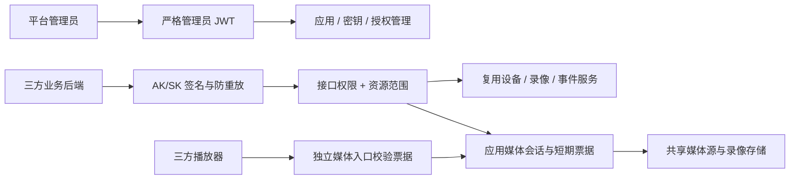

# 三方应用开放平台规划

日期：2026-11-04。状态：首期已实施并于 2026-11-04 12:12 发布到 10.144.0.20，版本 v1-20261104-openplatform1；已进行本地必要检查和线上接口冒烟，真实设备、播放器和接收方业务效果待人工验收。实际接口契约见 `docs/open-platform/openapi.yaml`。完整在线开发文档已于 13:12 随 v1-20261104-openplatformdocs1 发布，入口 http://10.144.0.20:15123/web/#/open-platform/docs，无需管理员登录即可阅读全部接口说明与下载客户端示例。

部署调整（2026-11-04）：用户明确要求保留现有 HTTP 地址，增加 `OWL_OPEN_PLATFORM_ALLOW_HTTP` 显式开关，允许 HTTP 公共入口、密钥一次性响应和回调；默认仍为 HTTPS。下文 HTTPS 为默认设计，本服务器按此调整执行。

首期范围：应用管理、AK/SK 认证、资源授权、设备/通道查询、实时播放、平台录像、事件查询、抓拍、云台控制及应用级告警订阅全部纳入同一期交付。下文 P0—P5 为本期内部实施步骤，不代表拆成不同发布期。

## 1. 目标与架构决策

为每个三方业务系统建立独立应用身份，使用 AK/SK 对每次服务端请求签名，按应用授予接口能力和设备/通道范围，并提供密钥轮换、停用、限流、审计及接入文档。

采用**独立模块、独立认证入口，首期与 Owl 同进程部署**。复用 Go + Gin + GORM 和现有 IPC、录像、事件、流媒体能力，管理页面复用 Vue 3 管理端。不新增独立微服务、第二套视频处理系统或首期必需的 Redis。模块接口为以后独立部署保留边界，但数据库访问和媒体编排仍属于 Owl 的宿主适配部分。

“独立认证”具体含义：

| 入口 | 身份 | 认证方式 | 边界 |
| --- | --- | --- | --- |
| 现有管理业务 | 管理员 | 现有登录/JWT | 保留兼容 |
| `/admin/open-platform/*` | 平台管理员 | 严格管理员 JWT | 不接受应用签名，不回退到 AuthURL |
| `/openapi/v1/*` | 三方应用 | AK/SK 请求签名 | 不接受管理员 JWT、播放票据、AuthURL 或旧 Webhook 密钥 |
| `/openmedia/v1/*` | 已授权应用的媒体会话 | 限资源的短期媒体票据 | 仅能读取该会话资源，不能调用业务 API |

三方系统不需要管理员账号，也不需要先登录或换取通用 Access Token。SK 只保存在三方后端；浏览器、H5、App 通过其业务后端申请媒体票据，不内置 SK。



## 2. 当前实现与必须覆盖的边界

以下为本地工作区源码核查结果，不代表线上版本已验证：

| 现有实现 | 规划中的复用或调整 |
| --- | --- |
| `internal/web/api/api.go` 注册路由、初始化通用 AuthMiddleware | 同级注册独立开放路由，避免挂入旧鉴权链 |
| `internal/web/api/auth.go` 支持 JWT 和 AuthURL 回退 | 不用于开放接口或新增应用管理入口 |
| `internal/web/api/user.go` 使用单个管理员凭据签发 JWT | 平台管理员管理应用；应用本身不模拟登录 |
| `internal/web/api/ipc.go` 提供设备、通道、播放、云台等入口 | 提取必要的业务编排服务，复用核心能力，不直接内部 HTTP 回调或直接调用 Gin handler |
| 当前播放票据使用 `JwtSecret + "_play"`，有效期 42 小时 | 开放平台使用独立、短期、可撤销的媒体票据 |
| `internal/web/api/api.go` 对部分 HLS 子资源免票据校验 | 新媒体入口所有清单、切片、初始化片段均校验，不能沿用该豁免 |
| `internal/core/sms/driver_zlm.go` 同时生成代理地址及 RTSP/RTMP 直连地址 | 开放 DTO 只输出已实现授权闭环的协议与地址 |
| `internal/web/api/ipc.go` 的 stopPlay 可能停止通道源流 | 应用停止接口只释放自己的媒体会话，不直接复用此接口 |
| `internal/push/notifier.go` 使用全局目标、内存队列及有限重试 | 保留旧功能；应用订阅另建授权过滤和持久化投递机制 |
| `internal/data/provider.go` 支持 SQLite/PostgreSQL/MySQL | 新表通过现有 GORM 数据源接入，保持三种数据库可迁移 |

首期不开放设备增删、系统配置、升级、原始媒体服务 API、任意文件路径下载和外部事件写入。开放接口返回专用 DTO，去除设备口令、推流密钥、内网媒体节点信息、原始文件路径和配置对象。

## 3. 应用与凭据生命周期

### 3.1 应用

应用字段包括：随机 UUID `app_id`、名称、接入单位、负责人/联系方式、用途、状态、有效期、设备访问模式 `device_access_mode`、授权设备清单、接口权限、来源 IP 策略、限流和并发配额、创建/修改时间。

状态为 `disabled → enabled → disabled`，另有 `archived` 终态。新建默认停用，创建表单的接口权限默认不勾选，设备范围默认“指定设备”且尚未勾选。提交创建前必须明确选择全部设备或完成指定设备勾选；启用前还需完成凭据创建、接口授权、配额和来源策略设置。未填写范围不能解释为全部资源。归档要求先停用并撤销凭据，保留审计，不提供首期物理删除。

应用到期与停用具有相同拒绝效果。停用、收紧授权或撤销密钥后，后续业务请求和媒体资源请求读取最新状态；已建立的媒体连接按第 7 节收敛。已完成下载或已缓冲到客户端的数据无法追回。

### 3.2 AK/SK

- AK：`owl_ak_` 加至少 128 位密码学随机标识，全局唯一，用于查找凭据；不是密码。
- SK：32 字节密码学随机数，Base64URL 无填充展示。HMAC 的密钥使用 Base64URL 解码后的 32 字节，避免不同 SDK 使用不同密钥语义。
- 一个应用最多同时存在两组可用 AK/SK，轮换时创建新 AK/SK，新旧短期并行；旧组按指定期限失效，建议并行不超过 24 小时。任一组可立即撤销，`revoked` 不可恢复。
- SK 仅创建时在 HTTPS 响应中展示一次；列表和详情不能取回明文。响应设置 `Cache-Control: no-store`，不记录响应体，不写前端持久存储、埋点或错误上报。遗失则创建新组并撤销旧组。
- 创建凭据响应丢失时不提供“重试取回 SK”：管理员按凭据列表定位并撤销未知组后重新创建，避免幂等缓存明文 SK。
- HMAC 验签要求服务端持有可恢复的密钥，因此 SK 不能只存普通单向哈希。使用 AES-256-GCM 加密落库，随机 nonce，AAD 使用固定版本、长度前缀编码绑定 app_id、access_key、encryption_key_id，避免直接拼接歧义；数据库保存密文、nonce 和加密密钥版本。
- 加密主密钥通过部署 Secret/受限挂载文件注入，不进入 TOML、数据库、镜像或 Git。新增独立的开放平台密钥环及当前版本配置，不复用管理员 JWT、SIP、ZLM、Webhook 密钥。
- 配置启用但缺主密钥、加密版本未知或解密失败时，开放平台入口拒绝服务并告警，不能生成替代密钥覆盖旧密文；现有管理和视频业务不因此被错误切换鉴权。
- 主密钥轮换采用“加载新旧版本 → 新写入使用新版本 → 批量重新加密并验证 → 移除旧版本”。备份恢复同时验证数据库与密钥环匹配。

## 4. AK/SK 签名协议 v1

### 4.1 请求头

```http
Authorization: OWL-HMAC-SHA256 Credential=<AK>,Signature=<64位小写十六进制HMAC>
X-Owl-Audience: <部署配置的开放平台标识>
X-Owl-Timestamp: <UTC Unix秒，十进制整数>
X-Owl-Nonce: <至少128位随机数的Base64URL无填充形式>
X-Owl-Content-SHA256: <原始请求体SHA256的小写十六进制>
Content-Type: application/json
Idempotency-Key: <仅要求幂等的写操作携带>
```

凭据不允许放在 URL。`X-Owl-Audience` 必须精确匹配本部署的固定配置，各环境使用不同身份与凭据，避免跨环境转发重放。除 Authorization 外，协议头名称不区分大小写；值按规定精确处理，重复安全头、未知认证参数、非法长度直接拒绝。

### 4.2 待签名串

下列 10 行以单个 LF 连接，最后一行后不追加 LF，整体按 UTF-8 编码：

```text
OWL-HMAC-SHA256
<audience>
<HTTP_METHOD_UPPERCASE>
<canonical_path>
<canonical_query>
<canonical_content_type>
<timestamp>
<nonce>
<idempotency_key_or_empty>
<body_sha256_hex>
```

`signature = lowercase_hex(HMAC-SHA256(decoded_SK, canonical_request_bytes))`，服务端使用常量时间比较。

规范化规则固定如下，SDK 和服务端使用同一组测试向量：

1. path 包含 `/openapi/v1`，以服务端收到的外部标准路径为准。首期 ID/路由采用 ASCII 安全集；拒绝重复斜线、点路径、反斜线、编码斜线、双重编码及其他非标准路径。代理不得改写路径前缀或自动重定向签名请求。
2. query 严格百分号解码后，对名称和值的 UTF-8 字节按 RFC 3986 编码；保留 `A-Z a-z 0-9 - . _ ~`，空格用 `%20`，其他字节使用大写 `%HH`。按编码后的名称、值依次排序，以 `name=value` 及 `&` 连接；无 query 时为空行。保留空值，`+` 按字面加号处理；拒绝非法转义和重复参数名，不能直接套用会把 `+` 解释为空格的表单解析器。
3. GET/DELETE 首期不接受请求体、Content-Type 为空；JSON POST/PATCH/PUT 固定为 `application/json`，不接受其他参数或 Content-Encoding。body 摘要针对实际发送的原始字节，不重新序列化 JSON；JSON 属性重复、未知写入字段等由严格 DTO 校验拒绝。
4. 空请求体摘要是 `e3b0c44298fc1c149afbf4c8996fb92427ae41e4649b934ca495991b7852b855`。服务端必须实际计算并核对，不能只对客户端声明的摘要验签。
5. 修改资源选择或行为的输入必须来自已签名 path/query/body；业务不得再信任额外未签名头来改变操作。Range 等媒体读取参数在独立媒体契约中约束。
6. 不把用户可控 Host 或 X-Forwarded-* 作为身份依据。返回地址使用配置的 `PublicBaseURL`；来源 IP 仅从可信代理链解析。

首期只支持 JSON 和空 body，body 默认最大 1 MiB；在读取/计算哈希前限制长度。文件上传、大图片写入等以后单独设计，不能直接放宽全局限制。

### 4.3 校验顺序、防重放与幂等

请求链：入口 IP 粗限流/长度限制 → 协议格式与时间窗 → 查 AK/应用当前状态和来源策略 → body 摘要及 HMAC → 原子占用 nonce → 应用限流 → 接口权限 → 资源授权 → 幂等/业务执行 → 审计。

- 默认允许时间偏差 `abs(server_now - timestamp) ≤ 300 秒`，部署配置不得为三方单独无限放宽；双方配置时间同步。
- nonce 以 `(access_key, nonce)` 建唯一约束，验签成功后通过数据库原子插入占用，不使用“先查再写”。重复 nonce 返回 401，存储异常返回 503，均不执行业务。
- nonce 保留到 `signed_timestamp + 300 秒 + 60 秒余量`，而不是仅从首次收到起保存 300 秒；首次收到未来时间戳时保留期最多约 660 秒，覆盖整个可接收窗口。清理已过期记录要分批，鉴权拒绝不能依赖清理协程是否及时运行。
- 防重放状态落现有数据库，覆盖重启与多实例验签。后续高吞吐可抽象为 Redis 原子写入，但不能以进程内 map 冒充跨实例防重放。
- 每次网络重试更换时间戳/nonce/签名。对创建会话、抓拍等写操作，保留相同 `Idempotency-Key`；与防重放分开处理。
- 幂等记录按 `(app_id, operation, idempotency_key)` 唯一，指纹绑定规范化目标和业务 body。不同参数复用同一键返回 409；处理中返回 409 和 Retry-After；完成后返回同一资源标识。默认保留 24 小时，过期后客户端不能继续把该键作为防重复保障。
- 外部设备命令无法与本地事务原子提交：先记执行意图；崩溃后标记待核对，不盲目重发。首期不把 PTZ 等物理控制纳入自动重试流程。凭据生成接口不使用存储明文响应的幂等策略。

## 5. 授权模型

采用“接口能力 Scope + 资源范围”双重授权，默认拒绝。应用身份由服务端从 AK 绑定，不相信请求传入的 app_id。

| Scope | 能力 | 初始批次 |
| --- | --- | --- |
| `device:read` | 设备基础信息、状态 | 首期 |
| `channel:read` | 通道基础信息、状态 | 首期 |
| `live:play` | 创建/续领/释放自身实时播放会话 | 首期媒体闭环 |
| `recording:read` | 平台已落盘录像的列表、时间轴、详情 | 首期 |
| `recording:play` | 读取指定录像内容 | 首期媒体闭环 |
| `recording:download` | 下载指定录像，独立控制数据导出 | 首期媒体闭环 |
| `event:read` | 告警列表、详情 | 首期 |
| `event:image` | 获取已授权告警的图片票据 | 首期媒体闭环 |
| `snapshot:capture` | 触发抓拍并读取自身任务结果 | 首期 |
| `ptz:control` | 云台控制，含动作范围/持续时长限制 | 首期 |
| `event:subscribe` | 订阅授权范围内的告警 | 首期 |

应用创建和编辑均提供两种设备访问模式：

| 页面选项 | `device_access_mode` | 授权范围 | 新增资源规则 |
| --- | --- | --- | --- |
| 全部设备（不限制设备范围） | `all` | 平台当前全部设备及其通道 | 后续新增设备及通道自动纳入 |
| 指定设备 | `selected_devices` | 仅勾选的设备及其通道 | 已授权设备新增通道自动纳入；新设备需再次勾选授权 |

本期设备授权粒度统一为设备，通道权限继承所属设备；创建页面不增加单独勾选通道的第三种模式。`all` 必须显式选择，并显示“包含今后新增的设备”；不能由空设备数组、前端全选状态或未传字段推导。`selected_devices` 创建/保存时至少勾选一台设备，服务端校验设备存在、ID 不重复且属于当前平台；离线设备仍可授权。

“全部设备”只表示设备范围不限，应用仍受接口 Scope、动作白名单、有效期、IP 和配额限制。例如仅有 `live:play` 的应用，即使授权全部设备，也不能抓拍、控制云台或订阅告警。一个应用的全部 AK/SK 共享该应用的设备授权，轮换密钥不改变访问范围。

- 通道详情、录像、快照、事件及媒体任务均沿所属设备检查授权；设备级无通道事件按该设备授权校验。缺归属、归属失效的旧数据默认拒绝。
- 指定设备模式下，设备/通道列表、数量和详情只能返回勾选设备范围内的数据；未授权设备及其任何通道、录像、图片和告警都不能通过已知 ID 绕过列表直接访问。
- 列表在数据库查询中先按资源范围过滤，再排序、分页、统计；不在完整分页结果上事后过滤。时间轴、总数、下载和图片接口遵守相同规则。
- 详情目标不存在或不在授权范围均返回 404，避免区分资源存在性；缺少接口 Scope 返回 403。
- 会话、任务、幂等记录按 app_id 隔离。同一通道的授权不能使应用 A 操作应用 B 的会话。
- 编辑应用可切换全部/指定模式或增减设备。保存后原子替换授权并递增 revision；移除设备同时使其媒体票据/会话、抓拍结果读取、活动云台控制及后续告警投递按既定撤权规则收敛，不能只隐藏列表。
- 全部模式不存全部设备 ID 的快照；指定模式保存稳定的内部设备 ID。设备删除后不得因失效绑定退化为全部授权；所有勾选设备均被删除时应用没有可访问设备，新建同名或同国标编码设备不自动继承旧授权。
- 默认查询最近 24 小时，最大时间跨度 7 天，单页最多 100 条；跨页游标绑定应用与查询条件，每次重新检查当前授权。
- 来源 IP 支持 IPv4/IPv6 CIDR；空白策略默认拒绝。确需不限来源时由管理员显式选择 `allow_any`，不以空数组表示不限。

## 6. 接口与管理页面

### 6.1 管理 API：管理员身份

| 方法与路径 | 功能 |
| --- | --- |
| `GET/POST /admin/open-platform/apps` | 查询、新建应用；创建时一并保存设备访问模式和勾选设备 |
| `GET/PATCH /admin/open-platform/apps/{app_id}` | 查看、修改基础信息及有效期 |
| `PUT /admin/open-platform/apps/{app_id}/authorization` | 原子替换 Scope、device_access_mode 和 device_ids |
| `PUT /admin/open-platform/apps/{app_id}/access-policy` | 来源 IP、QPS、突发及并发配额 |
| `POST /admin/open-platform/apps/{app_id}/enable` | 检查完整性后启用 |
| `POST /admin/open-platform/apps/{app_id}/disable` | 停用并撤销活动会话 |
| `POST /admin/open-platform/apps/{app_id}/archive` | 停用后归档 |
| `GET/POST /admin/open-platform/apps/{app_id}/credentials` | 查看脱敏凭据/创建 AK/SK |
| `POST /admin/open-platform/apps/{app_id}/credentials/{credential_id}/revoke` | 撤销指定凭据及其会话 |
| `GET /admin/open-platform/audit-logs` | 管理、调用、拒绝和媒体会话审计 |
| `GET/POST /admin/open-platform/apps/{app_id}/callback-targets` | 查看、新建该应用允许使用的回调目标 |
| `PATCH /admin/open-platform/apps/{app_id}/callback-targets/{target_id}` | 审核目标、更新地址或禁用；地址变化后重新审核 |
| `GET /admin/open-platform/apps/{app_id}/subscriptions` | 查看该应用的订阅状态 |
| `GET /admin/open-platform/apps/{app_id}/deliveries` | 查询投递结果、重试和死信 |

授权和配额更新带 `revision` 乐观锁，过期版本返回 409，防止多个管理员操作覆盖。轮换复用“创建新组 + 指定旧组到期/撤销”，避免含糊的原地重置 SK。新增严格管理员中间件校验当前管理员身份，不复用带 AuthURL 回退的通用中间件；保持旧业务接口行为。

管理端新增“开放平台”：应用列表、应用详情（基本信息/接口权限/资源范围/密钥/限流与来源/调用日志），以及接入文档。本期同时提供抓拍任务、云台动作授权与执行记录、回调目标审核、告警订阅和投递记录页面，支持定位失败及受控重投。应用管理首期由现有平台管理员操作，不新增三方注册审批或开发者账号体系。SK 展示只存在于创建成功的内存弹窗，关闭后清除；界面明确提示保存后不可再次查看。

创建/编辑表单中的“设备访问范围”为必填单选：

- 选择“全部设备”时隐藏设备勾选列表，提示自动包含今后新增设备；提交 `device_access_mode: "all"` 和空 `device_ids`。若全部模式同时提交非空设备清单，服务端拒绝，避免出现两套相互矛盾的范围。
- 选择“指定设备”时显示可搜索、分页的设备多选列表，支持按设备名称、内部 ID/国标编码检索，展示协议类型、在线状态和已选数量；跨页保留勾选。页面“全选当前页/搜索结果”仅生成指定设备清单，不等同于全部设备模式。
- 从全部切换为指定时，必须重新明确设备勾选，不自动勾选平台所有设备；编辑取消不改变现有权限。应用列表显示“全部设备”或“指定设备 N 台”，详情可查看完整授权清单及已删除设备提示。
- 创建时应用及设备授权同一事务保存，设备校验失败则整次创建失败，不产生缺少预期授权的半完成应用。编辑复用授权更新接口和 revision 校验。

指定设备的授权请求示例（字段值为占位示例）：

```json
{
  "revision": 1,
  "scopes": ["device:read", "channel:read", "live:play"],
  "device_access_mode": "selected_devices",
  "device_ids": ["device-a", "device-b"]
}
```

### 6.2 开放 API：应用 AK/SK 签名

| 方法与路径 | 功能/Scope |
| --- | --- |
| `GET /openapi/v1/devices`、`GET /openapi/v1/devices/{id}` | 设备摘要，`device:read` |
| `GET /openapi/v1/channels`、`GET /openapi/v1/channels/{id}` | 通道查询，`channel:read` |
| `POST /openapi/v1/live-sessions` | 指定 channel_id/protocol 创建自身会话，`live:play` |
| `GET/DELETE /openapi/v1/live-sessions/{session_id}` | 查看/释放自身会话，`live:play` |
| `POST /openapi/v1/live-sessions/{session_id}/tickets` | 重新签发短期媒体票据，`live:play` |
| `GET /openapi/v1/recordings`、`GET /openapi/v1/recordings/{id}` | 平台录像查询，`recording:read` |
| `POST /openapi/v1/recordings/{id}/tickets` | 按 play/download 目的授权，分别检查 Scope |
| `GET /openapi/v1/events`、`GET /openapi/v1/events/{id}` | 告警查询，`event:read` |
| `POST /openapi/v1/events/{id}/image-tickets` | 申请告警图片票据，`event:image` |
| `POST /openapi/v1/snapshot-tasks` | 指定 channel_id 发起抓拍，`snapshot:capture` |
| `GET /openapi/v1/snapshot-tasks/{task_id}` | 查询自身抓拍任务和结果，`snapshot:capture` |
| `POST /openapi/v1/snapshot-tasks/{task_id}/image-tickets` | 获取该任务图片的短期票据，`snapshot:capture` |
| `GET /openapi/v1/channels/{id}/ptz/capabilities` | 查询已授权通道的可用动作及参数限制，`ptz:control` |
| `POST /openapi/v1/channels/{id}/ptz` | 提交受限云台指令，返回 command_id，`ptz:control` |
| `GET /openapi/v1/ptz-commands/{command_id}` | 查询自身命令的协议应答、停止和异常状态，`ptz:control` |
| `POST /openapi/v1/ptz-commands/{command_id}/stop` | 停止自身命令，`ptz:control` |
| `GET/POST /openapi/v1/subscriptions` | 查看/创建自身订阅，`event:subscribe` |
| `GET/PATCH/DELETE /openapi/v1/subscriptions/{subscription_id}` | 查看、更新或取消自身订阅，`event:subscribe` |
| `POST /openapi/v1/subscriptions/{subscription_id}/signing-keys` | 创建/轮换独立回调签名密钥，仅创建时展示，`event:subscribe` |
| `GET /openapi/v1/subscriptions/{subscription_id}/deliveries` | 查看自身投递记录，`event:subscribe` |
| `POST /openapi/v1/subscriptions/{subscription_id}/deliveries/{delivery_id}/retry` | 受控重投自身失败/死信记录，`event:subscribe` |

以上接口全部纳入首期。设备侧录像目录/回放是另一条协议链，待独立工作包验证后开放，不与平台已落盘录像混称。

列表查询返回显式 `items`、`next_cursor`，仅在需要时提供授权范围内的 total。资源 ID 首期沿用 Owl 的设备/通道 ID，明确与国标编码的区别；新增应用、会话、任务 ID 使用随机 UUID。

业务 JSON 使用独立统一封装：

```json
{
  "code": "OK",
  "message": "success",
  "request_id": "server-generated-id",
  "data": { "items": [], "next_cursor": null }
}
```

HTTP 状态码表达真实结果：400 参数/格式错误，401 认证失败/过期/重放，403 缺 Scope 或来源不允许，404 无可见资源，409 幂等/版本冲突，413 body 超限，429 超配额，503 依赖不可用；异步创建可返回 202 和状态查询地址。文件、媒体和下载按内容类型直接返回，不强制套 JSON。

外部认证失败统一为 `AUTHENTICATION_FAILED`，不暴露 AK 是否存在、SK 解密细节或应用状态；内部审计保留具体原因。时间窗拒绝可附不含凭据的服务器时间。所有响应附 `X-Request-ID`；服务器生成该值，不直接信任客户端输入。

### 6.3 首期抓拍任务

- 复用现有抓拍能力，服务端按通道协议和能力选择路径；不接收三方传入的设备密码、任意抓拍 URL、文件路径或 FFmpeg 参数。
- 创建时检查 Scope、资源授权、应用并发和通道冷却期，要求 Idempotency-Key；返回独立 task_id，状态为 queued/running/succeeded/failed/unknown。结果绑定 app_id、credential_id、channel_id、请求时间、实际采集时间及独立结果文件，不能把同通道旧封面或另一任务的图片当成本次成功结果。
- 任务默认最多执行 60 秒，结果默认保留 24 小时；结果文件受清理流程管理。读取状态和申请图片票据时重新检查当前权限，仅可读取自身任务；图片访问遵循第 7 节的票据规则。
- 应用停用、签发凭据撤销或通道授权取消后拒绝新任务、取消尚未执行的任务，禁止读取已有结果；已下发设备的采集可能无法撤回，不把取消响应解释为设备侧动作已撤销。崩溃后不盲目重发未知结果的任务，重启核对后返回明确状态。

### 6.4 首期云台控制

- 复用现有 GB28181/ONVIF 适配器，由能力查询返回动作和参数范围。基础方向、变倍、聚焦、光圈、预置位调用按实际支持开放；预置位写入/删除、巡航、扫描等扩展动作需要管理员显式加入动作白名单，不因授予 `ptz:control` 自动全部放行。不支持的能力返回确定错误。
- 云台指令要求 Idempotency-Key，持久化 command_id、归属应用/凭据/通道、动作、参数、有效期、协议应答和停止状态；请求接受、设备协议确认和实际转动效果分别描述，不声称协议成功就代表设备到达目标。
- 连续动作默认 1 秒、最大 3 秒，持续时间必须有界，由服务端负责下发停止，不依赖三方发送配对 stop；扩展持续动作同样必须具备停止能力。连续控制的计时基点、协议超时和停止重试使用独立受限后台上下文，不因客户端断连丢失停止责任。
- 同通道控制采用互斥租约和代次校验，覆盖管理端、开放接口及其他控制调用方；新指令或管理员接管时先收敛旧动作，旧定时器不能停止后续拥有者的新动作。未接入统一协调器的控制入口不能与开放控制并行发布。
- 停用应用、撤销凭据、收紧授权或命令超时，立即禁止新动作并触发活动命令停止。启动时优先核对未终结命令、执行受限停止并记录结果，核对前不接收该通道的新控制；停止失败则标记 stop_failed、告警并阻止后续移动，不能报告已停止。
- 重复请求不能重复启动动作；执行结果不明时只允许状态核对和安全停止，不自动重放移动/巡航指令。停止自身命令允许绕过普通动作频率限制，但仍验证身份和归属；管理员可执行紧急停止。

## 7. 媒体访问与共享源流

API 签名用于申请资源，播放器使用短期媒体票据。首期支持经 Owl 受控入口的 HTTP-FLV 和 HLS，以及录像/图片读取；WebRTC、WS-FLV、RTSP、RTMP 需分别完成信令、连接及撤销授权后再声明支持。

### 7.1 会话与票据

1. 应用签名创建会话，检查 `live:play`、通道授权、应用/通道/全局并发及拉流配额；先原子预占名额，再启动或复用源，失败释放。
2. 会话绑定 app_id、credential_id、channel_id、media_server_id、内部 app/stream 精确标识、协议、创建/到期时间、授权版本及状态；默认最长 30 分钟，绝对到期不因刷新票据自动延期。
3. 媒体票据使用独立 256 位随机不透明令牌，只存 SHA-256 哈希；绑定会话/应用/签发凭据/授权版本/单一资源用途，默认 5 分钟。图片/录像票据同样保存资源归属、过期和撤销状态。SK 和管理员 JWT 不传给播放器。
4. 返回 `session_id`、状态、`expires_at` 及已授权的媒体 URL。准备中的源返回 preparing，客户端查询会话状态；不把“发起拉流”当作“已经可播放”。
5. `/openmedia/v1/*` 查询票据哈希并验证绑定关系及当前应用、凭据、资源授权；所有访问必须走该入口，路径精确匹配，不使用 stream 子串匹配，也不接受任意上游 URL。
6. ticket 仅允许放指定 query 或媒体专用 Authorization 头，任何入口均不得接收 SK。代理/应用日志清除 ticket，响应禁止共享缓存和转发第三方资源，避免 URL 通过日志、Referer 或 CDN 泄漏。
7. HLS 重写所有变体清单、切片、init map、密钥等 URI 到受控入口并带票据，拒绝跳出会话允许路径、跨域和任意回源。每个请求检查到期和撤销；SDK 在票据到期前经业务后端申请新票据并更新播放清单，不能让子资源免鉴权。
8. 票据有效期限制新请求入场。已建立的 FLV/下载连接由活动会话控制器最多每 5 秒重查撤销/授权/到期状态并中断；不能声称短期 token 会自动断开已有连接。会话绝对到期后必须重新签名创建，客户端接续行为在 SDK 中说明。
9. 停用应用、撤销凭据、取消资源授权同时作废相关票据和会话；事务提交后拒绝新请求，已有长连接目标在 5 秒内终止。允许提交前已通过校验的短请求完成，不承诺追回在途响应。
10. 录像下载仅允许指定录像资源内的单段 Range；支持断点续传但不授予任意路径读取。票据过期需重新申请，不能用一次授权获得永久文件地址。

### 7.2 避免误停其他业务

`DELETE live-sessions/{id}` 只释放调用应用自己的会话引用；重复释放幂等成功。不能直接调用旧 `/channels/:id/stop` 或强制关闭源流。

首期释放最后一个应用引用后，仍交由现有源生命周期/无人观看策略清理；只有确认源不被管理员观看、录像、级联或其他业务使用后才允许主动停止。应用会话表本身不能证明全局无人使用。需要新增的使用引用适配必须覆盖这些调用方；未完成时采用“不主动关源”的保守策略，并明确资源回收限制。

会话启动/释放、超时、进程重启、源中断都要收敛状态和配额。服务重启时旧进程长连接已断开，启动阶段把遗留实时会话标记失效并释放名额，再允许新请求；多实例部署须使用 owner + lease + generation，不能在某个实例启动时全局作废其他实例会话。

### 7.3 外部网络入口

三方网关只允许 `/openapi/v1/*` 和 `/openmedia/v1/*`。管理页面、旧 API、旧 `/proxy/sms/*`、Webhook 及流媒体控制端口留在管理/专用网络，不可把 Owl 整个监听端口直接暴露给三方，否则新接口授权可以被旧入口绕过。

媒体端口按协议用途区分：保留设备接入所需 SIP/RTP/RTMP 等方向规则，限制三方对直连播放和管理端口的访问；不能为隔离三方误封设备接入。若部署要求旧播放器入口与三方共享公网，必须先对共享入口完成等效资源鉴权，或使用严格隔离的域名、监听入口和代理 ACL。该部署条件未满足前不能宣称三方媒体隔离完成。

## 8. 限流、审计与事件订阅

### 8.1 配额

拟定初始默认值：每应用 API 20 QPS、突发 40、实时会话 5、单通道会话 2、并行录像下载 2；抓拍每应用并发 2、同通道冷却 2 秒，PTZ 移动命令每应用 2 次/秒、同通道活动命令最多 1 个，订阅每应用最多 10 条、回调投递并发 2。本期一并实现这些配额；安全停止不受移动命令速率配额阻挡。媒体切片不计入普通业务 QPS，使用独立请求速率、连接数及出口带宽配额；全局源拉起并发也需要上限，避免签名合法请求压垮设备。

首期声明单实例：普通 QPS 可使用有界内存令牌桶，并发名额和状态持久化；重启可能恢复短时突发额度，必须写入运维说明。防重放、幂等和会话名额始终使用数据库原子约束。多实例正式支持前补共享限流、活动连接撤销和会话租约；不能把每实例 20 QPS 宣称为全局 20 QPS。Nonce/审计写入随流量增长，应依据目标数据库测量后调整默认额度，不预先承诺吞吐。

### 8.2 审计

审计至少记录：request_id、应用和凭据内部 ID、管理员标识、来源 IP、路由模板、动作、资源 ID、认证/授权拒绝原因、HTTP 状态、耗时、时间、会话/业务结果。认证失败中的未知 AK 只存有限长度脱敏值或哈希。

不记录 SK、明文/密文凭据响应、签名原串、完整 Authorization、媒体 ticket、配置密码和完整原始业务 body。日志按应用、时间、操作、状态检索；默认保留 90 天并分批清理，可按部署容量配置。

应用启停、凭据生成/撤销、授权更新等管理动作的状态和审计同事务提交，审计写入失败则操作失败。产生外部副作用的命令先持久化审计意图，执行后补结果；查询访问日志可有界异步写入，失败计数并告警。平台管理员可见本部署日志；应用接口不提供跨应用日志检索。

### 8.3 首期应用级告警订阅

新增订阅按 app_id 绑定，包含 callback_target_id、事件类型/标签、通道过滤、有效期和状态（paused/active/cancelled）。新建默认 paused，配置独立回调密钥并完成目标审核后才可启用；创建使用 Idempotency-Key，更新带 revision，取消后保留历史投递记录。

订阅只能选择管理员为该应用批准的回调目标及自身授权范围；越权筛选条件返回错误，不能默默扩大范围。事件可见性取订阅过滤、当前 Scope 和资源授权的交集，遵循第 5 节的设备级事件规则。复用现有事件产生入口，使所有应订阅的事件路径在事件入库的同一事务中创建 outbox；按 `(event_id, subscription_id)` 唯一创建投递记录，不能在事件提交后只靠内存回调补写。

worker 投递前再次核对应用、凭据、订阅、目标和资源权限，不能仅创建订阅时检查一次。应用停用、创建该订阅的凭据撤销/到期、目标禁用、订阅取消或权限收紧后，暂停/终止对应待发及重试任务；恢复应用不自动重放暂停期间全部历史事件，需显式恢复订阅或受控重投。已发出的在途 HTTP 请求尽力取消，不能保证撤回接收方已收到的内容；重新绑定有效凭据必须显式更新订阅。

每个订阅使用单独回调签名密钥，与入站 API SK 分离，支持独立轮换；明文仅创建时展示、服务端加密存储，响应丢失后通过新建/轮换恢复，不持久化明文幂等响应。签名绑定回调版本、时间戳、nonce、event_id、delivery_id、body 哈希；接收方验签并按 delivery_id 去重，重试使用新时间戳/nonce，保持相同 delivery_id。固定签名规范、轮换期验签和接收示例均属于本期接入文档。

语义为至少一次投递：成功响应 2xx，网络错误/408/429/5xx 指数退避并带 jitter，其他 4xx 进入失败终态；默认单次 HTTP 超时 10 秒、最多尝试 8 次、退避上限 5 分钟。队列和重试时间持久化，进程崩溃可恢复，不得静默丢弃满队列事件；worker 用租约和原子状态领取，过期后重新投递可能重复，由 delivery_id 去重。重复告警若被业务合法写为不同 event_id，不能由投递层擅自合并。

超过次数进入死信并可在管理端/应用自身接口查询。手动重投要求 Idempotency-Key、配额及当前授权检查，已成功投递不可重投；重试保留原 delivery_id，新的签名使用当前有效回调密钥。订阅和回调密钥轮换均记录管理/应用审计。短期图片票据只在投递时按当前权限生成，不在 outbox 中保存永久 URL；应用没有图片授权时 payload 不附图片能力。

回调 URL 仅允许管理员配置的 HTTPS 目标。保存和每次连接校验允许域名/IP、DNS 解析结果，禁止重定向和任意回源；内网目标需显式批准 CIDR，始终拒绝回环、链路本地、云元数据地址和平台管理目标，防范 SSRF/DNS 重绑定。默认不内嵌大图，传带授权的短期图片访问能力。

旧全局 Webhook 继续按其原有配置工作，不自动转换成应用订阅；开放平台投递不得继承旧全局目标对全部事件的可见性。

## 9. 数据与代码组织

### 9.1 拟新增数据表

| 表 | 主要字段与约束 |
| --- | --- |
| `open_apps` | UUID PK、名称、负责人、status、expires_at、scopes、device_access_mode、IP策略、配额、revision、timestamps |
| `open_app_resources` | app_id、resource_type、resource_id；三列唯一；本期 resource_type 固定为 device，仅指定模式存储设备绑定，全部模式不枚举设备 |
| `open_credentials` | UUID PK、app_id、access_key 唯一、SK密文/nonce/key_id、status、not_before、expires_at、revoked_at |
| `open_request_nonces` | access_key + nonce 唯一、expires_at 索引；按过期时间清理 |
| `open_idempotency_records` | app_id + operation + key 唯一、输入指纹、执行状态、resource_id、expires_at |
| `open_media_sessions` | UUID PK、app/credential/channel/media定位、状态、协议、绝对到期、授权版本、名额状态 |
| `open_media_tickets` | token_hash 唯一、app/credential/session或资源定位、用途、授权版本、expires_at、revoked_at |
| `open_snapshot_tasks` | UUID PK、app/credential/channel、状态、采集时间、独立结果定位、expires_at、幂等记录关联 |
| `open_ptz_commands` / `open_ptz_leases` | command_id、app/credential/channel、动作参数、代次、deadline、确认/停止状态；通道租约唯一 |
| `open_audit_logs` | request_id、actor、route、action、resource、结果、耗时、created_at；应用+时间索引 |
| `open_callback_targets` | app_id、URL、批准的域名/CIDR策略、审核/禁用状态、revision |
| `open_subscriptions` | app_id、credential_id、资源/事件过滤、callback_target_id、独立加密密钥/版本、状态、revision |
| `open_event_outbox` / `open_deliveries` | 事件快照、订阅、delivery_id、attempt、next_retry_at、worker租约、终态；event_id+subscription_id唯一 |

状态、策略和 Scope 使用跨数据库可表达的字符串/关系表；不依赖某一种数据库的 enum、JSON 查询或部分唯一索引。策略变更与资源绑定关系在同一事务更新并递增 revision。密钥有效组数量、会话配额和幂等预占通过数据库事务/CAS 串行化，不能只在 Go 进程加锁后判断。

迁移仅新增表及必要索引，不重写现有设备、录像和事件数据。启用前显式运行并核验迁移；失败则保持开放平台禁用，不对外提供半完成入口。数据库版本与迁移结果可观测。回滚关闭新入口并撤销活动会话，保留新表与审计供恢复，不默认删表。禁用状态不要求注入开放平台主密钥、不启动开放平台 worker。

### 9.2 拟新增模块

```text
internal/core/openplatform/
  app.go / credential.go / authorization.go / session.go / audit.go
  snapshot.go / ptz.go / subscription.go / delivery.go / worker.go
  model.go / storer.go
  store/openplatformdb/
internal/web/openapi/
  middleware.go / signing.go / response.go
  device.go / channel.go / live.go / recording.go / event.go / media.go
  snapshot.go / ptz.go / subscription.go
internal/web/api/openplatform_admin.go
internal/conf/openplatform.go
admin-ui/src/views/OpenPlatformAppsView.vue
admin-ui/src/views/OpenPlatformAppDetailView.vue
admin-ui/src/views/OpenPlatformTasksView.vue
admin-ui/src/views/OpenPlatformSubscriptionsView.vue
admin-ui/src/views/OpenPlatformDeliveriesView.vue
admin-ui/src/services/open-platform.ts
docs/open-platform/openapi.yaml
docs/open-platform/signing-v1.md
examples/open-platform/{go,python,java}/
```

鉴权模块只生成受信的 `AppPrincipal`；授权服务统一生成资源过滤条件并校验单资源，开放 handler 不能自行省略。核心 IPC/Recording/Event 通过服务接口适配，不把签名、Gin Context 或应用权限字段散落到 SIP 协议实现中。需要共享的播放编排从旧 handler 抽取服务并保留原响应，由新适配返回开放 DTO。

可复用部分：签名规范与测试向量、应用/凭据生命周期、授权框架、Nonce/幂等接口、审计结构、订阅和可靠投递状态机。Owl 专用部分：设备/通道映射、查询过滤适配、源流引用、媒体协议代理、录像文件访问、抓拍结果适配、统一 PTZ 协调及事件事务 outbox 桥接。

## 10. 实施顺序与完成标准

| 阶段 | 交付范围 | 完成标准 |
| --- | --- | --- |
| P0：应用身份基础 | 配置/迁移、应用和密钥管理、AK/SK签名、防重放、基础限流审计、严格管理认证 | 管理员和应用凭据互不通用；停用/撤销/到期拒绝；重复请求仅一次通过 |
| P1：首期查询 | 授权服务、设备/通道/事件/平台录像查询、专用DTO、创建/编辑时全部或指定设备授权页面 | A/B 应用的列表/统计/详情完全按授权过滤；全部模式覆盖新增设备，指定模式只含勾选设备，空范围不变成全部 |
| P2：首期媒体闭环 | 自有播放会话、票据、HTTP-FLV/HLS、录像播放下载/告警图片、并发和撤销、网关隔离 | 无票据切片被拒；停用后拒新请求、连接5秒内收敛；停止A不影响B/录像/管理端 |
| P3：抓拍与云台 | 独立抓拍任务/结果、短期图片票据、PTZ能力/白名单、互斥租约、限时和自动停止、任务管理页面 | 抓拍不串任务/应用；重复请求不重复执行；动作到期/撤销触发停止，旧命令不误停新命令，停止失败可见 |
| P4：应用级告警订阅 | 回调目标审核、订阅管理、独立回调签名、事务outbox、持久化投递/重试/死信/受控重投、投递页面 | 越权事件不投递；重复投递可去重；重启恢复；禁用/撤权停止后续投递；失败和死信可追踪 |
| P5：接入交付 | 独立OpenAPI、入站/回调签名说明、Go/Python/Java示例、代理与密钥运维说明、兼容检查 | 至少两种语言与服务端固定向量互验，按文档完成授权播放、抓拍、限时PTZ及订阅回调链 |

P0—P5 全部属于同一期交付，抓拍、云台控制和应用级告警订阅均为本期必需能力；任一未完成均不能宣称本期开放平台已完成。第三方自助注册、多租户管理员、计费、OAuth2、通用 Token 交换、独立微服务和多实例媒体高可用暂不纳入首期。

实施时执行直接相关的必要检查，不为本次规划新增测试或运行全量构建。后续重点回归：

1. 签名互操作：空body、编码/排序、路径拒绝、头重复、body篡改、时间窗边界、代理前缀、跨audience；并发相同nonce只有一次通过，未来时间戳整个窗口不允许重放。
2. 授权与生命周期：Scope/设备范围双重拒绝、全部/指定模式切换、跨页勾选与分页/统计不过界、新增设备/通道语义、设备删除后不扩大范围、移除设备后的全链路撤权、密钥轮换、过期/撤销、重启后Nonce与凭据仍正确。
3. 媒体和运维：HLS全部子资源与Range下载检查；跨应用会话拒绝；撤销长连接；应用停播不误停共享源；配额并发预占；迁移/主密钥缺失时拒绝开放入口；三方网络无法访问旧代理及直连播放。
4. 抓拍与控制：任务幂等及新鲜图片归属、结果到期清理、越权结果拒绝；动作白名单、并发互斥、旧代次停止拒绝、自动停止、撤权/断连/崩溃后的安全收敛及停止失败记录。
5. 订阅与投递：目标审核/SSRF限制、事件写入与outbox事务一致、过滤与撤权、签名/轮换/去重、超时和退避、重启恢复、死信查询及受控重投、在途请求无法撤回的边界。

上线由人工确认真实设备、指定播放器、回调接收方和三方网络环境的业务效果；云台实际动作及停止效果属于本期人工验收重点。设计与单元测试不能替代流媒体长连接、代理隔离和真实设备协议验收。

## 11. 需要在实施前按部署确定的配置

采用本方案即可开展模块实现；以下属于部署输入，不需要在规划阶段猜测线上值：

- 对外域名、`PublicBaseURL`、唯一 `Audience`、可信反向代理网段、管理入口与媒体端口隔离方式。
- 加密密钥环的注入、备份和恢复责任人；不能用示例密钥上线。
- 首批应用、负责人、授权设备/通道、来源 CIDR 和配额；按最小权限逐个启用。
- 各通道允许的 PTZ 动作/速度限制、抓拍结果保留策略、回调目标和审核的出站网络范围；三方提供接收方验签与去重实现。
- 实际数据库类型及预计请求/并发规模。首期以单实例运行；若首发即要求多实例，须把共享限流、媒体会话租约与跨实例撤销提前纳入首期。

## 12. 本次实施落点

- 核心模块位于 `internal/core/openplatform`，独立路由位于 `internal/web/openapi`；宿主桥及严格管理员认证为 `internal/web/api/openplatform.go`。管理端复用一个带分页和页签的 `OpenPlatformView.vue`，覆盖原规划多个页面的功能。
- 应用支持全部 / 指定设备，权限变化保守作废该应用旧会话/票据并暂停订阅。独立 AK/SK、AES-GCM 主密钥环、防重放、幂等、配额、审计、抓拍、云台及应用订阅均已接入。
- 事件显式事务兼容宿主关闭 GORM 默认事务的配置；outbox 与 events 同事务。回调并发池与云台停止循环分离；停止失败保留租约并退避重试。旧管理和 GB 级联控制均接入通道协调器。
- 首期媒体和抓拍支持 ZLM；ONVIF 聚焦/光圈不声明为开放能力，支持方向、变倍及预置位；GB 扩展动作须显式授权。录像时间轴复用分页录像时间段；设备侧录像回放不开放。
- 配置、独立迁移/主密钥重加密、网关隔离、回调验签、OpenAPI 和三种语言示例见 `docs/open-platform/README.md`。订阅、投递业务列表采用游标，管理员列表采用 page/size。
- 已使用临时 SQLite、模拟宿主及本地媒体响应完成相关快速检查；三种语言固定向量互验。随后按用户授权部署到现有服务器，新增 15 张开放平台表并启用 HTTP 入口；未触发真实设备控制、未发送外部告警通知、未调整线上端口和防火墙。发布与回滚记录见 `deploy/server-192.168.6.20.md` 第10.16节，真实业务效果仍按第11节人工检查。

### 12.1 设备与完整通道编码入口（2026-11-04 已发布）

已新增设备编码查询、设备加完整通道编码查询、云台能力/控制、播放会话和抓拍任务共 6 个业务接口，并补充列表的编码精确筛选。三方无须先获取内部 ID；旧内部 ID 入口保持兼容。通道编码以设备上报的完整编码为准，不按录像机数字序号推断。接口继续执行应用 Scope 与设备授权，授权绑定内部设备 ID；同设备通道编码重复时拒绝定位。具体路径、参数、请求/结果和错误说明见在线开发文档及 `docs/open-platform/openapi.yaml`。发布记录见 `deploy/server-192.168.6.20.md` 第 10.25 节。

### 12.2 编码定位完整覆盖（2026-11-04 已发布）

补齐设备/通道编码下的录像、告警、播放会话、抓拍任务、云台命令记录列表，设备编码下的通道列表；原业务列表支持编码精确筛选，播放和抓拍创建请求体支持编码二选一定位，告警订阅支持 `channel_codes` 通道编码对。具体业务记录继续使用结果 ID，避免同通道多条结果歧义。公开契约现为 76 个操作，所有实际路由与文档双向核对；详见第10.27节发布记录。
