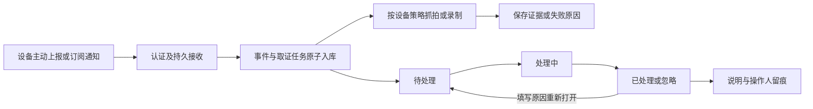

# 事件中心处理与取证

## 当前问题与本次改造

此前国标报警已可靠进入事件中心，但事件只有检测字段，没有人工处理状态和操作记录；设备与通道只保存内部标识，界面临时逐条查询通道名；后端支持基础分页，前端使用累加式“加载更多”，搜索只覆盖已加载的数据。国标报警桥接没有抓拍和视频动作配置。

本次在现有事件存储、报警持久投递、实时媒体链路和管理端设计规范上补齐处理流程。国标报警先按语义去重，再按下述规则聚合连续上报；每次有效上报保留独立明细。取证冷却继续限制不同事件之间的媒体动作。

## 使用入口

- **导航和通知角标**：统一统计全部时间范围内的待处理事件，不计入处理中、已处理和已忽略事件；待处理为0时隐藏角标。单条或批量处理、重新打开以及刷新事件列表时同步刷新，应用可见时每30秒刷新，返回窗口时重新核对。通知入口直接打开待处理列表。
- **事件中心 → 事件处理**：默认待处理；可查看处理中、已处理、已忽略及全部事件。默认使用卡片视图展示现场抓拍、设备与通道名称、事件类型、时间和处理状态；悬停或键盘聚焦展示编码、报警摘要与处理入口，触屏直接显示这些操作。可切换为表格并记住本机偏好，切换保留当前页、筛选和已选事件。表格直接显示设备名称、通道名称、编码、报警类型、时间、取证与处理状态。按设备、通道、来源、时间、取证情况筛选，名称和编码在服务端搜索。提供20/50/100条分页、页码与跳页，筛选和页码保存在URL。
- **自动刷新**：进入事件中心默认开启，每30秒更新当前筛选和页码的列表，显示最近成功更新时间；开关明确标记开启/关闭，切换后本次页面立即生效。鼠标悬停或键盘聚焦卡片不会阻止刷新。勾选事件、打开详情或批量处理时暂停，结束操作后立即补刷；页面隐藏及联动策略分区不轮询，回到事件列表或窗口时补刷。慢请求不重叠，请求期间开始处理则放弃该次列表替换，避免清空选择或覆盖操作。
- **查看 / 处理**：在当前页查看图片、播放或下载视频、原始报警信息和最近100条处理记录；可开始处理、填写结果完成或忽略，已结束事件须填写原因重新打开。附件播放由用户主动触发。
- **批量处理**：选择本页同一处理阶段的事件，统一记录说明。最多100条，以版本号检查并发修改；任一事件冲突则全部取消，不覆盖其他人的处理结果。刷新后重新选择再处理。
- **设备详情 → 事件联动**：设置该设备下所有通道的报警抓拍、视频时长和同通道取证间隔，并直接进入该设备事件列表。事件中心的“联动策略”和详情弹窗的“配置该设备联动”也可进入同一策略；列表不重复放置联动配置按钮。

## 取证行为

### 报警去重和连续聚合

- 同一内部设备、通道、国标目标、报警方式/类型、等级、进入/离开阶段、描述、位置和发生时间只计一次。忽略传输方式、SN、协议版本及 XML 排版，避免 MESSAGE/NOTIFY 双路上报或不同序号的重传重复入库；时间统一到 UTC 比较。
- 同一组报警与已有事件时间范围间隔不超过10秒，且该事件仍为待处理或处理中时，聚合到同一事件，累计 `occurrence_count` 并维护首次、末次报警时间。支持乱序到达；超过静默间隔、报警类别/通道/规则变化，或已有事件已处理/忽略时，新建事件。重复包不会延长聚合时间，也不会重新打开已结束事件。末次时间不代表设备已恢复。
- 每个聚合事件只在首次建立时安排抓拍、视频、Webhook和开放平台通知。后续有效上报不重复取证，不修改人工处理版本。现场证据对应首次报警，不覆盖为后续画面。
- 每次有效上报写入 `event_alarm_reports`，保留原始字段及上报/接收时间，通过鉴权分页接口 `GET /events/:id/reports?page=1&size=20` 查询，最多每页100条。事件卡片、表格显示连续次数，详情显示首次、末次时间。明细与事件一同删除或到期清理。
- 去重、聚合、明细与首次取证在同一事务中提交，以设备策略行锁串行处理，进程重启、多实例和重复投递不会重置计数。设备时间无效时沿用原投递键去重，不按接收时间聚合，避免吞并无关报警。适用于2011/2014/2016/2022解析后的统一报警；不改变SIP应答、B网关转发及持久重试机制。
- 仅对升级后的新报警生效，不自动合并、删除或修改历史事件的处理结果。升级时正在重试的旧投递键仍保持幂等。

默认抓拍、录制均关闭，保持既有只记录事件的行为。启用后仅对后续 GB28181 报警生效，不修改摄像头上的检测区域、布防、声音联动、订阅或本地录像计划。

抓拍使用平台实时流和现有 FFmpeg 取帧参数。录像使用独立 FFmpeg 文件，输出最多1280宽的H.264视频，无音轨；不会调用 stopRecord 或改写常规录像模式。片段5–120秒，默认15秒；视频需 FFmpeg / FFprobe 及 libx264。无需设备SD卡；录制从平台收到报警、取得媒体流后开始，不含报警前画面。预录缓存不属于本版能力。

同通道取证间隔10–3600秒，默认60秒；冷却期间或同通道已有取证任务时仍保存新报警，显示跳过原因。单任务冻结当时策略；后续关闭或修改策略不撤销已经排队的任务。全局禁用平台录制时不能启用事件视频，已存在的策略也会明确记录录制失败。

两路后台工作流消费持久任务，复用现有 FFmpeg 并发限制。队列繁忙、设备级事件未指定通道、离线、设备/通道归属变更、取证排队超时或磁盘可用空间低于5%/256MiB时跳过或失败，事件仍可人工处理。仅接受报警时间距离当前不超过120秒、未来偏差不超过30秒的实时取证；超时和历史数据不补拍之后的画面。失败不自动延迟重试，避免把之后的画面冒充报警现场。服务重启将未完成的执行中任务标为失败，未过期的排队任务继续执行。

事件取证写入应用 `configs/events/snapshots/` 与 `configs/events/clips/`，通过鉴权接口访问。视频支持 Range 播放及下载，并拒绝越界路径和指向根目录外的符号链接。附件和处理记录沿用现有事件保留期，到期随事件清理，不因为标为已处理而立即删除。任务进行中禁止手工删除事件。

抓拍落盘时同时生成同目录 `.<原文件名>.thumb.jpg`：保持比例、最长边640像素、JPEG质量75，不放大小图。事件卡片、表格及详情现场证据默认读取缩略图，点击“查看原图”才加载原图。`GET /events/image/{path}?thumbnail=true` 读取缩略图，历史图片首次请求时补生成并复用；不带参数继续返回原图。生成失败保留原图并允许后续预览重试。删除和到期清理同步删除缩略图；不新增数据库字段，也无需升级B网关。

## 数据与接口

数据库版本由 `0.0.32` 升为 `0.0.33`：

- events新增status、revision及video_path；旧事件保留原来源键和图片，默认待处理、版本1，不回补取证。
- event_actions保存每次状态变更、说明和服务端鉴权操作人。
- event_policies保存设备策略及修改版本；策略更新与同设备取证冷却使用行锁串行判断。
- event_evidence_tasks保存任务、冻结策略、两种取证状态、时间与失败原因，按event_id唯一关联事件。事件及任务在同一事务提交，SIP重传通过既有source_key去重，不再创建第二份任务。

报警聚合将数据库版本升为 `0.0.34`：events增加可空 `aggregation_key`、默认1的 `occurrence_count` 及聚合时间索引，创建 `event_alarm_reports` 明细表及事件/时间索引。已有事件默认次数1、不回补明细，状态、附件和审计记录保持。迁移失败阻止启动，不能跳过；回退应用时保留新增表列和明细，后续旧版产生的记录不执行聚合。本次仅需升级A端。

`GET /events`增加key/status/evidence筛选，原调用不传status时仍返回全部状态；响应增加设备/通道展示字段和取证状态，使用批量查询，不再按每条事件请求设备接口。新增 `POST /events/process`、`GET /events/:id/actions`、`GET /events/:id/video` 和 `GET/PUT /event_policies/:did`，均复用管理端鉴权。操作人及策略更新时间由服务端产生。详见 `docs/api/event.go.yaml`。

升级前需备份数据库及应用目录；迁移失败应停止发布并回滚应用。回退旧版时保留新增列和表，不通过恢复旧库覆盖新增报警。旧版不消费新增取证任务；回退前应关闭新策略并等待任务结束。B网关仅转发国标消息，本次无需升级。

## 已执行检查与人工验收

已执行事件领域、接口鉴权/路径/并发冲突、历史表升级及既有相关回归；前端文档门禁、Vue类型检查和生产构建通过。模拟执行器验证持久任务调度、独立成功/失败、关闭退出、重启恢复及过期任务不重放。没有将这些检查作为真机抓拍或真实视频录制已通过的证据。

已于2026-11-11 19:17发布到 A 端10.144.0.20，数据库升级为0.0.33，B端无需更新。未自动更改任何线上设备策略；发布后原有185条事件保留、5台设备全部恢复在线。发布记录见 `deploy/releases/eventflow-20261111.md`。卡片/表格双视图及时间、筛选布局修复已于2026-11-11 19:44仅更新A端前端，记录见 `deploy/releases/eventcards-20261111.md`。页面交互和真实设备取证仍由人工验收，重点：

1. 用已有报警核对设备/通道名称、分页与筛选，单条及批量处理后检查状态和操作记录；两个会话操作同一事件时检查冲突提示。
2. 为测试设备开启抓拍及视频，触发一次新报警，核对实际图片、完整片段、任务时间与冷却跳过提示；确认原有直播和常规录像继续可用。
3. 关闭策略后触发新报警，确认只记录事件；检查离线或媒体失败时事件仍保留且显示原因。
