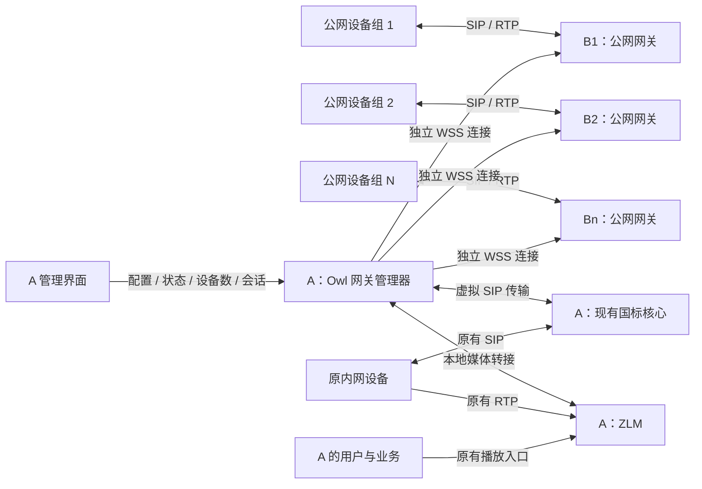
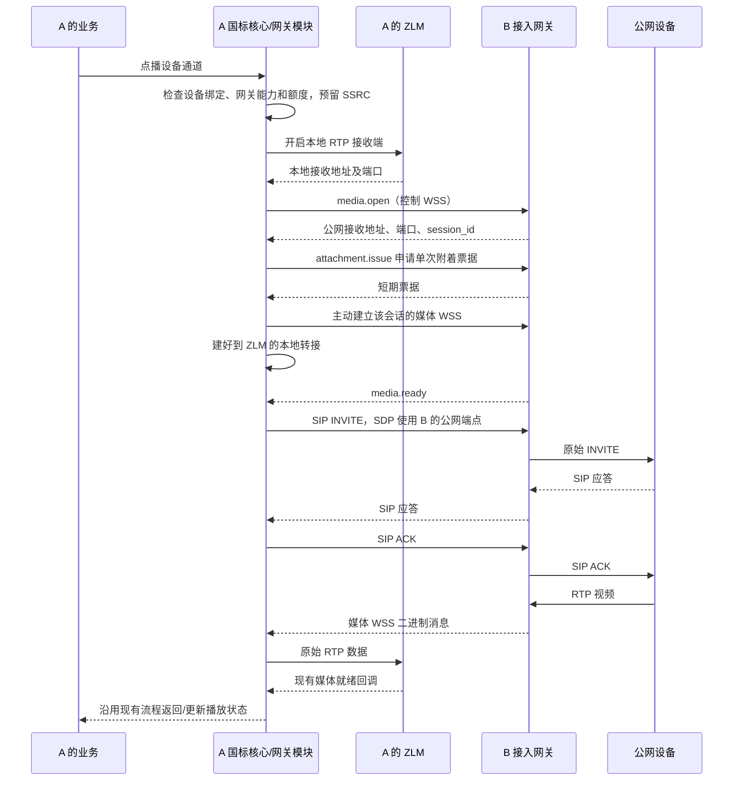
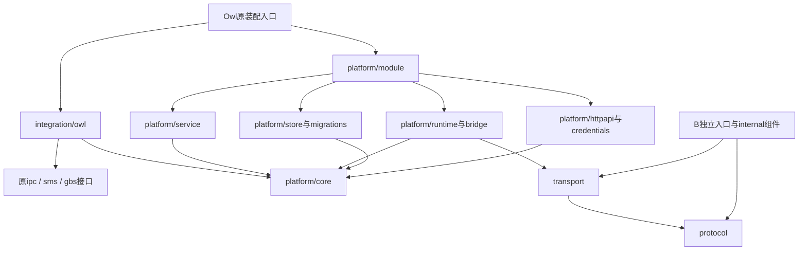

# 国标公网接入网关 WSS 方案

状态：开发设计基线 v1，尚未实施。日期：2026-11-10。本版以多公网接入网关和 A 端统一配置管理为正式交付要求，传输、持久化、界面、统计和运维一起交付。

阅读顺序：第 1—14 节定义架构、功能和交付边界；第 15—18 节固定开发契约、数据约束、业务时序和异常处理；第 19 节固定功能目录、依赖方向和原项目集成边界。实现中以详细章节的具体约定为准；修改跨端契约须同步更新本文和相关实现，不能由某一端静默变更。本文件定义的是待开发功能，字段和接口不表示当前程序已经支持。

## 1. 目标与架构决策

A 位于内网，能够访问互联网，运行 Owl 国标服务及 ZLM；B1、B2……Bn 各有固定公网入口。不同公网设备分别向对应 B 注册并推流，A 统一管理和访问全部网关设备与原有内网设备。A、各 B 之间不使用 VPN 或 frp。

采用“B 公网接入网关 + A 内置 WSS 客户端”：

- B 部署一个独立 Go 应用 `owl-gateway`，提供公网 SIP 入口、RTP 接收端口和 WSS 服务；不部署完整国标平台或 ZLM。
- A 在 Owl 中增加网关模块，主动连接 B；设备认证、目录、点播、回放、控制、录像和播放分发继续由 A 负责。
- A 提供独立“接入网关”管理模块，支持多个 B 的新增、配置、连接诊断、启停、排空、证书管理、设备统计、媒体会话和事件审计；添加网关不需要修改服务器配置文件或重启 A。
- 每个 B 独立连接、独立重连、独立配额和配置版本，一个 B 的故障或编辑不重建其他网关连接。
- 控制连接与媒体连接分离。每个活动媒体源独占一条媒体 WSS 连接，复用该源的多个观看者不重复建立设备流。
- B 只中继必要的 SIP、RTP/RTCP 数据，不解码、转码或提供任意地址的 TCP/UDP 转发。
- 使用私有 CA 签发证书和双向 TLS（mTLS），不依赖公有证书机构。A 主动拨号，不要求 A 具有公网 IP 或入站端口。

本方案以部署网络允许指定 B 地址的 WSS 长连接为前提。WSS 使用 443 端口不等于一定获准；如果出口需要域名准入、HTTP CONNECT 代理或证书策略配置，应使用网络管理方允许的配置。自定义证书不保证能通过所有出口策略。



每个 B 对应一条控制 WSS 和按活动媒体源创建的媒体 WSS，全部由 A 发起，建立后可双向传输。设备仍使用标准国标协议连接 B，不要求设备支持 WebSocket。

## 2. 实施范围

| 能力 | 完整交付范围 |
| --- | --- |
| 网关拓扑 | 一个 A 同时管理 B1…Bn；每个 B 在本方案中归属一个 A；A 是单个逻辑管理中心，不要求 A 多实例双活 |
| A 管理界面 | 网关列表、配置向导、详情、设备/通道列表、媒体与任务、统计趋势、事件与审计、证书管理 |
| 网关生命周期 | 草稿、连接测试、启用、重连、配置变更、排空、停用、证书轮换、迁移计划、删除保护 |
| 状态与统计 | 管理状态、连接状态、服务健康独立展示；接入设备总数/在线/离线、通道数、活动流、带宽、延迟、端口与资源用量 |
| 设备信令 | SIP UDP、SIP TCP；注册鉴权、心跳、目录、告警和控制交给 A |
| 实时视频 | RTP/UDP、RTP/TCP 被动与主动模式，双向 RTCP |
| 设备录像 | 录像目录、回放、暂停/继续/倍速/跳转、RTP 下载及已有 2014 裸 TCP 下载路径适配；设备支持度按原协议结果判断 |
| 语音与扩展任务 | 已有对讲/广播的双向媒体路径、抓拍/升级等任务需要的受控文件传输入口 |
| 国标平台互联 | 对现有级联流程的公网传输适配，分别管理平台绑定与设备绑定，不把平台注册数计入设备数 |
| 平台录像及观看 | 复用 A 的 ZLM 和原有业务入口，不新增 B 播放出口 |
| 证书 | 私有 CA、自签根证书、服务端与客户端证书、双向 TLS |
| 故障 | 连接检测、重连、租约回收、按代次隔离、失败补偿 |
| 数据与权限 | 配置/绑定/会话回收/统计/审计持久化，现有管理员认证及后端权限门禁，凭据受控保存 |
| 发布与维护 | A/B 的部署产物、升级回滚、配置备份、日志与告警、完整范围检查 |

完整指本方案列出的多网关接入、管理和现有业务适配全部完成，不以单设备点播演示替代交付。协议能力仍按 A/B 版本、设备及真实网络协商；设备不支持或版本不匹配的动作明确拒绝，不能伪造成功。

涉及 RTCP 的模式必须同时实现必要的双向 RTCP 路径。开发可以按依赖顺序推进，但管理界面、数据库和统计不是可省略的后续选项；尚未完成的能力不出现在可用声明中。

## 3. 部署与端口

| 位置 | 入口 | 说明 |
| --- | --- | --- |
| B | TCP 443 | WSS 控制与媒体，共用 TLS 监听器，按路径区分 |
| B | UDP/TCP 15060（示例） | 设备 SIP 注册和信令；实际使用部署配置 |
| B | UDP/TCP 30000–30199（示例） | 网关动态申请的媒体接收范围；仅为活动租约绑定端口 |
| B | TCP 8443（示例，设备任务入口） | 图片上传/文件获取使用独立 HTTPS 监听器，不要求设备持有 A 的 mTLS 证书，按任务票据认证 |
| A | 出站 TCP 443 到 B | A 不为本方案增加公网入站端口 |
| A | 本地/容器网络中的 ZLM API 与 RTP | 沿用媒体节点配置；容器部署须确认 Owl 到 ZLM 的实际可达地址 |

B 的防火墙/云安全组预先允许配置中的媒体范围。应用只在这个范围内分配端口，不运行时修改主机防火墙，不需要通用网络转发或 IP forwarding。应用监听 443 所需的权限通过部署配置解决，进程其他操作使用普通运行账号。

不同于 VPN 端口映射，B 的公网端口不需要等于 A 的 ZLM 端口。例如 B 的 `30036` 可以对应 A 的 `20058`，二者通过媒体会话关联。

## 4. 组件职责

### 4.1 B：公网接入网关

- 加载网关 ID、公网通告 IP、SIP 监听地址、媒体端口范围和证书。
- 对 A 进行 mTLS 认证，将客户端证书身份映射为唯一 `platform_id`。
- 一个 SIP 监听入口静态归属一个 A；设备尚未认证时，也能确定应把注册交给哪个 A。一个 B 共享给多个独立 A 不属于本次拓扑要求，不影响一个 A 同时接入多个 B。
- 为 SIP UDP 对端、TCP 连接分配 `flow_id`，保存设备实际来源地址和连接生命周期。
- 接收、转发完整 SIP 消息，维持设备侧 UDP 回复路径和 TCP 连接；不代替 A 校验设备口令。
- 按 A 的请求分配媒体端口、绑定会话并通过媒体 WSS 转送数据，负责端口和租约回收。
- 无可用 A 控制连接时，SIP 请求返回合适的临时不可用响应；不缓存无限信令，不伪造注册成功。
- 活动连接与租约在内存运行；B 本地原子保存已应用配置版本及必要恢复日志，A 持久化租约和待清理记录。B 重启后使用新代次，旧连接不能复活；启动时结合恢复记录和端口冷却处理遗留资源，不引入独立数据库服务。
- 定期上报进程状态、端口占用、流量、活动会话与配置版本；这些是网关运行指标，不代替 A 的设备认证及设备数量统计。

### 4.2 A：Owl 网关模块

- 主动拨号、验证 B 证书、发送平台身份、获取 B 的通告地址与能力。
- 将带网关上下文的 SIP 消息接入现有解析器、事务和安全检查，保留设备侧 UDP/TCP 语义。
- 设备认证通过后提交入口绑定；网关认证不能代替国标设备认证。
- 在点播/回放时同时协调本地 ZLM 接收端和 B 的公网接收端。
- 生成 SDP 时使用 B 分配的公网地址和端口；ZLM 管理地址与本地实际收流地址保持原配置。
- 把媒体 WSS 数据转交给对应 ZLM 接收端，统一处理停止、失败和断线清理。
- 在管理端显示网关连接、设备绑定、活动媒体数、流量和失败原因。
- 由独立 GatewayManager 管理 B1…Bn 的运行态，所有查询和操作显式指定网关，后台按组聚合统计，避免页面为每个 B 单独发起远程查询。
- 负责配置数据库、证书引用、版本控制、设备迁移计划和操作审计；重启从数据库加载启用的网关并各自重连。

## 5. 身份、入口和注册

不依靠 A 看到的 socket 源 IP 判断设备来自哪台 B。每条可信消息携带以下上下文：

| 字段 | 含义 |
| --- | --- |
| `gateway_id` | B 的稳定标识，必须与 A 预配置值一致 |
| `platform_id` | A 的稳定标识，必须与 B 对客户端证书的授权一致 |
| `generation` | B 进程启动代次，用于拒绝重启前的旧消息 |
| `connection_epoch` | 本次控制连接代次，由 B 生成 |
| `flow_id` | B 上的设备 UDP 对端或 TCP 连接标识 |
| `device_peer` | B 实际观察到的设备 IP、端口、传输协议 |

`gateway_id/platform_id` 不能仅信任消息中的自报值，必须与配置及已认证连接绑定。设备报文中伪造同名 SIP Header 不构成网关身份。

设备注册流程：

1. B 接收设备 REGISTER，按监听入口找到 A，将原始消息和连接上下文发送给 A。
2. A 使用原有国标鉴权；401 挑战及最终响应经同一设备路径返回。
3. 注册成功后，在同一次绑定更新中记录 `ingress=direct/gateway`、`gateway_id`、当前运行态代次与 `flow_id`。
4. 未通过认证的 REGISTER、迟到心跳、旧连接消息不得更新设备入口。
5. 相同设备更换入口时，仅新的有效注册能切换绑定。与现有注册顺序校验、注销和并发保护一起提交。

设备稳定入口信息需要持久化；`flow_id`、socket、连接代次等运行态不能在重启后直接复活。数据库中的“上次入口”用于显示和恢复判断，不代表设备当前在线。

### 5.1 多网关隔离与唯一绑定

- 运行态主键至少为 `(gateway_id, platform_id, generation, connection_epoch, flow_id/session_id)`，不能只用设备 IP、端口或 B 自增序号索引全局对象。
- 不同 B 可以使用相同 SIP/RTP 端口范围；A 分配独立本地转接 socket，不发生跨网关端口冲突。
- 网关 ID 在 A 中唯一且创建后不可修改，端点按规范化后的 WSS host/port/path 检查重复；已删除 ID 保留审计标识，不自动继承原网关的设备授权。
- 一个设备内部主键同时只能有一个有效入口绑定；一个 NVR 的多个通道继承设备入口，设备数和通道数分别统计。
- 同一设备在 B1 有有效绑定，又经 B2 注册时，默认拒绝隐式抢占并记录冲突事件；不能简单用最后收到的 REGISTER 覆盖。不同入口的 Call-ID/CSeq 也不能直接拿来比较新旧。
- 入口切换通过 A 创建迁移计划，限制目标 B、设备集合、有效期及是否允许替换旧绑定。目标入口完成新的设备认证，且旧会话已经排空，才能原子提交新绑定和统计归属。
- 旧入口的迟到心跳、注销和清理不能覆盖新绑定；绑定版本校验同时约束设备状态、会话和计数更新。
- B1 离线只影响 B1；不能自动改为 B2，因为设备仍可能只知道 B1 的公网地址。多 B 不等于设备侧自动容灾。

### 5.2 A 与多个 B 的配置关系

A 保存每个 B 的期望配置，B 上报实际配置和能力。配置包含 `desired_revision/applied_revision`；只有实际已应用且满足能力要求的配置才用于新会话。

B 本地启动配置控制身份、TLS 监听、允许的平台与可开放端口边界。A 可以在这些边界内调整公网通告配置、会话/带宽额度、超时和设备来源策略；越界返回明确拒绝原因，不改系统防火墙或操作系统网络。

所有远程变更采用“校验/准备 → 持久保存期望版本 → B 原子应用 → 应答版本 → A 更新生效状态”。重复应用同版本幂等；失败保留最后有效版本和待应用状态。会影响活动会话的变更必须先排空，不能让表单保存成功等同于公网入口已变更成功。

## 6. SIP 传输适配

建议在 A 增加 `GatewaySIPConnection`，适配现有 `sip.Connection`，并提供可选的网关路由元数据接口。网关数据通过受控入口进入同一解析、事务、安全校验及请求分发流程。

- `Network/SignalingTransport` 反映设备到 B 的 UDP/TCP，不能因为载体是 WSS 就对设备宣告 `SIP/2.0/WSS`，也不能把设备 UDP 事务当成可靠 TCP 事务。
- 入站 SIP 的逻辑对端地址使用 B 实际观察到的设备地址，用于原有来源检查和审计；出站发送必须通过绑定的网关路由，不尝试从 A 直接连接公网设备。
- A 为经网关发送的 SIP 选择 B 的公网 SIP 地址生成 Via、Contact 等平台传输地址；国标平台编号、域与设备身份继续遵循原协议配置。
- B 只拆分必要的 TCP 消息边界并转送原始 SIP 字节，不在 A 完成摘要/签名后重写 SIP。原始消息通过 base64 放入控制消息，解码后按原字节解析。
- 响应、ACK、BYE、INFO、MESSAGE、NOTIFY 和对话路由均需覆盖。既有大报文从 UDP 升级到 TCP 的路径，也必须通过 B 建连；不能保留 A 直接拨设备的旁路。
- `sip.flow.open` 的连接目标只允许来自已认证设备绑定及经校验的协议路由，限制目标地址和设备端口；不得把它实现为可连接任意内网地址的代理接口。
- B 的 UDP flow 空闲期限应覆盖有效注册与心跳周期；A 向 B 同步已认证绑定的租约。TCP 使用原连接，断开即失效。
- A、B 都限制 SIP 消息大小及单入口速率；网关 WSS 投递不改变 SIP 原本的重传、超时和幂等语义。

这是一项明确的传输扩展，不是简单把 WSS 字节写到 `127.0.0.1:15060`。后一种做法会丢失入口身份、实际来源和连接路由，影响多设备、多个网关和来源校验。

## 7. 点播与媒体会话

### 7.1 资源创建顺序



媒体转接在 INVITE 前就绪，并接受设备在最终 SIP 应答前提前送来的有效媒体。不能把 `media.ready` 或 SIP 200 当成 ZLM 已收到可播放视频；最终就绪仍由现有媒体状态判定。

### 7.2 公网端点与本地端点分离

```text
设备 D 的入口：gateway-b
B 的公网接收端：203.0.113.10:30036
A 的实际 ZLM 接收端：127.0.0.1:20058（仅为同主机部署示例）

设备 → B:30036 → 媒体 WSS → A 网关模块 → ZLM:20058
```

SDP 的 `c=`、相关 `o=` 地址及 `m=video` 端口由统一端点解析器生成，指向 B 的公网接收端。直连设备继续使用原有媒体节点的 SDP 地址。不得修改全局 `Media.SDPIP`，也不得把同一个 ZLM 伪装成重复媒体节点来切换地址。

### 7.3 UDP、TCP 和 RTCP

- UDP：一条 WSS 二进制消息携带一个完整数据报，保留 RTP/RTCP 包边界。A 通过会话独占的本地 UDP socket 转发至 ZLM，保持稳定源端点。
- TCP 被动收流：设备连接 B 的公网监听端口；A 连接本地 ZLM 的 TCP 接收端。按顺序转送原始字节流，保留 RFC4571 长度前缀，不重复添加或删除帧头，不假定 socket 读取边界等于 RTP 包边界。
- TCP 主动收流：A 校验设备 SDP 应答后，通过 `media.connect` 要求 B 连接设备指定的可达端点；连接超时、来源不匹配和地址策略沿用现有规则。B 与设备的公开传输模式、A 与本地 ZLM 的传输模式分别记录；A 可用本地被动 TCP 接收端承接该字节流，不能误用本地 ZLM 的主动模式从 A 直接拨设备。
- RTCP：媒体协议包含双向 RTCP 类型。UDP 若使用独立端口，A、B 显式协商本地/公网 RTCP 端点并一起分配；只有在所用驱动及协议明确采用相邻端口时才使用 `RTP+1`。TCP RTCP 沿用对应帧格式与设备协商。
- 会话校验：分配时绑定预期 SSRC、设备入口和来源策略。B 校验媒体源，A/ZLM 继续检查会话与 SSRC；不同设备/会话不能因端口复用串流。SSRC 是路由约束，不是密码学认证。
- 设备信令与媒体公网源 IP 不同的部署需显式配置允许的媒体来源；不能无条件把任意首包来源当成可信设备。

### 7.4 会话状态与释放

状态为 `allocated → attached → receiving → closing → closed`，任一启动步骤失败转入 `closing`。资源不足、端口绑定失败、媒体连接未就绪时不发送 INVITE。

- B 租约与 A 的媒体会话一一对应，保存网关代次、SSRC、端口、传输类型和配置版本快照。
- `media.open` 使用操作 ID 幂等；同 ID 不同参数拒绝。同请求重试返回原租约，不重复分配端口。
- `media.close` 幂等；正常停止遵循现有共享源引用计数，最后需要释放时才停止设备并关闭网关和本地收流资源。
- SIP 超时、用户取消、媒体创建失败均回收已创建的两端资源。清理失败单独记为待回收，不虚报完全释放。
- B 对未 attached 租约使用短期限；活动租约由控制心跳续租，并受媒体读写超时约束。失联可独立回收，避免依赖无法抵达的关闭命令。
- 关闭后延迟复用端口，结合新 SSRC、来源绑定和租约代次拒绝旧数据；不能假设 UDP 迟到包带有内部 session_id。
- B 启动后先进入端口冷却期，再开放新媒体分配；冷却期至少覆盖上次进程可能残留的租约窗口。内存状态丢失后不能仅靠新 generation 区分公网旧 UDP 包，因为设备报文不携带这个字段。
- 改网关公网 IP、端口范围等配置，只影响新会话；活动租约保持快照，或要求先排空再变更。

### 7.5 回放、下载、语音和文件任务

完整适配不能只覆盖 `Play`：

| 业务 | 网关处理 | A 的业务归属 |
| --- | --- | --- |
| 设备录像回放 / RTP 下载 | 与实时视频共用网关租约，独立 session/SSRC；控制 SIP 仍走原设备绑定 | 既有历史会话、进度、播放票据与下载权限 |
| 2014 裸 TCP 下载 | B 提供协议要求的公网 TCP 端点，独立 WSS 传原始文件字节 | A 的现有下载接收/文件落盘流程，不把裸文件流送进 ZLM RTP 端口 |
| 对讲 / 广播 | 同一语音任务协调设备到 A、A 到设备两个方向，分别保存源/目的和 SSRC；B 负责设备侧 UDP/TCP 收发 | 复用现有语音控制、广播等待、停止和超时机制 |
| 国标级联 | 平台信令绑定与设备绑定分开；按每个对话/媒体腿选择网关，双向 RTP 和协议能力独立校验 | 复用既有上/下级平台身份与目录授权，不在 B 再实现级联业务 |
| 设备图片上传 / 文件获取 | B 提供任务限定的公网 HTTPS 路径，按任务创建受控转送会话 | A 继续校验原任务状态/权限、保存结果并维护进度 |

任务 WSS 由 A 主动建立，绑定 `gateway_id/task_id/transfer_id`，与视频连接分开，文件/图片传输有独立并发和带宽额度。设备公网任务入口使用与 WSS mTLS 不同的监听器/TLS 策略；设备不持有 A 的客户端证书。公网 HTTP 路径只允许白名单任务类型、大小、时限和单次凭据，不能成为任意 URL 代理或暴露 A 的管理 API。

设备侧 HTTPS 任务还受设备支持的证书信任和 HTTP 协议能力约束。A↔B 的私有 CA 不能自动让摄像机信任 B；不支持的设备返回能力原因，不能为兼容设备而关闭 A↔B 的证书校验。

任务取消、设备换入口和网关停用，需要终止相关传送并按既有业务规则安全停止语音/控制。下载途中失败保存失败状态或可验证进度；不凭 WSS 重连自动续传 SIP 对话，是否支持续传遵循原业务协议。

## 8. WSS 协议概览

使用标准 RFC6455 WebSocket over TLS，初期使用 HTTP/1.1 Upgrade，子协议 `owl-gateway.v1`。禁用 WebSocket 压缩。以下路径、字段和错误码是待实现的内部协议，不是当前已有 API。

| 路径 | 用途 | 连接身份 |
| --- | --- | --- |
| `/gateway/v1/control` | 注册、心跳、SIP、媒体租约管理 | 平台 mTLS 证书 |
| `/gateway/v1/media` | 单媒体源双向数据 | 同一平台 mTLS 证书 + 单次附着票据 |
| `/gateway/v1/transfer` | 单个文件/图片任务传输 | 同一平台 mTLS 证书 + 任务附着票据 |
| `/gateway/v1/probe` | HTTPS 只读连接诊断，不接管控制连接 | 平台 mTLS 证书 |

### 8.1 控制消息

JSON 文本消息使用第 15 节的公共信封。`hello` 建连前尚无代次，由 B 在 `hello.ack` 返回。请求、响应、事件有明确分类，字段、错误码及超时按第 15 节执行。

| 消息 | 方向 | 作用 |
| --- | --- | --- |
| `hello` / `hello.ack` | A → B / B → A | 版本协商、身份绑定；B 返回公网端点、范围、能力和心跳参数 |
| `heartbeat` / `heartbeat.ack` | A ↔ B | 平台状态、活动租约摘要、连接健康 |
| `sip.packet` | A ↔ B | flow、对端元数据及 base64 原始 SIP |
| `sip.flow.open` / `sip.flow.close` | A → B | 通过 B 建立授权的设备 TCP 路径或平台 UDP/TCP 路径，以及释放 flow |
| `sip.binding.update` | A → B | 已认证注册租约、设备到 flow 的绑定更新/注销 |
| `media.open` / `media.open.result` | A → B / B → A | 申请会话与公网端点，包含能力、SSRC、操作 ID |
| `media.connect` / `media.connect.result` | A → B / B → A | 主动 TCP 模式中由 B 发起到经验证设备端点的连接 |
| `media.ready` / `media.failed` | B → A | 媒体连接可用或异常；不代表视频已可播放 |
| `media.close` / `media.close.result` | A → B / B → A | 幂等释放，确认实际回收状态 |
| `config.prepare` / `config.apply` / `config.result` | A ↔ B | 校验、应用配置版本，返回成功版本或拒绝原因 |
| `status.snapshot` / `metrics.snapshot` | B → A | 带采样时间/序号的状态、租约摘要、端口和资源指标 |
| `gateway.drain` / `gateway.resume` | A → B | 排空/恢复接入，不改变 B 的进程身份 |
| `transfer.open` / `transfer.close` / `transfer.result` | A ↔ B | 管理任务限定的公网路径和传输生命周期 |

B 返回的公网 IP 来自其显式配置，A 对照允许的地址/端口范围校验。不从 WSS 对端 IP 推断公网通告地址，也不接受设备指定任意转发目标。

媒体附着票据有效期建议 30 秒、单次使用，绑定平台、网关代次、控制连接代次及媒体会话。通过 Upgrade 请求头传递，不放入 URL query 或日志。失败重连申请新票据；旧票据不能跨控制连接复用。

### 8.2 媒体消息

每条媒体 WSS 已绑定唯一会话，因此消息不必重复携带设备口令或完整设备标识。二进制消息采用以下头部，整数使用网络字节序：

| 字段 | 长度 | 说明 |
| --- | --- | --- |
| version | 1 字节 | 协议版本 |
| kind | 1 字节 | UDP_RTP、UDP_RTCP、TCP_BYTES；独立任务连接另有 FILE_BYTES/任务元数据类型 |
| flags | 2 字节 | 协议 v1 为 0，未知标志拒绝 |
| sequence | 8 字节 | 每方向递增的诊断序号，不替代 RTP 序列号 |
| payload | 剩余长度 | 原始数据报或有序 TCP 字节片段 |

UDP 不合并不同数据报，TCP 片段建议不超过 64 KiB。接收使用 WebSocket 消息重组后的边界，不依赖底层 WS frame 或 TCP read 边界。控制消息上限建议 2 MiB，并继续执行现有 SIP 头/正文限制；媒体消息上限建议 256 KiB。

控制连接只传控制和 SIP，不能混入视频负载。每个 socket 单一写入循环，有界队列，Ping/Pong 与读写 deadline 明确设置。

## 9. 心跳、断线与拥塞

以下是初始配置值，需按真实网络调整：

| 参数 | 建议初值 |
| --- | --- |
| 应用心跳 / 无响应判定 | 15 秒 / 45 秒；socket 明确断开时立即处理 |
| 重连 | 1 秒开始指数退避，上限 30 秒，加入随机抖动 |
| 未附着媒体租约 | 30 秒 |
| 活动租约失联回收 | 最后一次有效续租后 60 秒 |
| 媒体建连 / 无首包 | 10 秒 / 复用并协调原点播启动超时 |
| 媒体待写数据 | 每源最多 1 MiB 且排队不超过 1 秒，先达到者触发处理 |

- 控制断开立即停止接受该入口的新点播，并将设备标记为网关不可达。已存在媒体可以在剩余租约内短暂继续，失联到期后关闭；主动停用/撤销平台身份则立即收敛相关连接和租约。
- 重连生成新控制代次，不自动接管旧 SIP 对话或旧媒体。旧会话清理，新设备注册确认后恢复可用；受控 SIP 路径恢复时尽力对旧对话发送 BYE，无法送达时依赖设备超时并保留清理记录。
- 新代次不能仅凭旧 flow 的心跳恢复注册绑定；设备应重新完成注册。恢复时间受设备注册/重试周期影响，部署时应配置合理周期，不承诺 WSS 重连后设备立即在线。
- A/B 重启都不宣称无缝续播。B 旧进程消息、旧附着票据、旧 flow 和迟到清理请求不得操作新代次资源。
- 同一平台重复控制连接默认拒绝新连接，不静默互踢；接管需要明确配置/管理操作与代次隔离。连接已被确认断开后才允许正常重连。
- WSS 底层是可靠 TCP。UDP 经其传送仍会受到重传等待影响，不能承诺原生 UDP 延迟，也不额外重放历史视频。
- 缓冲超限或持续写超时时，关闭该媒体会话并报告 `MEDIA_BACKPRESSURE`，避免无限积压。不任意丢弃 TCP 字节或部分 PS/RTP 数据来假装继续；实时丢帧需要单独设计完整帧恢复策略，不作为 TCP 隧道的隐含能力。
- 设备流停止后的媒体连接关闭，与共享源引用管理和现有清理机制协调，不能因某个观看者断开就关闭全部观看者的源。
- 网关故障处理只持有该网关的状态锁和会话集合；数据库计数/事件写入失败需要重试并暴露异常，不能卡住其他 B 的收流。

## 10. 自定义证书与认证

### 10.1 推荐方式

“不用公有证书”采用自签根 CA + 私有签发证书实现，不等于接受过期证书、名称不匹配或任意不可信证书。

- B：持有服务端证书、私钥和允许的客户端 CA；要求并验证 A 的客户端证书。
- A：显式加载 B 的根 CA，校验服务端证书链、有效期及 DNS/IP SAN，提供自己的客户端证书。
- 客户端证书由受控部署 CA 签发；每个 B 将证书 CN 显式映射到平台 ID，不允许任意 CN 自动注册。
- 不使用 `InsecureSkipVerify=true`，不依赖操作系统已信任私有 CA。
- 服务端证书使用 `serverAuth`，客户端使用 `clientAuth`。B/A 私钥只保存在各自部署端，根 CA 私钥离线保管。
- 轮换证书采用受信 CA/证书的受控重叠期；已经建立的 WSS 不会自动重新验签，撤销身份或紧急替换时需主动断开相关连接。

### 10.2 证书生成示例

在离线管理机的受控空目录执行。示例要求支持 `-addext` 的 OpenSSL；`gateway.example.com` 是示例，必须替换成 A 实际使用的 B 域名。命令不会配置服务器，也没有在本次方案编写中执行。

```sh
umask 077

# 根 CA：私钥留在管理机，不部署到 A/B。
openssl req -x509 -newkey rsa:3072 -sha256 -nodes \
  -keyout gateway-ca.key -out gateway-ca.crt -days 3650 \
  -subj '/CN=Owl Gateway Private CA' \
  -addext 'basicConstraints=critical,CA:TRUE' \
  -addext 'keyUsage=critical,keyCertSign,cRLSign'

# B 的服务端证书。
openssl req -new -newkey rsa:3072 -nodes \
  -keyout gateway-b.key -out gateway-b.csr \
  -subj '/CN=gateway.example.com'
cat > gateway-b.ext <<'EOF'
basicConstraints=critical,CA:FALSE
keyUsage=critical,digitalSignature,keyEncipherment
extendedKeyUsage=serverAuth
subjectAltName=DNS:gateway.example.com
EOF
openssl x509 -req -in gateway-b.csr \
  -CA gateway-ca.crt -CAkey gateway-ca.key -CAcreateserial \
  -out gateway-b.crt -days 365 -sha256 -extfile gateway-b.ext

# A 的客户端证书，CN 必须与 B 上的平台授权映射一致。
openssl req -new -newkey rsa:3072 -nodes \
  -keyout platform-a.key -out platform-a.csr \
  -subj '/CN=platform-a'
cat > platform-a.ext <<'EOF'
basicConstraints=critical,CA:FALSE
keyUsage=critical,digitalSignature
extendedKeyUsage=clientAuth
EOF
openssl x509 -req -in platform-a.csr \
  -CA gateway-ca.crt -CAkey gateway-ca.key -CAserial gateway-ca.srl \
  -out platform-a.crt -days 365 -sha256 -extfile platform-a.ext

# 检查用途、信任链及服务端名称。
openssl verify -CAfile gateway-ca.crt -purpose sslserver \
  -verify_hostname gateway.example.com gateway-b.crt
openssl verify -CAfile gateway-ca.crt -purpose sslclient platform-a.crt
```

如果 A 使用 B 的公网 IP 连接，服务端证书 SAN 必须配置对应 `IP:实际公网IP`，并使用 IP 校验；不能只写 CN。也可使用域名连接并让其解析到 B 的固定公网 IP。

WSS 的加密范围是 A↔B；设备↔B 仍取决于设备实际使用的 SIP/RTP 协议，不因本方案自动具备端到端加密。

## 11. A 端统一配置、管理界面与数据契约

本节为正式交付内容。A 的网关配置以数据库为运行时唯一来源，管理端调用 A 后端完成测试和连接，浏览器不直连 B，也不持有平台私钥。下述路由、字段、表名均为待实施契约，不是当前版本已有功能。

### 11.1 网关管理器

`GatewayManager` 按网关 ID 维护独立 `GatewayRuntime`，每个运行态包含控制连接、重连循环、配置快照、设备 flow、媒体/任务租约和指标缓存。

- 启动时从数据库加载已启用记录；新增、启停或修改一台网关，只协调其自身运行态。
- 全局有并发建连限制、媒体总配额和连接数量限制；每个网关再有独立配额，不让单台 B 占满 A 的资源。
- 每个 B 默认只有一个控制连接所有者；A 数据库记录 owner/租约及 fencing 版本，避免旧进程和重复启动同时工作。续租失败/失去所有权后停止新操作并按代次退出；该保护不代表提供 A 多实例双活。
- 不使用全局单例“当前网关”；业务通过设备/平台绑定或会话快照定位具体 B。
- 媒体节点选择遵循“通道显式绑定 → 网关默认媒体节点 → 现有默认节点”，并检查类型与能力；该选择与公网网关选择独立。活动会话保持原媒体节点，不能因默认值修改而漂移。

### 11.2 新增与配置向导

入口放在现有“平台运维”分组下，名称“接入网关”，与“媒体节点”并列。

1. 基本信息：稳定 ID、名称、备注/分组、WSS 地址、允许的公网通告 IP、SIP 端口和媒体端口边界。
2. 认证配置：选择或导入私有 CA、客户端证书/私钥，校验证书链、用途、私钥匹配和有效期；展示指纹及到期时间。
3. 接入策略：默认媒体节点、会话数、带宽和任务额度，心跳/超时，设备来源策略、需要的协议能力。
4. 测试连接：A 后端完成 DNS、TCP、TLS、mTLS、网关身份、协议版本和 B 配置读取，逐项返回结果；已有活动控制连接时使用只读 probe，不建立第二个控制所有者。
5. 对比配置：展示 A 期望值与 B 实际值、端口和能力差异；不一致时允许保存草稿，阻止直接启用不满足要求的接入。
6. 保存并启用：数据库事务提交后启动对应连接；失败显示具体原因，记录保留可编辑，不回滚成“未添加过”。可以只保存草稿。

表单校验 ID/端点唯一性、端口范围、证书、容量和版本。并发编辑使用 revision 乐观锁，旧表单覆盖返回冲突。A 对 B 返回的地址做策略校验，同一 TLS 端点推导媒体/任务路径，不把客户端证书发送到未经批准的其他主机。

首次导入凭据可先由向导创建草稿 ID，再上传证书并继续后续步骤；页面仍呈现一个连续流程，取消可删除无引用草稿。私钥只在上传时进入内存并提交受控后端，上传后清除表单内容，不存入 localStorage、草稿 JSON 或浏览器日志。

连接测试成功只证明对应检查项成功；B 本地绑定端口正常不代表公网设备一定可达。界面单列“设备端到端回流验证”：未观察到真实会话时显示“未验证”。

### 11.3 网关列表

页面顶部展示网关总数、在线/异常/停用网关数、接入设备总数/在线数、活动媒体源数和总入流量。设备总数包含各网关当前绑定设备，不包含 A 的 direct 设备；系统总览另按 direct + 全部网关汇总。

| 列 | 展示内容 |
| --- | --- |
| 网关 | 名称、稳定 ID、分组、备注摘要 |
| 地址 | WSS 端点、B 公网 IP、SIP 端口 |
| 状态 | 管理状态、连接/服务状态、错误摘要、指标是否过期 |
| 设备 | 已绑定总数 / 当前在线 / 离线，点击进入该网关设备页 |
| 通道 | 通道总数 / 在线通道数，与设备数量分列 |
| 会话 | 实时源、回放、下载、语音/任务数；公网端口已用/总量 |
| 流量 | B→A 当前码率、A→B 当前码率、WSS RTT |
| 健康 | 心跳时间、配置版本差异、证书到期和待回收告警 |
| 操作 | 详情、编辑、测试、启用、排空、停用、重连、删除，按状态和后端门禁启用 |

支持名称/ID/地址搜索，按分组、管理状态、连接状态、异常类型筛选，服务端分页和排序。默认每 5 秒刷新一次可见列表，离开页面或标签不可见时暂停；读取后端聚合快照，不由页面逐台访问 B。

请求失败保留上次数据并标记更新时间和错误；不得把统计失败渲染成“0 台设备”。

### 11.4 网关详情页

详情固定展示名称、ID、期望/实际配置版本和三类状态，提供以下页签：

| 页签 | 功能 |
| --- | --- |
| 概览 | 设备/通道/会话摘要、心跳、运行时长、版本、连接质量、CPU/内存、端口利用率、证书状态与异常建议 |
| 配置 | 期望值与 B 实际值对照，修改、应用结果、待应用原因；必要变更引导先排空 |
| 设备与通道 | 按此 B 筛选的设备列表，设备编码/名称、厂商、注册地址、注册/心跳时间、在线状态、通道数；跳转原设备/通道详情、播放和回放 |
| 活动会话与任务 | 类型、设备/通道、SSRC、B 公网端点、A 媒体节点/端口、开始时间、字节/码率、排队、状态及错误；支持受权限保护的定向停止 |
| 指标趋势 | 网关流量、设备在线数、活动源数、RTT、端口用量、异常/断连趋势；区分 A 统计与 B 上报来源 |
| 事件与审计 | 上下线、重连、认证失败、绑定冲突、资源不足、配置变更、迁移与操作者；按时间/类型/设备过滤 |
| 证书与部署 | 证书元信息、到期提醒、轮换、B 部署配置模板和连接说明；不回显/下载已保存的私钥 |

设备总列表及设备详情同步增加“接入方式/网关”字段和筛选。用户从网关设备页执行原有业务时复用原设备/通道 API，不另造一套弱鉴权播放接口。

界面复用现有 Vue 3、TypeScript、路由、HTTP service、表格、ModalDialog 和既有趋势图能力；不引入新 UI 框架。数据空、加载、失败、离线、指标过期及权限不足均有明确状态。

### 11.5 状态模型

后台分别保存/计算三个维度，页面不能只用一个 online 布尔值：

| 维度 | 状态 | 含义 |
| --- | --- | --- |
| 管理状态 | draft / enabled / draining / disabled | 管理员期望是否接入、排空或停用 |
| 连接状态 | disconnected / connecting / authenticating / connected / reconnecting | WSS/TLS 的真实生命周期 |
| 服务健康 | unknown / ready / degraded / unavailable | SIP 入口、媒体能力、配置、容量和指标综合结果 |

例如“已启用 + 重连中 + 不可用”“已启用 + 已连接 + 媒体端口不足”“排空中 + 已连接 + 可服务已有会话”必须能区分。证书校验失败与配置不匹配各有错误码和原因，不笼统显示离线。

无活动视频时媒体状态为“空闲/未验证”，不是视频故障；最近真实收流结果和连接在线分开呈现。配置边界越界或关键能力缺失时拒绝相应新业务；单项指标采集失败不将整台网关所有业务一概停用。

### 11.6 数量与指标口径

| 指标 | 权威来源与口径 |
| --- | --- |
| `device_total` | A 数据库中当前归属该网关、未删除的国标设备去重数，包括离线设备；一个 NVR 算一台 |
| `device_online` | 当前入口/代次有效、注册及心跳满足既有在线规则，且网关对应信令路径可用的设备数 |
| `device_offline` | 有效快照中 `device_total - device_online`；网关确认失联时其设备不可达，不删除绑定 |
| `channel_total/online` | 当前绑定设备下的有效通道，在线统计同时要求设备入口有效且对应路径可用；设备原始上报状态可另列，不拿通道数代替设备数 |
| `platform_bindings` | 通过此网关连接的级联平台数，单独展示，不算摄像机/NVR |
| `active_sources` | A 中独立设备媒体源数，共享观看同一源只算一个 |
| `active_sessions/tasks` | 按实时、回放、下载、语音、文件任务分别计数，待回收单列 |
| `sip_flows` | B 的 UDP 对端/TCP 连接数，包含未认证尝试，不等于设备数 |
| 带宽与流量 | 标明方向和统计位置；B 设备侧接收与 B→A WSS 输出分别记录，避免重复加总成业务码率 |
| RTT、端口、CPU/内存 | B 带采样时间/序号的上报及 A 连接探测；指标过期标记 stale，缺失显示未知 |

同一设备从 B1 迁到 B2 时，在绑定提交事务中改变统计归属，系统总设备数不增加；注册重传、重连和 flow 变化不增加设备数量。实际设备删除遵循现有删除入口，同步解除网关引用，历史事件仍保留原网关快照。

列表批量读取 A 的数据库分组聚合与运行态缓存，不逐设备/逐网关发远程请求。响应携带 `snapshot_id/sampled_at/received_at/stale`；配置和设备计数有可解释的快照时间，网关上报不能覆盖 A 权威绑定计数。

实时指标建议每 5 秒采集；分钟聚合保留 24 小时，5 分钟聚合保留 30 天，事件/审计默认保留 90 天，可由保留策略调整。网关离线仍可看最后指标和历史趋势，不把无样本填成零流量；A 重启不丢失设备归属与已有历史趋势。

### 11.7 生命周期与操作边界

| 操作 | 行为与约束 |
| --- | --- |
| 启用 | 验证配置/凭据并启动此 B 的连接，不影响其他 B；连接失败保留启用记录并重试/显示错误 |
| 编辑名称/备注 | 更新版本及审计，无须重建连接 |
| 修改端点/身份/端口边界 | 活动媒体/任务存在时先排空；准备新配置成功后应用，失败保留原有效配置 |
| 调整额度 | 不强杀已有合法会话；新会话按新额度准入，低于当前用量时显示超额并等待释放 |
| 测试 | 只读 probe，不占有控制连接，不修改绑定，不把测试成功冒充端到端收流成功 |
| 重连 | 明确提示此 B 相关影响，执行代次切换及清理；不承诺无缝重连，不重连其他 B |
| 排空 | 禁止新设备绑定、新媒体源和新任务；保留已有绑定的心跳/刷新及必要控制和停止，允许已有会话结束 |
| 停用 | 普通操作在排空完成后关闭连接；强制停用明确报告受影响会话并走安全停止/回收，未完成则保留 pending 状态 |
| 删除 | 仅停用、无设备/平台绑定、无活动/待回收任务及迁移引用时允许；不级联删除设备和录像，保留审计 tombstone |
| 迁移设备 | 创建 B1→B2 计划，设备改为连接 B2 并重新认证后才能提交；不通过修改数据库冒充设备已切换公网入口 |
| 证书轮换 | 验证并保存新引用，按计划排空/重连；更新失败保留旧证书，管理端不回显私钥 |

所有动作在后端重复校验状态、引用和 revision，防止编辑/绑定/删除并发绕过门禁；前端按钮隐藏不能替代权限控制。停止媒体/下载/语音遵循现有业务安全收尾顺序。

排空、配置应用、证书轮换等长操作返回 `operation_id` 和 accepted/running 状态，界面查询实际进度与最终结果，不在按钮提交成功时提示“已经完成”。操作记录持久化，A 重启后核对 B 实际版本/租约再继续或标记失败；应答丢失通过相同操作 ID 幂等查询，不重复执行。排空超时默认保留 draining 并提示管理员，不自动强制中断。

迁移计划显示待设备重新注册、旧会话待排空、已迁移、失败和过期数量。B1 离线不自动把设备指派给 B2；若要自动容灾，需要另行配置设备多中心或稳定公网入口策略，不能靠 A 修改路由实现。

### 11.8 管理 API 总览

均通过 A 的现有管理员登录鉴权及后端权限校验，禁止第三方播放凭据调用。沿用项目响应和分页约定，更新/动作携带 revision 与操作 ID，重复动作幂等；返回脱敏数据和可定位错误，不返回私钥、长期密钥或内部任意转发能力。

| 方法 / 路径 | 用途 |
| --- | --- |
| `GET /access_gateways` | 搜索、筛选、分页及批量状态/统计快照 |
| `POST /access_gateways` | 新增草稿或保存后启用 |
| `GET /access_gateways/:id` | 配置、实际版本、脱敏证书信息及状态 |
| `PUT /access_gateways/:id` | 带 revision 更新期望配置 |
| `POST /access_gateways/connection-test` | 向导诊断入口，提交已创建 draft_id/revision，使用已保存草稿与凭据，不接受任意目标 URL |
| `POST /access_gateways/:id/test` | 已保存网关的只读诊断 |
| `PUT /access_gateways/:id/state` | enabled / draining / disabled，包含 force 和排空时限 |
| `POST /access_gateways/:id/reconnect` | 单网关重连 |
| `DELETE /access_gateways/:id` | 带引用保护的删除 |
| `GET /access_gateways/:id/devices` | 权威绑定设备及通道摘要，支持在线/编码/名称过滤 |
| `GET /access_gateways/:id/platforms` | 级联平台绑定列表 |
| `GET /access_gateways/:id/sessions` | 媒体与任务列表，包含待回收资源 |
| `POST /access_gateways/:id/sessions/:session/stop` | 定向停止，必须核对会话所属网关与代次 |
| `GET /access_gateways/:id/metrics` | 当前指标及时间区间聚合趋势 |
| `GET /access_gateways/:id/events` | 事件和操作审计 |
| `GET /access_gateways/:id/operations/:operation` | 排空、配置应用、轮换等异步操作进度和结果 |
| `POST /access_gateways/:id/credentials` | 导入并验证 CA/客户端证书与私钥，返回引用及元信息 |
| `POST /access_gateways/:id/certificate-rotation` | 受控轮换与结果查询 |
| `GET /access_gateways/:id/deployment-template` | 脱敏 B 配置模板和部署参数，不导出已存私钥 |
| `POST /access_gateway_migrations` | 创建受限的设备/平台迁移计划 |
| `GET /access_gateway_migrations/:id` | 迁移进度、失败原因、待排空与待注册对象 |
| `POST /access_gateway_migrations/:id/cancel` | 取消未提交部分，已完成绑定不自动回退 |

日志审计记录操作者、网关、动作、版本差异、结果和影响资源数；凭据内容只记录指纹和引用。诊断地址仅允许管理员预配置/批准的 B 端点，防止该接口成为服务器任意地址探测入口。

### 11.9 持久化模型

| 业务表 | 主要字段与约束（详细字段见第16.4节） |
| --- | --- |
| `access_gateways` | 内部主键、唯一稳定 ID、名称/分组、URL、公网端点、期望/实际配置、管理状态、revision、凭据引用、默认媒体节点、额度、owner_id/owner_epoch/owner_expires_at、最后错误/时间；逻辑删除保留标识 |
| `access_gateway_credentials` | 网关归属、受控文件/加密存储引用、CA/证书指纹、用途、有效期、轮换状态；不返回私钥 |
| `access_gateway_bindings` | 设备内部主键唯一、ingress_type、gateway_id、binding_revision、认证更新时间；历史 direct 设备默认不创建 gateway 引用 |
| `access_gateway_platform_bindings` | 平台身份主键、网关引用和绑定版本，与设备绑定分离 |
| `access_gateway_sessions` | 网关、媒体/任务 ID、设备/平台、代次、SSRC、两端端点、配置快照、生命周期、关闭步骤和待回收状态；活动连接本身仍在内存 |
| `access_gateway_metrics` | 网关、时间桶、样本有效性、设备/会话计数、流量、RTT、资源摘要；网关+粒度+时间桶唯一 |
| `access_gateway_events` | 网关/设备快照、操作者、动作、事件类型、错误码、时间和 request_id；支持保留策略清理 |
| `access_gateway_operations` | 操作 ID、网关、类型、配置/绑定版本、步骤、影响资源、状态、错误与操作者；支持重启核对及幂等 |
| `access_gateway_migrations` | 源/目标、允许对象、到期、状态、revision；对象执行结果使用关联项记录 |

表关系采用已有存储层风格维护，外键支持情况按现有数据库处理，但服务端必须执行引用检查。配置更新、绑定迁移及所属统计归属采用事务；指标定期聚合可以最终一致，但不能用最终一致的指标绕过删除/资源占用检查。

A 的原有配置文件仅保留网关模块总开关、平台身份、凭据存储位置和默认超时等启动参数；不得同时维护另一份运行时网关清单造成数据库与文件覆盖。允许一次性导入配置，但导入后数据库为准。

证书/私钥上传通过管理员受控入口，验证后存放在服务账号独占目录，目录权限 0700、文件权限 0600、临时文件原子替换；数据库仅保存受控引用和元信息，不保存 PEM 私钥。备份配置与凭据分别受控，数据库备份不能替代私钥备份，也不把私钥写入审计或前端持久存储。

### 11.10 B 配置与多网关接入示例

B 的本地配置用于首次部署、身份认证与可调整边界。以下 TOML 是待实现配置草案，不可直接用于当前版本启动：

```toml
gateway_id = "gateway-b1"
listen = ":443"
public_ip = "203.0.113.10" # 文档示例地址，部署时替换
sip_listen = ":15060"
media_port_range = "30000-30199"
tls_cert_file = "/etc/owl-gateway/tls/gateway-b1.crt"
tls_key_file = "/etc/owl-gateway/tls/gateway-b1.key"
client_ca_file = "/etc/owl-gateway/tls/gateway-ca.crt"
state_dir = "/var/lib/owl-gateway"

[platform]
id = "platform-a"
client_certificate_cn = "platform-a"
max_media_sessions = 64
```

A 管理页面分别新增：

| ID / 名称 | WSS 地址 | 公网地址 | 设备归属示例 |
| --- | --- | --- | --- |
| gateway-b1 / 网关一 | `wss://gateway1.example.com/gateway/v1/control` | 203.0.113.10 | 当前绑定设备 30 台、在线 28 台 |
| gateway-b2 / 网关二 | `wss://gateway2.example.com/gateway/v1/control` | 198.51.100.20 | 当前绑定设备 50 台、在线 45 台 |

示例合计网关设备 80 台、在线 73 台，不含 direct 设备；表中数量仅为界面口径演示。两台 B 可使用同一媒体端口范围，分别选择自己的证书/凭据引用。可以按网关使用独立 CA，或者在同一受控 CA 下为不同域名签发不同服务端证书。

若支持 HTTP CONNECT 出站代理，A 的网关配置提供独立代理引用，不把含凭据的代理 URL 写入日志。

由 B 应用直接终止 TLS。若部署在 Nginx 后，需要配置 Upgrade、匹配长连接超时并明确 mTLS 身份校验层，不信任公网可伪造的证书 Header。B 日志关联完整网关/代次/flow/session/request 上下文，默认不记录原始 SIP 正文、Authorization、媒体票据或证书私钥。

## 12. 与当前 Owl 的改造对应

以下位置已根据当前源码检查，名称为现有符号；新目录为实施目标，不代表已实现。

| 现有位置 | 现状与改造 |
| --- | --- |
| `pkg/gbs/sip/connection.go`：`Connection` | 已封装 net.Conn、数据报读写；新增可选网关上下文及虚拟传输实现 |
| `pkg/gbs/sip/server.go` | 复用现有解析、请求/响应分发及事务；新增受控网关入站与连接生命周期入口 |
| `pkg/gbs/register.go`：`handlerRegister` | 目前保存连接和源地址；在认证成功的绑定提交中保存入口，覆盖注销、重传和切换 |
| `pkg/gbs/devices.go`：`Device` | 运行态增加网关路由快照，并与现有锁/状态快照一起维护 |
| `pkg/gbs/catalog.go`：`wrapRequestContextInternal`、对话发送流程 | 按入口生成 SIP 通告地址，覆盖 TCP 升级和对话内请求，禁止 A 直接拨经网关设备 |
| `pkg/gbs/play.go`：`Play` 流程、`sipPlayPush2` | 目前直接使用 `in.SMS.GetSDPIP()` 与 ZLM 端口；接入公网/本地双端点与媒体租约 |
| `pkg/gbs/history.go`：`StartHistory`、`sipInviteHistory` | 与实时点播共用入口解析与媒体租约，不单独复制地址选择规则 |
| `pkg/gbs/voice.go`、裸 TCP 下载及级联流程 | 适配双向媒体、文件接收与各平台传输腿，统一网关能力和生命周期 |
| `pkg/gbs/stream.go`：`Streams` | 保存媒体租约/代次快照，接入已有失败清理、共享源管理与 SSRC 释放 |
| `internal/adapter/gbadapter/gb.go` | 保持现有媒体节点选择；增加网关模式能力门禁，复用所有业务入口 |
| `internal/core/sms/node_manager.go` | 继续管理真实 ZLM；不把 B 注册成 ZLM 节点 |
| `internal/conf/config.go`、`internal/app`、`internal/web/api/provider.go` | 增加网关启动配置和装配入口，复用当前Wire/Usecase装配及Close链；具体业务置于独立扩展目录，默认关闭保持兼容 |
| `internal/core/ipc/model.go` 与存储层 | 持久化设备入口；优先采用独立扩展/侧表，避免手改标注为生成代码的模型文件 |
| `internal/core/sms/management.go` | 借鉴现有节点的唯一性校验、引用检查与管理锁，网关使用独立业务模型 |
| `admin-ui/src/router/index.ts`、`admin-ui/src/layouts/AppShell.vue` | 增加平台运维菜单、列表/详情路由和导航 |
| `admin-ui/src/views/MediaServersView.vue`、`MediaServerDetailView.vue` | 参考现有节点交互，新增独立接入网关页面，不把两类节点混成同一资源 |
| `admin-ui/src/services/http.ts` | 复用现有HTTP客户端；网关API、类型和页面集中在 `admin-ui/src/features/access-gateway/`，不继续扩张总API/类型文件 |
| 设备列表/详情、概览与系统状态页 | 增加入口筛选、网关跳转及分组汇总，保持原有播放/回放业务入口 |

新增后端功能统一落位 `extensions/accessgateway/`：A端在 `platform/`，B端在 `gateway/`，共享协议在 `protocol/`，传输基础在 `transport/`，现有Owl适配在 `integration/owl/`。前端统一落位 `admin-ui/src/features/access-gateway/`，部署材料集中于扩展目录的 `deploy/`。第19节为最终目录规划，取代先前将新增实现分散到 `internal/gateway/`、`internal/core/accessgateway/`、`pkg/gatewayproto/` 等目录的建议。沿用当前Go module和已有WebSocket依赖，不额外引入消息队列或数据库服务。

第 11.9 节的持久化模型与运行态、API、界面同步实施。设备入口以设备内部主键关联，不使用可能重用的设备编码独立关联。迁移遵循现有版本管理：历史设备缺省 direct、事务/失败处理明确、保留旧数据、迁移失败不跳过。数据库版本号根据实施时当前版本递增，不在方案中硬编码过时版本。

该表记录“上次已认证入口”；网关路径在 A 启动后必须重新验证有效绑定，不能用旧持久化地址从 A 直接探测/发送设备信令。网关停用/删除需要检查设备引用和活动会话，删除前要求解除绑定，避免隐式切回 direct。

## 13. 实施顺序与完整交付标准

以下为依赖顺序，所有项都属于本次完整方案；中间开发状态不能作为功能已全部交付。

| 顺序 | 实施内容 | 对应交付物 |
| --- | --- | --- |
| 1 | 多网关数据模型、管理员 API 契约、身份/证书、状态/统计口径 | 迁移、类型与接口契约、绑定/并发保护 |
| 2 | B 独立程序、A 多连接管理器、WSS 控制和配置协调 | 多 B 同时在线，独立身份、配置、心跳和重连 |
| 3 | SIP 全路径及设备/平台唯一入口 | 注册、鉴权、目录、心跳、控制、冲突及迁移 |
| 4 | 双向媒体及文件任务，接入原有业务生命周期 | UDP/TCP 主被动、RTCP、回放/下载/语音/任务和级联适配 |
| 5 | A 配置向导、列表、详情及原有页面联动 | 管理页面、设备/通道查询、会话操作与证书管理 |
| 6 | 指标历史、事件/审计、配额、排空和故障恢复 | 可解释的数量与状态，单 B 故障隔离，数据持久化 |
| 7 | A/B 部署、升级、备份、回滚及直接相关检查 | Dockerfile/Compose/配置模板/证书说明和部署记录 |

功能完成依据：

| 项目 | 必须满足的结果 |
| --- | --- |
| 多网关 | A 同时连接至少 B1、B2，原有 direct 设备共存；两个 B 使用相同端口/局部 flow 编号也不串路 |
| 管理闭环 | 管理页面新增、测试、启用、编辑、排空、停用、重连、证书轮换和删除保护均走真实后端；新增 B 不重启 A |
| 设备计数 | NVR、通道、SIP flow 和平台注册分别统计；重传/重连不增加设备数，B1→B2 迁移不重复计数 |
| 状态真实性 | 连接在线、媒体端口异常、证书错误、配置待生效和指标过期可区分；A/B 重启后配置/绑定/历史可查 |
| 路径正确 | 实际 INVITE 使用设备所属 B 的地址；各协议的主动连接、回程和双向媒体均不绕过网关 |
| 原业务兼容 | 原有实时、回放、录像、语音、下载/文件任务和级联在相应设备支持范围内工作；不支持动作明确拒绝 |
| 故障隔离 | B1 停机、拥塞或错误配置不影响 B2/direct；会话失败不泄漏两端端口、任务和待清理记录 |
| 权限与身份 | 错误证书/平台、伪造网关、过期票据、跨网关会话操作、旧代次清理和普通用户管理请求均被拒绝 |
| 并发与升级 | 编辑/删除/绑定/迁移同时发生不绕过约束；迁移失败和凭据恢复有明确处理，不以无索引/无绑定空库启动替代 |

优先扩展现有传输、媒体清理和协议用例，针对新协议、生命周期、计数与权限补必要回归。页面源码/契约检查由实现阶段完成，真实防火墙、设备固件、页面效果和容量由部署环境验收；未实际执行的检查不能记录为通过。

## 14. 容量、限制与回滚

视频主路径为设备→B→A：B 需要接收设备视频并向 A 输出近似相同码率；A 需要相应下载带宽。估算 `N × 单路码率 × 1.2` 作为规划余量，实际 WSS/TLS 开销与网络吞吐需测量；例如 20 路 × 4 Mbps，至少按约 96 Mbps 的 B 出口和 A 下载能力规划，并另留原有业务余量。这不是并发性能承诺。

多个 B 分别核算出口、媒体端口和连接上限；A 的下载、ZLM 接收能力、文件存储及总会话配额按全部 B 的合计负载规划。语音上行、文件传输和 A 用户观看的出口单列，不与 B→A 视频码率混算。运行时同时执行全局与单网关准入；具体可交付并发和码率应在明确硬件及网络后确定，不能仅凭“支持多个 B”给出无上限承诺。

每源一个媒体 WSS 能隔离不同源的写入阻塞，但总出口不足仍会影响全部媒体。以配置的会话数、带宽和有界缓冲做准入，超额拒绝新会话，不无限排队。

A 或 B 故障都会影响该网关设备；本方案不提供双活或无缝故障切换。私有证书只影响 A↔B 身份校验，不解决防火墙是否允许此业务的问题。

回滚先停止经网关的新点播并收敛活动资源，再停用 A 网关模块和 B 程序；保留设备入口表与历史记录。回滚到不理解网关设备的旧程序前，需要将这些设备显式停用/隔离，防止旧版把它们误当直连设备。原内网设备、ZLM 配置、播放接口和录像文件无需为本方案整体迁移。

## 15. WSS v1 开发契约

### 15.1 基本类型、握手和信封

| 类型 | 固定约定 |
| --- | --- |
| ID | UUID v4 小写字符串；管理员网关标识另用 `[A-Za-z0-9][A-Za-z0-9_-]{0,63}` |
| revision / epoch / 累计字节数 | JSON 使用非负十进制字符串，数据库使用有符号 64 位整数；禁止浮点数和超过 int64 的值，避免 JS 精度丢失 |
| 时间 | UTC RFC3339，毫秒精度；持续时间字段以 `_ms` 为后缀、整数毫秒；状态过期用本机单调时钟判断，不依赖双方时钟一致 |
| Endpoint | `{ip:string,port:int}`，port 为 1—65535；IP 为规范化字面 IPv4/IPv6，不在媒体消息中临时解析任意域名 |
| 方向 | `device_to_a` / `a_to_device` / `duplex`，从业务角度定义，不随 WSS 发起方向改变 |
| 错误 | `{code:string,message:string,retryable:bool,retry_after_ms:int,details:object}`；details 仅含字段名、资源 ID、版本及计数，不含密钥 |

WSS 必须协商 `owl-gateway.v1`，TLS 最低 1.2，推荐 1.3；不跟随 HTTP 重定向。升级前验证 mTLS、平台授权、路径和子协议；HTTP 返回 400/401/403/409/429/503 分别表示参数、身份、授权、控制所有者冲突、限流和不可用。TLS 验证失败可能没有 HTTP 响应，A 应保存对应 TLS 错误类型。

控制信封字段：

| 字段 | 类型 / 必填 | 说明 |
| --- | --- | --- |
| `version` | int / 是 | 固定 1 |
| `type` | string / 是 | 下表定义的消息名 |
| `kind` | string / 是 | request / response / event |
| `request_id` | UUID / 是 | 当前消息标识，每条消息唯一 |
| `reply_to` | UUID / 仅响应 | 对应请求 ID；请求/事件禁止填写 |
| `gateway_id/platform_id` | string / 是 | 与端点配置及已认证连接一致 |
| `generation` | UUID / 是 | B 启动代次；首次 hello 为 null |
| `connection_epoch` | 十进制字符串 / 是 | B 本进程控制代次；首次 hello 为 null |
| `owner_epoch` | 十进制字符串 / 是 | A 从数据库取得的单调 fencing 版本；B 持久保存已接受的最大值 |
| `payload` | object / 是 | 请求/事件或成功响应的数据；失败时为 `{}` |
| `error` | object / 仅响应 | 成功时 null；失败时使用上述错误对象 |

一个控制连接在升级后 5 秒内完成 hello。B 在接受 hello 时分配 connection_epoch，返回 generation、有效配置、能力和租约参数；A 验证后才开放新业务。同一有效所有者尚连接时不隐式接管，即使新请求携带更大 owner_epoch 也返回 `OWNER_CONFLICT`；确认旧连接断开/过期后，拒绝较小 owner_epoch，相同owner_epoch仅允许同client_instance_id重连，新实例必须持更高owner_epoch。B将最高owner_epoch及对应client_instance_id一起持久化。

JSON 限 UTF-8，拒绝重复字段、未知字段、错误类型及超限消息；payload 内允许扩展的唯一位置为显式 `extensions:{}`，v1 不据此开启新能力。带 required 标志的新能力必须提升协商版本或显式能力位。每端单写循环、消息完整校验后才分发。

响应名使用请求定义的 `.ack` 或 `.result`；出错仍使用同一响应名，通过 error 表达。事件不确认；需要可靠状态核对时使用查询请求，不对事件自行重放。WSS 连接可靠不等于跨断线业务恰好执行一次。

首次hello消息示例（仅演示协议，不含任何真实凭据）：

```json
{
  "version": 1,
  "type": "hello",
  "kind": "request",
  "request_id": "b8f73992-d91b-4b63-bd2e-7ce6497e8d25",
  "gateway_id": "gateway-b1",
  "platform_id": "platform-a",
  "generation": null,
  "connection_epoch": null,
  "owner_epoch": "7",
  "payload": {
    "client_instance_id": "38fbed59-577a-4d02-9a65-a71ad3827b0e",
    "supported_versions": [1],
    "required_capabilities": ["sip_udp", "rtp_udp"],
    "last_applied_revision": "0"
  }
}
```

### 15.2 共享对象和能力

| 对象 | 字段 |
| --- | --- |
| `Route` | `flow_id:UUID,transport:udp/tcp,peer:Endpoint,listener:Endpoint,binding_revision:decimal-string`；未认证入站 binding_revision 为 null |
| `Binding` | `subject_type:device/platform,subject_id:string,flow_id:UUID,binding_revision:decimal-string,expires_in_ms:int`；subject_id 为 A 内部主键 |
| `MediaSpec` | `subject_type,subject_id,channel_id:string或null,purpose:live/playback/download/talk/broadcast/cascade,direction,wire_mode:udp/tcp_passive/tcp_active,ssrc:string或null,send_ssrc:string或null,flow_id,config_revision,source_ips:string[],rtcp:disabled/udp_separate/tcp_mux` |
| `Lease` | `session_id:UUID,state,public_rtp:Endpoint或null,public_rtcp:Endpoint或null,lease_ttl_ms:int,attach_ttl_ms:int,config_revision,wire_mode,direction` |
| `TransferSpec` | `task_id:UUID,subject_id:string,kind:snapshot_upload/upgrade_download/raw_download,direction,max_bytes:decimal-string,ttl_ms:int,content_type:string,expected_sha256:string或null`；raw_download增加wire_mode/source_ips；upgrade_download增加content_length/sha256/range_offset/range_length（十进制长度，hash为hex） |
| `ResourceRef` | `resource_type:media/transfer/flow,id:UUID,generation:UUID,connection_epoch:decimal-string`，只用于精确清理旧资源 |
| `ResourceRecord` | `ref:ResourceRef,operation_id:UUID或null,subject_type,subject_id,binding_revision,config_revision,state,remaining_ttl_ms:int,bytes_received/bytes_sent:decimal-string,local_eof/remote_eof:bool`，用于恢复对账，不含附着票据 |

MediaSpec 的 SSRC 是 10 位十进制国标值并按现有规则校验；ssrc用于device_to_a，send_ssrc用于a_to_device，无对应方向时null，duplex同时声明。语音/多媒体腿分别申请独立租约；同一TCP连接复用双向音频时用一个duplex租约保存两个方向的SSRC，不混为同一个值。RTCP 与 RTP 通过租约的同一会话关联，允许的 RTCP 报告者 SSRC 按 SDP/会话角色校验，不能简单要求所有 RTCP 头的 SSRC 都等于视频源 SSRC。

能力名固定为 `sip_udp/sip_tcp/rtp_udp/rtp_tcp_passive/rtp_tcp_active/rtcp_udp/rtcp_tcp_mux/playback/rtp_download/raw_tcp_download/voice_duplex/broadcast/cascade/https_transfer`。B 声明可中继的能力，A 与真实媒体驱动、协议版本及设备能力取交集；不能仅因 B 支持 TCP 就宣告设备支持裸 TCP 下载或语音。

### 15.3 请求和响应字段

表内字段均位于 payload，除标注可选外必填。所有请求使用第 15.1 节信封；`operation_id:UUID` 表示有副作用请求的幂等标识，与传输 request_id 分开。

| 请求 → 响应 / 方向 | 请求 payload | 成功响应 payload |
| --- | --- | --- |
| `hello → hello.ack` / A→B | `client_instance_id:UUID,supported_versions:int[],required_capabilities:string[],last_applied_revision:decimal-string` | `selected_version:int,capabilities:string[],config:GatewayEffectiveConfig,config_revision,heartbeat_interval_ms,heartbeat_timeout_ms,lease_ttl_ms,cooldown_remaining_ms:int` |
| `heartbeat → heartbeat.ack` / A→B | `heartbeat_seq:decimal-string,renew_session_ids:UUID[],renew_transfer_ids:UUID[]` | `heartbeat_seq,renewed_session_ids,renewed_transfer_ids,rejected_ids:UUID[],drain_state:string`；续租仅限当前代次，不能靠存在一条控制连接续所有资源 |
| `sip.flow.open → sip.flow.open.result` / A→B | `operation_id,subject_type,subject_id,target:Endpoint,transport:udp/tcp,binding_revision` | `route:Route`；设备仅TCP升级，平台允许UDP/TCP，限已授权配置的目标 |
| `sip.flow.close → sip.flow.close.result` / A→B | `operation_id,flow_id,reason:string` | `flow_id,closed:bool` |
| `sip.binding.update → sip.binding.update.result` / A→B | `operation_id,action:bind/refresh/unbind,binding:Binding` | `subject_id,binding_revision,applied:bool` |
| `media.open → media.open.result` / A→B | `operation_id,spec:MediaSpec` | `lease:Lease`；不直接包含可重复使用的附着票据 |
| `media.connect → media.connect.result` / A→B | `operation_id,session_id,target:Endpoint` | `session_id,connected:bool`；只用于 tcp_active，目标经 A/B 双重校验 |
| `attachment.issue → attachment.issue.result` / A→B | `operation_id,resource_type:media/transfer,resource_id:UUID` | `ticket:string,expires_in_ms:int`；只给当前代次尚未附着的资源，绑定此平台证书指纹 |
| `media.close → media.close.result` / A→B | `operation_id,session_id,reason:string` | `session_id,closed:bool,cleanup_pending:bool` |
| `resources.list → resources.list.result` / A→B | `resource_type:all/media/transfer/flow,cursor:string或null,size:int` | `items:ResourceRecord[],next_cursor:string或null`；size 1—200，仅返回本平台资源 |
| `resources.close → resources.close.result` / A→B | `operation_id,ref:ResourceRef,reason:string` | `ref,closed:bool,cleanup_pending:bool`；当前信封可精确清理旧代次，不能把 ref 改写为当前会话 |
| `config.prepare → config.prepare.result` / A→B | `operation_id,expected_revision,desired_revision,config:GatewayEffectiveConfig,config_sha256:string` | `prepare_id:UUID,prepare_ttl_ms:int,requires_drain:bool` |
| `config.apply → config.result` / A→B | `operation_id,prepare_id,desired_revision,config_sha256` | `applied_revision,config_sha256,applied:bool`；准备票据 30 秒有效，过期重新准备 |
| `gateway.drain → gateway.drain.result` / A→B | `operation_id,deadline_ms:int,reason:string` | `drain_state:draining,active_resources:int` |
| `gateway.resume → gateway.resume.result` / A→B | `operation_id,config_revision` | `drain_state:enabled`；版本与状态满足恢复条件才成功 |
| `transfer.open → transfer.open.result` / A→B | `operation_id,spec:TransferSpec` | `transfer_id:UUID,public_url:string或null,public_tcp:Endpoint或null,expires_in_ms:int,max_bytes:decimal-string` |
| `transfer.connect → transfer.connect.result` / A→B | `operation_id,transfer_id,target:Endpoint` | `transfer_id,connected:bool`；仅raw_download/tcp_active |
| `transfer.close → transfer.close.result` / A→B | `operation_id,transfer_id,reason:string` | `transfer_id,closed:bool,cleanup_pending:bool` |
| `transfer.finish → transfer.finish.result` / A→B | `operation_id,transfer_id,received_bytes:decimal-string,sha256:string` | `transfer_id,committed:bool`；A 确认业务存储成功后才能提交 |
| `transfer.query → transfer.query.result` / A→B | `transfer_id` | `transfer_id,ref:ResourceRef,phase,state,bytes_received/bytes_sent:decimal-string,sha256:string或null,committed:bool`；只读，可查同平台旧代次结果，不能复活旧传输 |

心跳数组每条上限 500，总资源更多时按同一序号分片，增加 `part_index:int/part_count:int`；B 每个合法片段独立续租并回传对应片段，不需要等待所有片段。最多 64 个片段，超出部署上限先拒绝新资源；不会通过省略数组续租未知资源。

租约只对双方现存的同代次会话续期。A 丢失会话运行态后不能从数据库盲目恢复续租；先按第 18 节核对并清理。公网任务票据与 WSS 附着票据分开，前者不能登录 WSS，后者不能直接访问设备 HTTP 入口。

### 15.4 双向事件和只读诊断

| 事件 / 方向 | payload |
| --- | --- |
| `sip.packet` / 双向 | `route:Route,raw_base64:string`；A 出站必须已有有效 route；REGISTER 挑战响应允许使用尚未绑定的入站 flow |
| `sip.flow.closed` / B→A | `flow_id,reason:string`，仅使绑定此 flow 的运行态不可用 |
| `media.ready` / B→A | `session_id`，表示附着及 B 端桥接准备完成，不表示设备连接或视频就绪 |
| `media.failed` / B→A | `session_id,error:Error` |
| `transfer.ready` / B→A | `transfer_id`，表示 A 已附着且公网任务可以被设备访问 |
| `transfer.progress` / B→A | `transfer_id,bytes:decimal-string,phase:receiving/forwarding/waiting_commit` |
| `transfer.sent` / B→A | `transfer_id,bytes:decimal-string`；B已将下载字节写出至设备连接并结束本次HTTP响应，不能表示设备完成升级 |
| `transfer.completed` / B→A | `transfer_id,committed:bool,bytes,sha256`；必须以 A 的 finish 确认为依据 |
| `transfer.failed` / B→A | `transfer_id,error:Error` |
| `status.snapshot` / B→A | `sample_seq:decimal-string,sampled_at,sip_udp_bound:bool,sip_tcp_bound:bool,media_ready:bool,config_revision,drain_state,port_total:int,port_used:int,cleanup_pending:int` |
| `metrics.snapshot` / B→A | `sample_seq,sampled_at,uptime_ms:int,cpu_percent:number,rss_bytes:decimal-string,sip_flows:int,media_sessions:int,transfer_sessions:int,device_rx_bytes,device_tx_bytes,wss_rx_bytes,wss_tx_bytes,queue_bytes:decimal-string或null`；不可采集项 null |

`GET /gateway/v1/probe` 是普通 HTTPS，不升级 WSS，不抢占 owner；mTLS 后返回 `{version:1,gateway_id,platform_id,generation,config_revision,capabilities,config_sha256,owner_connected:bool,cooldown_remaining_ms}`。不回传其他平台或网络连接明细。

TLS/SIP/媒体各层不可达分别记诊断项。WSS RTT 由 A 测量 Ping/Pong 的本机耗时，累计字节计数在 B 重启后重置，A 遇到新 generation 不按旧计数做差分。

### 15.5 幂等、超时、租约和错误

- 单个 RPC 默认 5 秒；media.connect 10 秒；config.apply 10 秒。内部信令 RPC 不替代设备 SIP 事务超时；原业务启动 deadline 优先约束全部创建步骤。
- 超时仅表示调用方未确认结果，不表示远端未执行。A 保留 operation_id，用查询或相同操作重试；启动取消时向 B 查询/关闭已分配资源，不能直接申请第二个端口。
- 幂等键为 `(platform_id,gateway_id,generation,connection_epoch,type,operation_id)`，同键请求以规范化字段生成 SHA-256；同键不同参数返回 `IDEMPOTENCY_CONFLICT`。资源存在期间保存原结果，资源关闭后的结果至少保留 10 分钟；控制重连不重放旧业务创建。
- hash规范化统一采用RFC8785 JSON Canonicalization，输入为校验、补全默认值后的业务对象；排除信封、operation_id及票据，集合型数组先去重校验并排序，顺序有意义的数组不得排序。IPv6/CIDR规范化后参与hash，长度/revision字符串不允许前导零（零本身除外），sha256输出小写64位hex。A/B使用相同共享实现及固定样例验证。
- 配置应用结果及已接受的 owner_epoch 由 B 落盘。重复 desired_revision 同 hash 返回原结果，不同 hash 返回版本冲突；版本不能倒退。附着票据不进入幂等结果缓存，重新签发使旧未使用票据失效。
- 附着请求使用 `X-Owl-Resource-Id`、`X-Owl-Attach-Ticket` 头；票据至少 256 位随机熵，B 原子消费。每资源同时只准一个媒体/任务连接；消费后升级失败，A 需确认无已附着连接再重新签发，不能同票据多拨。
- Ping 每 15 秒，单次写入 deadline 5 秒，连续 45 秒未收到有效 Pong/控制响应判失联；应用心跳以 heartbeat.ack 为准。仅 Ping 正常不允许无 ACK 的业务租约无限续期。
- 有效租约 TTL 默认 60 秒、附着 TTL 30 秒。续租间隔 15 秒；可配置值必须满足 `lease_ttl ≥ heartbeat_timeout + heartbeat_interval`，上限 300 秒。清理记录不随租约到期自动从 A 数据库删除。
- 首包超时默认 30 秒，TCP 建连 10 秒；采用 `min(网关超时,原业务剩余deadline)`。有意暂停的回放不因无 RTP 包关闭，仍需连接与租约健康；正在播放的无媒体超时按现有业务规则处理。
- 创建类控制队列 1024 条/每网关，并限制总字节 8 MiB；停止、心跳保留 128 条/1 MiB 独立配额且优先处理。每媒体连接缓冲遵循第 9 节；不能阻塞整个控制读循环等待单设备处理。

| 错误码 | 是否可自动重试 | 行为 |
| --- | --- | --- |
| `INVALID_ARGUMENT/PROTOCOL_VERSION_UNSUPPORTED` | 否 | 拒绝请求；结构损坏/未知版本 WS 关闭 1002，超限关闭 1009 |
| `IDENTITY_MISMATCH/FORBIDDEN/ATTACH_TICKET_INVALID` | 否 | 不分配资源，必要时 WS 关闭 1008 |
| `OWNER_CONFLICT/STALE_EPOCH/CONFIG_REVISION_CONFLICT/BINDING_CONFLICT/IDEMPOTENCY_CONFLICT` | 否 | 重新读取实际状态，不用新 ID 盲目绕过冲突 |
| `CAPABILITY_UNSUPPORTED/GATEWAY_DRAINING/GATEWAY_DISABLED` | 否 | 原业务立即失败并说明原因 |
| `CONFIG_BOUNDARY_VIOLATION` | 否 | 期望值超出B本地允许边界，保留原有效配置 |
| `RESOURCE_NOT_FOUND` | 否 | 查询失败；精确 close 已不存在资源则成功 closed=true |
| `RESOURCE_EXHAUSTED/PORT_BIND_FAILED` | 有界 | 按 retry_after_ms，启动 deadline 内最多 2 次，不能降级到其他 B |
| `DEVICE_UNREACHABLE/UPSTREAM_TIMEOUT` | 有界 | 保留原 SIP 事务/主动连接策略，不重建已成功的步骤 |
| `MEDIA_BACKPRESSURE/TRANSFER_LIMIT_EXCEEDED` | 否 | 关闭受影响资源，通知业务失败，不影响其他网关 |
| `INTERNAL_ERROR/IO_ERROR` | 有界 | 保留清理记录；WS 无法继续时关闭 1011 |

### 15.6 二进制消息与文件结束

第 8.2 节 12 字节头固定不变：version=1、flags=0、sequence 为 uint64 网络字节序，从每个连接每方向的 1 开始严格递增，溢出前关闭。空 TCP/RTP 消息拒绝，EOF 例外；收到重复/跳号意味着应用协议错误，终止此资源，不尝试拼凑旧数据。

| kind 数值 | 名称 | payload / 允许范围 |
| --- | --- | --- |
| 0x01 | UDP_RTP | 一个 RTP 数据报，12—65507 字节，再执行 RTP/SSRC 解析限制 |
| 0x02 | UDP_RTCP | 一个 RTCP/compound RTCP 数据报，按 RTCP length 校验，最大 65507 字节 |
| 0x03 | TCP_BYTES | 1—65536 字节；为有序原始 TCP 流的一部分，RFC4571 头原样保留 |
| 0x04 | FILE_BYTES | 1—65536 字节；仅 transfer WSS，按 TransferSpec 方向发送 |
| 0x05 | EOF | 零字节；表示本方向 TCP 写半关闭或文件数据结束，不代表业务成功 |

UDP 不允许 EOF。TCP 收到 EOF 对本地/设备 socket 执行 CloseWrite，另一方向可继续；双方 EOF 或业务停止后关闭会话。媒体 WSS 中的 FILE_BYTES、任务 WSS 中的 RTP、方向错误、EOF 后继续写数据均拒绝。

文件不支持跨连接自动拼接或隐式断点续传。每次 transfer 内偏移从0顺序传输，Range transfer对应原文件的固定range_offset；累计超过max_bytes才中止，正好等于上限仍允许成功结束。设备上传/裸下载到A时，发送方EOF后A计算长度/hash并校验任务，成功写盘/业务提交再发送transfer.finish。B此前保持等待提交，不提前向设备返回上传成功。HTTP上传最多等待30秒提交ACK，超时返回失败并允许按原任务规则重新申请新transfer；不能向设备返回成功后才发现A未保存。

只读文件下载由A在响应头承诺前提供已验证长度、内容类型、hash；Range只接受单段并在申请transfer时固定range_offset/range_length，纳入幂等hash。A发出EOF后，B写出全部预期字节并上报transfer.sent；A据此提交“文件已传送”业务状态并发送finish，B再发布completed。事件丢失通过资源/任务查询核对，不因重复事件重复提交。设备是否完成升级仍由后续设备业务结果判断。

B对终态transfer保留24小时的有界结果记录并落盘，内容只含平台/任务/transfer标识、代次、长度/hash及提交状态，不保留媒体/文件内容或公网票据。transfer.query在当前已认证控制连接上只读查询本平台记录；不存在返回RESOURCE_NOT_FOUND，不推断为成功。超过记录/磁盘预算先拒绝新任务并告警，不静默删除尚未到保留期的提交凭据。

## 16. 管理接口、数据和迁移详细契约

### 16.1 认证、响应和公共约束

当前通用 `AuthMiddleware` 存在 AuthURL 回退和 query token 兼容行为；接入网关管理不得直接沿用这一宽松入口。复用/抽取现有 `strictOpenAdmin` 的等价严格校验：只接收唯一 `Authorization: Bearer ...`、验证签名/有效期/管理员身份，拒绝 query token 和 AuthURL 回退。全部管理读取、诊断、凭据和动作都适用；不新增一套账号角色系统。

成功响应沿用现有 admin-ui 直接读取 `response.data` 的风格，不包装开放平台的 `{code,data}`：同步 HTTP 200 返回对象，列表 `{items:[],total:int,page:int,size:int,snapshot_id,sampled_at,stale:bool}`；异步 HTTP 202 返回 `Operation`。失败沿用前端可读的 `{msg:string,reason:string,trace_id:string,details:object}`，reason 使用稳定错误码。HTTP 400/401/403/404/409/413/429/503 分别表达参数/身份/权限/不存在/版本或引用冲突/超限/额度/依赖不可用。

所有请求拒绝重复键、未知写字段和类型不匹配。创建/更新只接收配置字段，不接收 online、计数、owner、applied_revision 等服务器字段。公共字段约定：

- ID、时间、revision 与第 15.1 节一致；HTTP 的累计字节数也用十进制字符串，计数用非负整数。
- 列表 `page` 从 1 开始、默认 1；size 默认 20、最大 100；sort 仅允许 `name/created_at/device_total/device_online/last_seen_at`，order=asc/desc，追加稳定 ID 排序。设备/任务列表采用各自字段白名单，未知排序拒绝。
- 更新/删除/改变状态/证书轮换携带 `If-Match: "<revision>"`；缺失 400，冲突 409。配置表单/操作快照返回 revision；指标变化不改变这个版本。
- 创建和全部动作携带 `Idempotency-Key: UUID`；A 以操作者、路由、资源、key 和请求 hash 记录，至少保留 24 小时，返回同一结果/operation_id。同键不同参数 409，不因浏览器重试重复启停或导入。
- API 出错不调用其他网关补偿本来属于 B1 的请求；没有就绪绑定时不回退到 direct 或 B2。
- GET 和日志不返回私钥、附着票据、任务公开凭据及凭据存储绝对路径。HTTP 上传限制 2 MiB，其余 JSON 1 MiB；指标查询不得无界扫描。

### 16.2 配置对象和读模型

`GatewayDesiredConfig` 是 A 表单保存的期望策略，字段如下；对象创建时所有非可选字段必填，PUT 为完整替换，省略字段不解释为沿用旧值。

| 字段 | 类型 / 约束 |
| --- | --- |
| `name/group/description` | string；name 1—80，group 0—64，description 0—500 个 Unicode 字符 |
| `url` | wss URL，最大 512 字节；无 userinfo/query/fragment，path 固定 `/gateway/v1/control` |
| `platform_id` | string 1—64，匹配已部署 A 平台身份，不由表单任意切换平台所有者 |
| `credential_id` | UUID或null；草稿可空，测试/启用前必填，必须属于此网关 |
| `public_ip` | 字面 IP；为设备可访问地址，必须在 B 的本地授权地址集合中 |
| `sip_port` | int 1—65535；为公网 SIP 通告端口，B 实际监听/映射需匹配 |
| `media_port_start/media_port_end` | int，1 ≤ start < end ≤ 65535；不与 B 的 SIP/TLS/任务入口冲突 |
| `task_public_base_url` | https URL或null，固定 B 设备任务入口，无 query/userinfo；启用文件任务必填，与 WSS 地址可用不同端口 |
| `default_media_server_id` | string或null；null 使用既有默认，非空须引用存在、启用且类型兼容的真实节点 |
| `max_media_sessions/max_transfer_sessions` | int，1—10000 / 0—1000，分别受 B 本地上限和 A 总上限约束 |
| `max_to_a_bps/max_to_device_bps` | 十进制字符串，正整数 bit/s，上界 int64；文件和媒体共享网关总预算但另有子额度 |
| `heartbeat_interval_ms/heartbeat_timeout_ms/lease_ttl_ms` | int，默认 15000/45000/60000；interval 5000—60000，timeout ≥ 3×interval，lease ≥ timeout+interval 且 ≤300000 |
| `media_connect_timeout_ms/media_first_packet_timeout_ms` | int，默认 10000/30000，1000—60000 |
| `source_cidrs` | string[]，最多 128；非空仅允许这些媒体源，空表示使用经认证设备的注册源 IP；不等于允许任意地址 |
| `required_capabilities` | 第 15.2 节能力名数组，不重复；B/媒体节点不满足则禁止相关启用或操作 |
| `proxy_ref` | string或null，服务端受控出站代理引用，浏览器不得提交含账号口令的任意代理 URL |

`GatewayEffectiveConfig` 为可发给 B 的子集：`public_ip/sip_port/media_port_start/media_port_end/task_public_base_url/max_media_sessions/max_transfer_sessions/max_to_a_bps/max_to_device_bps/heartbeat_interval_ms/heartbeat_timeout_ms/lease_ttl_ms/media_connect_timeout_ms/media_first_packet_timeout_ms/source_cidrs`。不传 A 媒体节点地址、CA 私钥、出站代理或数据库配置。B 本地上限与该对象取交集并在 prepare 阶段校验，不能静默裁剪为不同配置。

`GatewayView` 返回 `id`（稳定网关 ID）、`name/group/description`、`revision/config_revision/applied_revision`、`desired_config`（proxy仅引用）、`applied_config`、`admin_state/connection_state/health_state`、`pending_operation_id`、`last_seen_at/connected_at/last_error`、`capabilities`、`certificate`（指纹/到期/状态）、`counts`、`metrics` 及 snapshot 时间。

`counts` 固定字段为 `device_total/device_online/device_offline/channel_total/channel_online/platform_bindings/active_sources/live_sessions/playback_sessions/download_sessions/voice_sessions/transfer_sessions/cleanup_pending`。权威聚合不可读时整个 counts=null，并返回 `counts_error`，不能用全零替代；有效 counts 保证设备在线+离线=总数。`metrics` 含方向明确的 bps、累计 bytes、RTT、端口和资源，每项可 null，附 metrics_stale。

`Operation` 字段为 `operation_id,gateway_id,type,status,step,progress:{completed,total},revision,created_at,updated_at,deadline_at,result,error`；status 固定为 accepted/running/waiting_external/succeeded/failed/cancelled。waiting_external 用于离线待核对/设备待注册，不能被当成成功。会话/操作 cleanup_pending 单列，不以关闭 WSS 就清零。

配置状态初值为revision=1、config_revision=0、applied_revision=0；保存草稿不向B应用。首次启用分配config_revision=1，后续仅远端策略变更递增。B本地初始策略标记revision=0，不能用独立递增序号伪装成A已应用版本。每网关最多一个运行中的配置/凭据/启停操作；并发提交返回409及现有operation_id，读取和停止会话不受此串行门禁阻塞。

### 16.3 管理请求与返回对象

| API | 请求字段（均在 JSON body，GET 除外） | 结果 |
| --- | --- | --- |
| POST `/access_gateways` | `id:string,config:GatewayDesiredConfig,enable:bool`；默认 enable=false | 200 GatewayView；enable=true 则 202 Operation，result 引用新网关 |
| PUT `/access_gateways/:id` | `config:GatewayDesiredConfig` | 仅名称/备注更新为 200 View，涉及远端应用为 202 Operation |
| GET 列表/详情 | 列表增加 `q/group/admin_state/connection_state/health_state` 可选筛选 | GatewayView 或分页 GatewayView[]，列表去掉完整 config 但保留 revision/状态/统计 |
| POST `/access_gateways/connection-test` | `draft_id:string`，If-Match 对应草稿 | 200 `DiagnosticResult`，只使用已保存草稿和凭据 |
| POST `/:id/test` | `{}` | 200 DiagnosticResult，不占控制连接、不推送配置 |
| PUT `/:id/state` | `state:enabled/draining/disabled,force:bool,drain_timeout_ms:int`；force默认false，timeout默认300000、最大3600000 | 202 Operation；恢复也受实际版本/证书和冷却期约束 |
| POST `/:id/reconnect` | `reason:string` | 202 Operation，已有资源需先按该操作排空；不是暗含强制停用 |
| DELETE `/:id` | 无 body；If-Match 和幂等头 | 200 `{id,deleted:true}`；有引用则 409，details 给各类引用数 |
| GET `/:id/devices` | page/size/q/online；在线条件使用网关有效绑定口径 | 分页 `DeviceIngressView`，含 device_id（内部）、device_code、名称、入口/绑定版本、在线/通道数/注册与心跳时间 |
| GET `/:id/platforms` | page/size/q/state | 分页平台绑定，subject_type/平台内部 ID 明确，不混入设备 |
| GET `/:id/sessions` | page/size/purpose/state/subject_id | 分页 `SessionView`，含 ID、类型、代次、设备/通道、SSRC、两端端点、时间、流量和清理步骤 |
| POST `/:id/sessions/:session/stop` | `reason:string` | 202 Operation；若媒体源仍有引用，返回409及引用数，不能默默关闭其他业务源 |
| GET `/:id/metrics` | `start/end` RFC3339，`step_seconds:60或300`，最大30天、单次10000点 | `{points:[{sampled_at,valid,values}],step_seconds,stale}`；无样本用null |
| GET `/:id/events` | page/size/start/end/type/subject_id；最大查询90天 | 分页事件；每项含 event_id、type、时间、操作者、对象、reason、trace_id |
| GET `/:id/operations/:op` | 无 | Operation，只能查询此网关所属操作 |
| POST `/:id/credentials` | multipart `ca_pem/client_cert_pem/client_key_pem`，每项文件最多512 KiB、总2 MiB | 200 `CredentialView:{id,fingerprint,ca_fingerprint,not_before,not_after,status}`；不自动切换正在使用的凭据 |
| POST `/:id/certificate-rotation` | `new_credential_id:UUID,drain_timeout_ms:int` | 202 Operation；新引用须属于此网关，过期/私钥不匹配拒绝 |
| GET `/:id/deployment-template` | `format:toml或compose` | 200 `{format,content:string,warnings:string[]}`，全为脱敏模板 |
| POST `/access_gateway_migrations` | `source_gateway_id,target_gateway_id,subjects:[{type:device/platform,id,binding_revision}],expires_at`；最多500对象，有效期≤24小时 | 202 Operation，result 含 migration_id；校验两个网关和对象当前归属 |
| GET `/access_gateway_migrations/:id` | page/size可分页对象 | `{id,source,target,state,expires_at,counts,items}`；对象 pending/draining/waiting_register/migrated/failed/expired/cancelled |
| POST `/access_gateway_migrations/:id/cancel` | `reason:string`，If-Match 为迁移版本 | 202 Operation；取消未提交项，不反向迁移已成功对象 |

路径 `/:id/...` 在本表都位于 `/access_gateways`。迁移的 source/target 只支持已登记网关；direct↔gateway 切换使用同一迁移服务的内部入口策略，UI 需提供 direct 特殊选项并在 API 中以 null 网关 ID 表示 direct，不能创建一个假的网关记录。subject 仍使用内部主键和绑定版本。

DiagnosticResult 为 `{checked_at,checks:[{name,status:passed/failed/skipped,reason,msg,duration_ms}],gateway_id,config_revision,capabilities,can_enable:bool,media_path_verified:bool}`。步骤限 DNS/TCP/TLS/mTLS/identity/protocol/config/capabilities；无真实设备回流证据时 media_path_verified=false。

```json
{
  "operation_id": "5e52aa7e-7e5c-4c4e-bd50-1bca4ff4b5f2",
  "gateway_id": "gateway-b1",
  "type": "enable",
  "status": "accepted",
  "step": "validate",
  "progress": {"completed": 0, "total": 4},
  "revision": "3",
  "created_at": "2026-11-10T08:00:00.000Z",
  "updated_at": "2026-11-10T08:00:00.000Z",
  "deadline_at": "2026-11-10T08:05:00.000Z",
  "result": null,
  "error": null
}
```

后端诊断从草稿授权的精确端点出发，每次解析并校验实际连接 IP，禁止环回、链路本地、组播、元数据及任意内网探测；B 为公网入口，域名必须解析到允许的公网地址，DNS 重解析不能绕过地址约束。URL/证书修改形成新的草稿版本并重新诊断；管理员不需要修改 A 文件或重启来新增公网 B。

### 16.4 数据表字段与索引

使用已有 GORM 和数据库驱动，ID 为 string UUID/现有稳定 ID，不引入自增 ID 作为跨端协议身份。时间为 UTC 数据库时间类型，revision/bytes 使用 int64 非负；JSON 对象使用各驱动支持的 JSON/TEXT 编码，不写 PostgreSQL 专有查询作为其他数据库的必经路径。

新表公共字段 `id:varchar(64) PK,created_at,updated_at`；需要 revision 的表默认1。删除网关使用 nullable deleted_at，ID 永不复用。以下字段与第 11.9 节一起构成模型：

| 表 | 必需字段 / 类型 | 必需索引与约束 |
| --- | --- | --- |
| access_gateways | stable_id varchar64；name80/group64/description500；admin_state24；revision/config_revision/applied_revision int64；desired/applied_config JSON；credential_id UUID nullable；endpoint_active_key char64 nullable；owner_id UUID nullable、owner_epoch int64默认0、owner_expires_at nullable；pending_operation_id UUID nullable；deleted_at/last_seen_at/last_error JSON nullable | UNIQUE stable_id（包括逻辑删除）；UNIQUE endpoint_active_key；INDEX(admin_state,deleted_at)、INDEX(group,deleted_at) |
| access_gateway_credentials | gateway_id；ca/cert/key_file_ref opaque string；证书与CA SHA256指纹char64；not_before/not_after；state staged/active/retiring/retired；revision | INDEX(gateway_id,state)；文件引用只由服务器生成；一个有效 config 仅引用一组凭据 |
| access_gateway_bindings | subject_id为设备内部主键；ingress_type direct/gateway；gateway_id nullable；binding_revision int64；authenticated_at；last_generation UUID nullable；last_connection_epoch int64 nullable | UNIQUE subject_id；INDEX(gateway_id,subject_id)；direct 时 gateway_id=null；gateway 时引用有效网关 |
| access_gateway_platform_bindings | subject_id为现有平台稳定内部身份；其余同设备绑定，另存平台角色 upstream/downstream | UNIQUE subject_id；INDEX(gateway_id,subject_id) |
| access_gateway_sessions | gateway_id、resource_type media/transfer、remote_id UUID、generation UUID、connection_epoch/owner_epoch int64；subject_type/id、channel_id nullable、binding_revision/config_revision int64；purpose、wire_mode/local_mode、ssrc/send_ssrc nullable；media_server_id/stream_id nullable、原节点身份快照；public/local_endpoint JSON；state；cleanup_steps JSON；last_renewed_at、expires_at、closed_at nullable；error JSON nullable | UNIQUE(gateway_id,generation,connection_epoch,resource_type,remote_id)；INDEX(gateway_id,state)、INDEX(subject_type,subject_id,state)、INDEX(state,expires_at) |
| access_gateway_ssrc_reservations | ssrc char10为主键；session_id UUID；state reserved/quarantined；reserved_at、quarantine_until nullable | UNIQUE ssrc；INDEX(state,quarantine_until)；未确认清理不得删除；与既有全局SSRC分配器共同校验，direct新会话也不得碰撞隔离值 |
| access_gateway_operations | gateway_id nullable（多网关迁移另用subject关联）；type、status、step；expected_revision、operation_key_hash char64、request_hash char64；request_snapshot/result/error JSON；deadline_at nullable；revision | UNIQUE operation_key_hash；INDEX(gateway_id,status)、INDEX(status,updated_at) |
| access_gateway_metrics | gateway_id；granularity_seconds int；bucket_at；sample_count/valid_count int；counters/gauges JSON；last_generation；last_sample_seq int64 | UNIQUE(gateway_id,granularity_seconds,bucket_at)；INDEX(bucket_at) |
| access_gateway_events | gateway_id nullable、gateway_name_snapshot；subject_type/id nullable、actor、event_type、reason；trace_id、details JSON、occurred_at | INDEX(gateway_id,occurred_at)、INDEX(subject_type,subject_id,occurred_at)、INDEX(occurred_at) |
| access_gateway_migrations | source_gateway_id/target_gateway_id nullable（二者不能同时null/相等）；state；expires_at；revision；operation_id | INDEX(state,expires_at)、INDEX(source_gateway_id)、INDEX(target_gateway_id) |
| access_gateway_migration_items | migration_id、subject_type/id、expected_binding_revision；state；active_subject_key char64 nullable；error JSON；revision | UNIQUE(migration_id,subject_type,subject_id)；UNIQUE active_subject_key；同一对象最多一个未结束迁移 |

网关表 id 为内部 UUID，stable_id 为用户定义且跨端通告的 gateway_id；外键列均保存内部 UUID，API 路径以 stable_id 查询后转换。日志、协议及页面同时需要时明确命名 `gateway_pk/gateway_id`，不得把二者混用。事件永久保留标识快照，保留期清理不影响网关 ID 防复用规则。

endpoint_active_key 为规范化 URL 的 SHA-256（scheme/host小写、IDNA域名、显式默认443端口统一、path保持大小写），非删除记录非空、删除后设 null；相同地址允许重新登记新的稳定 ID，但不能继承旧设备绑定。stable_id区分大小写并原样保存，MySQL对应列/索引使用二进制比较，SQLite/PostgreSQL采用等价精确比较；hash列固定小写hex。

active_subject_key 为未结束迁移中 `(subject_type,subject_id)` 的 SHA-256，结束置null，从而不依赖各数据库不同的部分唯一索引。migration_items 不能仅存在 JSON 数组中，否则无法可靠约束并发迁移。

owner 租约使用数据库时间计算，默认 TTL 45 秒、每15秒续租；获取、续租和提交写操作均条件匹配 owner_id/owner_epoch。丢失所有权即停止新网关副作用；B 仍独立验证 owner_epoch 和控制所有者。不能因数据库续租失败而无限继续操作。

设备绑定事务顺序：锁网关管理门禁/相关对象 → 校验设备现存及类型 → 条件更新/创建 subject 唯一绑定和版本 → 保存注册状态 → 写事件 → 提交 → 发布运行态快照。网络 I/O 不持有数据库事务；新运行态只在提交后可用于播放。无绑定记录的历史设备视为 direct；显式 direct 绑定留存版本，防止旧 gateway 请求覆盖。

网关管理锁只协调状态/引用快照，不在持锁时等待 WSS/SIP/媒体；跨网关迁移按内部 UUID 排序获取锁，避免 B1→B2 与 B2→B1 死锁。删除和新绑定共享同一门禁，不能先检查无引用再无锁删除。

### 16.5 凭据、迁移与升级规则

凭据存储决定为独立文件：服务端生成不可预测引用，根目录来自 A 启动配置；目录0700、文件0600，拒绝客户端路径和符号链接。导入先验证CA/用途/有效期/私钥匹配、写临时文件并原子重命名，再提交元信息；事务失败删除新文件。切换凭据不覆盖旧文件，旧连接排空结束后再退役旧引用。

未引用 staged 凭据和临时文件24小时后清理；active/retiring、待恢复操作引用的文件不能清理。A 启动核对数据库引用，缺失文件将对应网关标为配置错误并禁止连接，不自动生成替代证书；其他网关不受影响。备份恢复必须匹配凭据文件和配置版本。

数据库迁移只新增网关表、索引和版本记录，不改现有设备 ID、录像和媒体节点配置，不批量重写所有历史设备。步骤为：

1. 备份现有数据库与独立凭据目录，确认驱动、当前版本和迁移权限。
2. 通过既有版本迁移入口建表、建唯一索引，逐项核对字段和索引；新增模块默认关闭。
3. 所有 schema 检查通过后才提交数据库版本，再允许启用网关模块。SQLite/PostgreSQL 在支持的事务内完成；MySQL DDL 中断可能部分完成，重跑逐项检查，不假设整批自动回滚。
4. 部分迁移失败停止新版初始化并保留错误；不得以“关闭模块”掩盖 schema 已损坏。恢复/修复后按幂等步骤继续，不连接新空库绕过失败。
5. 绑定、会话和操作恢复完成前新网关业务返回503；旧 direct 业务按原启动规则运行，不从旧网关地址直接拨设备。
6. 程序回滚保留新表及凭据。在维护窗口隔离网关设备后才允许旧程序使用此库；不能删除表来清除 pending 资源或身份归属。

迁移的具体版本号在实施时按当前 DBVersion 递增，记录受支持数据库；添加完表名/索引的实际模型后，将模型与本文字段逐项核对。不会在本次文档完善时执行迁移。

## 17. 国标业务与媒体适配详细时序

### 17.1 统一端点及传输接口

所有经网关业务先解析不可变 `IngressRouteSnapshot`：`ingress_type,gateway_id,generation,connection_epoch,owner_epoch,flow_id,binding_revision,sip_advertise:Endpoint,config_revision`。同时持有真实媒体节点快照，不修改全局 SIP Host 或 SDPIP。Direct 路径继续使用既有实现。

实现内部 `GatewayMediaLease`：`resource_ref,wire_mode,local_mode,direction,public_rtp/public_rtcp,local_rtp/local_rtcp,ssrc,attach_state,cleanup_steps`。`wire_mode` 描述设备↔B，`local_mode` 描述 A 适配器↔ZLM，严格分开。选择媒体节点后确认 Owl 所在主机/容器可以访问其实际 RTP 端口，不默认一律127.0.0.1。

适配层提供以下职责接口，Go 方法可按项目风格命名但不能遗漏语义：

| 职责 | 输入 → 输出 / 责任 |
| --- | --- |
| ResolveIngress | 设备/平台内部 ID及绑定版本 → 路由快照；失效即拒绝，不猜测入口 |
| PrepareReceive | 路由、业务、wire_mode、SSRC、媒体节点 → 已附着网关租约及本地接收端 |
| ConnectRemote | 租约及已验证SDP设备端点 → B 完成主动连接；不能转成 A 直连 |
| PrepareSend | 路由、业务及源流 → A 本地发流接收器、B 设备侧发送端及票据 |
| ForwardSignal | 已解析或原始 SIP、路由快照 → 复用现有事务并通过 B 发送 |
| CloseLease | 精确 ResourceRef、原因 → 分步骤清理结果；重复调用幂等 |
| PrepareTransfer | 任务、方向、期限、大小和hash → 公网任务URL或裸TCP端点及独立transfer |

来源比较不能只比较 IP；事务索引、注册防重放上下文、TCP 连接复用索引须加入网关/代次/flow 范围。来源 IP 检查仍使用设备真实 IP，但通过 B1/B2 的相同公网来源不能因地址相同串事务。原设备业务规则与国标摘要/签名继续执行，A 在签名前生成正确的 B 传输地址。

### 17.2 注册、心跳与设备控制

1. B 为 UDP 对端分配 flow；TCP 按实际 socket 分配flow并按 SIP Content-Length 组完整消息。上报 listener、实际peer及原字节，限制报文/连接数量。
2. A 按网关入口构造逻辑 sip.Connection，交给原解析器和鉴权。挑战nonce绑定设备身份及入口上下文；不能让 B1 的挑战在 B2 直接复用。
3. A 发送401/成功响应均走入站flow。未认证flow允许发送挑战响应但不能发起任意媒体会话。
4. 注册通过后，在设备注册序列与锁约束下提交数据库绑定，发布运行态，发送成功响应，并用 sip.binding.update 同步 B 的认证租约。B 的绑定同步应答丢失时仅重试此步骤；A 不回滚已提交注册，也不重复创建档案。尚未同步则暂时拒绝新媒体操作并显示 degraded。
5. 心跳仅更新当前绑定/flow，不改变入口和设备总数；B 延长flow保留期，不能超过 A 同步的注册租约。注销只关闭匹配绑定版本，旧注销不影响新的绑定。
6. 目录、云台、查询、订阅、告警按相同route往返。对话内请求保持 Call-ID/tag/CSeq/Route，不因WSS重连构造伪成功响应。

注册响应写失败时按既有注册确认/重传机制处理；数据库已提交和设备是否收到200分别记录。B 不解析设备口令、不代发注册认证成功。

### 17.3 实时视频、回放和 RTP 下载

| 模式 | B 设备侧 | A 本地侧 | 顺序 |
| --- | --- | --- | --- |
| wire udp | B 绑定公网 UDP RTP/RTCP 端点 | 打开 ZLM UDP 接收端，适配器为每租约创建稳定的本地UDP对端 | 预留SSRC→开ZLM→media.open→附着WSS→media.ready→INVITE/SDP→接收RTP→ZLM就绪 |
| wire tcp_passive | B 监听TCP，设备主动连接 | ZLM 开被动TCP，A适配器主动连接ZLM | 本地接收/网关监听及WSS都准备好后INVITE；B只接受符合设备来源策略的连接 |
| wire tcp_active | B 按应答端点主动连接设备 | ZLM仍可使用被动TCP，由A适配器连接本地端 | 准备租约→INVITE含平台active→收到应答并验证→按原协议发送ACK→media.connect→B连接设备→媒体桥接 |

主动TCP的SDP保持原国标版本规定的 setup/connection 语义；本地ZLM tcp_mode=1不改变设备侧 stream_mode=2。B 接收/发送 TCP 都保留 RFC4571 帧，读取受大小和deadline限制，不能积累无限半包。

tcp_active的media.open预留B设备侧出站socket及源端口，public_rtp用于原协议所需的通告端点，不把它解释成监听成功；只有media.connect确认后remote_connected=true。B监听的bind地址与公网通告IP分开：云EIP不在本地网卡时不能尝试直接bind该EIP。B部署优先使用主机网络，若经过容器/云端口映射，必须保证所通告SIP/RTP/RTCP端点的实际映射一致；映射未验证不得标记端到端可用。

ZLM TCP RTP/RTCP复用需使用项目补丁能力；媒体驱动不支持时相关能力必须在业务创建前拒绝，不能悄悄删除协商的RTCP。UDP RTCP若驱动未提供可路由端点，先补齐驱动适配和端点查询，不硬编码端口猜测。

RTP数据在有效租约、媒体WSS及本地接收就绪后即可桥接，提前到达的数据仍需校验来源/SSRC；不等待最终SIP应答再开始读导致丢首帧。SSRC预留、SIP事务、ZLM流状态提交仍采用既有失败补偿和共享源保护。

录像回放、RTP下载沿用同一准备流程，分别以purpose=playback/download、独立stream_id和SSRC创建。INFO暂停/继续/倍速/跳转走当前SIP对话；暂停只改变媒体等待策略，不停止心跳、租约或RTCP。下载进度依据原协议及接收字节，传输中断标记失败/待清理，不将WSS EOF直接解释成录像已下载完成。

### 17.4 双向 RTCP 与媒体发送

UDP接收腿的本地socket既转设备→ZLM的RTP/RTCP，也接收ZLM回送至该socket的RTCP，经同一会话反向WSS送到B记录的经验证设备端点。B 每会话分别保存设备RTP/RTCP对端；不把任意报文来源自动设为反向发送目标。

TCP复用模式中，整条RFC4571字节流双向转送。按协议校验复用帧和允许的RTP/RTCP类型；收到EOF执行写半关闭，不因一个方向暂时无包中止另一方向。

对于单向A→设备媒体，A创建仅在内网可达的本地接收器，ZLM的startSendRtp目标设为该接收器，而不是公网设备地址。适配器将本地流经WSS送B，B按照租约从已分配的设备侧socket发出，保持协商的源端点。控制/停止命令独立优先处理，不能被大量发流阻塞。

### 17.5 语音对讲与广播

对讲任务包括一条控制对话和一个或多个媒体腿。每条腿都有独立租约、方向、SSRC和本地/公网端点；任务对象保存所有腿的引用，任一必要腿失败进入统一收尾。

1. A 按现有语音协议确定由谁发INVITE以及RTP方向，预建需要的本地接收/发送端和B端租约。
2. 平台发起INVITE时填入B端地址；广播先MESSAGE再等设备INVITE时，在发送MESSAGE前登记等待任务及B绑定，入向INVITE经相同flow抵达A并关联原任务。
3. 设备→A音频按收流流程送ZLM；A→设备音频先由ZLM送本地适配器，再经媒体WSS和B发往设备。
4. 若既有startSendRtpTalk复用同一设备TCP接收连接，网关本地适配器必须保留双向socket，ZLM反向音频经原WSS/原B设备socket返回。不能再申请另一条与原设备连接无关的TCP流冒充复用成功。
5. 任务取消/用户断开/设备BYE/网关故障触发收尾：先安全停止语音发送，再结束SIP对话，回收各媒体腿。广播等待超时要回收预留端口和等待索引，迟到INVITE不得重建已取消任务。

对讲就绪要求协议应答和必要媒体腿均成立；完成控制请求不代表双向声音已经验证。页面仍沿用既有语音权限，网关管理权限不能授予设备控制权限。

### 17.6 2014 裸 TCP 文件下载

裸TCP下载走Transfer而非RTP媒体：`TransferSpec.kind=raw_download`，返回B的独立TCP端点和transfer_id，A主动建立transfer WSS并接入原下载接收器。原协议需要A主动连设备时，由B执行TCP主动连接；需要设备主动连接时由B监听，两者都不从A直拨设备。

`transfer.open` 在 kind=raw_download 时额外包含 `wire_mode:tcp_passive/tcp_active,source_ips:string[]`，返回增加 `public_tcp:Endpoint或null`；主动模式以 `transfer.connect(operation_id,transfer_id,target)` → `transfer.connect.result(transfer_id,connected)` 建连，地址/代次校验与media.connect相同。

已验证的原始文件字节封装为FILE_BYTES，保留原文件接收器对文件长度、完成标志和协议状态的校验；不能插入RTP头。B socket EOF只表示设备结束发送，A确认长度/文件保存并发送transfer.finish后才将业务记为完成。取消走原下载取消和网关transfer.close；未完成文件的保留/删除遵循已有下载策略。

### 17.7 图片上传和升级文件获取

1. A 创建原业务任务，分配transfer并附着WSS；B仅在transfer.ready后公开任务路径，固定方法POST（图片上传）或GET（文件获取）。
2. 公网URL形如 `https://B任务入口/tasks/<task_id>/<随机单次凭据>`，不是管理API；设备只能使用URL时凭据可位于该专用路径，B访问日志必须对整段凭据脱敏。与禁止WSS票据放query的规则无冲突，但不能复用同一票据。
3. 允许方法、任务主体、最大大小、有效期、Content-Type、下载Range范围均在TransferSpec固定，路径过期/消费/取消后返回明确404/410，不转发任意Host或URL。
4. 上传先检查Content-Length（若有）并流式累计，超过max_bytes返回413；A接收失败时B返回502/503。A持久化并确认finish后B才返回设备成功。若成功HTTP响应丢失，设备重复请求使用同一任务状态返回原完成结果，不重复落库。
5. 下载由A在发送前提供`content_length:decimal-string,sha256:string,range_offset:decimal-string,range_length:decimal-string`，B据此发送响应头；下载中断后只能按新的受控Range请求创建新transfer，不能重复消费已使用票据继续旧WSS。
6. 升级包下载完只记录“文件已传送”，设备升级完成仍等原设备结果/状态。任务取消立即禁用公网票据，并停止相关transfer。

为兼容设备重试，公网票据在同一任务成功后仅允许查询/返回该次完成结果，不再次接收数据；处理中重复请求409，失败后按原任务规则重新签发。设备不支持HTTPS/私有证书时界面准确显示原因；如需要HTTP设备入口，须以独立显式部署开关和任务策略启用，不能降低WSS安全配置。

### 17.8 级联适配与设备入口迁移

级联平台是独立subject_type=platform，不复用摄像机注册记录。A作为下级向上级注册时，B必须支持受控sip.flow.open的UDP发送形式（transport=udp或tcp），并把响应/后续请求关联到同一平台flow；平台目标由A已经保存的上级配置授权，不能任意发包。SIP REGISTER由A生成并通过B发送，身份与摘要沿用既有平台配置。

A作为上级接收下级平台注册时，按B监听归属交给A的既有平台认证；平台绑定成功后共享目录、点播、对话和媒体各腿分别选其入口。不能因为一个上级经B1，就强制其点播的所有下级设备也走B1：上级腿走B1、下级设备腿可能为B2或direct，由A的真实媒体节点桥接。

SIP/SDP的国标版本、安全摘要、共享权限和X-PreferredPath语义由A原级联模块处理；B不解释业务目录。平台媒体输出使用第17.4节的本地发流适配，接收使用第17.3节。

设备/平台迁移每对象执行：创建受限计划 → 旧入口禁止该对象新业务并排空现存会话 → 等目标入口完成新认证 → 校验目标B状态、计划期限与旧绑定版本 → 事务提交新绑定并使旧绑定失效 → 更新两端路由/统计并记录事件。原设备/平台档案和录像不复制、不换内部ID。

目标认证先到而旧会话未排空时，记录“等待排空”，向目标返回临时不可用及Retry-After，不能先返回注册200再把业务继续路由旧入口。计划超时/取消前未提交的对象仍保留旧绑定；已提交对象不自动回滚。迁移明确授权后才允许跨入口取代，direct也适用。

## 18. 状态转换、恢复和开发检查基线

### 18.1 连接及配置状态转换

| 当前状态 / 事件 | 立即动作 | 后续状态和业务门禁 |
| --- | --- | --- |
| draft / 保存 | 只保存配置，不发起控制连接 | 可测试、导入凭据、编辑；不能接设备和媒体 |
| enabled / 启动或启用 | 取得owner租约、加载凭据、拨B | connecting→authenticating；完成hello及资源核对前拒绝新业务 |
| authenticating / hello成功 | 校验身份、能力、配置hash/版本、冷却期和遗留资源 | 全部通过connected+ready，否则connected+degraded/unavailable，按能力门禁 |
| connected / socket关闭或45秒失联 | 原子使此入口不可达，停止新操作；旧媒体只在已确认剩余租约内存续 | reconnecting；设备/通道有效在线数归零，绑定总数保持 |
| reconnecting / 连接恢复 | 新connection_epoch，拒绝旧代次事件；按18.3核对 | 确认旧资源收尾后可处理新REGISTER；旧心跳不恢复绑定 |
| connected / 管理员排空 | A先持久draining，再发gateway.drain | 禁止新绑定/新源/新任务，允许既有刷新和收尾；等待资源数为零 |
| draining / 超时 | 保留draining和操作进度 | 返回waiting_external，不自动强制关闭；管理员可明确强制停用 |
| draining / 完成普通停用 | 所有实际引用归零并验证回收，关闭此控制连接、释放owner | disabled；保留档案、历史和last_seen |
| 任意 / owner续租失败或被更高版本取代 | 停止新副作用并退出此运行态，所有写入校验owner_epoch | 不恢复旧owner；由合法owner核对资源，不以“连接还在”继续工作 |
| 任意 / 凭据无效或配置越界 | 保存诊断原因，禁止相关新连接/操作 | 修正配置后显式重试；不反复无间隔拨号，不回退弱认证 |

认证/配置类非重试错误停止快速退避拨号，转为每5分钟受控探测或等待配置变更；网络中断按1—30秒带抖动退避。鉴权失败事件限频，保留首次/最近一次和累计次数，避免填满数据库。

配置有三个版本概念：`revision` 为管理记录版本，名称/凭据等编辑都改变；`config_revision` 为发给B的有效策略版本；`applied_revision` 为B已确认的该策略版本。改名称不触发远端配置，应用应答丢失不伪造applied_revision。

配置修改步骤固定为：

1. 验证If-Match，在短事务保存待执行操作和候选配置；未应用候选保存在操作快照，原生效配置不被提前替换。
2. 若需要排空，完成既有资源收敛；控制通道仍保留以便管理配置。
3. config.prepare使用expected_revision检查B当前版本，B保存30秒准备记录并返回prepare_id；失败不改变B有效配置。
4. A事务提交新的desired/config_revision及对应hash，保留last_good_config；发config.apply。B再次检查prepared hash和无冲突条件，原子写配置日志后更新运行态并应答。
5. 应答丢失时先probe/hello查询applied_revision/hash。匹配目标则确认成功；仍为旧版则同operation重试/重新prepare；高于目标或同版本不同hash进入冲突，禁止盲目覆盖。
6. 确认失败后若需回退，生成一个更高config_revision携带last_good_config，不倒退版本。失败候选与操作记录保留，页面显示实际配置与期望差异。

端点/本地监听/TLS私钥属于B启动边界，A不能远程把一个已建立连接的B任意改成另一个服务器。A变更连接URL、客户端凭据或B通告策略时，按类型分别测试/排空/应用；B本地边界不允许的改动返回CONFIG_BOUNDARY_VIOLATION（HTTP409，WSS不可自动重试）。

### 18.2 媒体与任务清理步骤

租约正常状态 `allocated→attached→receiving→closing→closed`；TCP主动在attached后可处于等待connect，是否就绪另有bridge_ready/remote_connected字段，不用receiving表示“可能有流”。Transfer的waiting_commit属于任务阶段，资源状态仍可为receiving。任何失败进入closing，不能从closing恢复成receiving。

| 清理步骤 | 成功判定 | 失败处理 |
| --- | --- | --- |
| 1. 业务失效 | 停止新引用/票据/任务入口，取消未完成启动；语音/云台按原安全策略停止 | 原子标记cleanup_requested，迟到媒体回调不能写回ready |
| 2. 原协议收尾 | 既有任务完成/取消或已匹配对话BYE/停止成功；无可用对话时记录不可补发原因 | 事务内不得等网络；SIP失联记录dialog_cleanup_pending，不能伪造设备已停止 |
| 3. B端回收 | media/transfer.close确认closed，或同B代次resources.list证明该资源不存在 | 同一ResourceRef重试；不能仅凭控制断开认定B已释放 |
| 4. 本地转接与媒体端回收 | 本地socket已关、ZLM对应stream/RTP端已关闭或查询不存在、文件接收器已终止 | 精确引用原媒体节点和流ID重试，不查询当前通道配置后关闭新流 |
| 5. 持久化终态 | 各步骤完成，closed_at和结果已保存，释放SSRC/端口保留记录及业务额度 | 写库失败保持pending并重试；不能先删记录再补日志 |

步骤3/4在步骤2失败时仍要执行，避免无法送达BYE导致无限占用端口；协议收尾与资源释放分别记录。对话确实丢失时按原业务规则标记不可补发并留事件，网关资源已验证释放后可结束本地操作，设备最终停止仍依赖超时。

关闭重试在A采用1、2、4、8秒至30秒上限的退避，至少保留到确认释放。B自己在TTL到期/读写故障时也执行同一幂等关闭。无法核对的远端会话为waiting_external/cleanup_pending，继续占资源预算与删除保护；实际TTL已过可以标注“预计已过期”，不能当作远端确认。

停止某观看会话先释放该引用，只有原共享源引用数归零才执行设备源清理；网关管理员定向停止共享源有引用时返回409。强制停用网关会先取消此网关涉及的全部业务引用并报告数量，再统一清理，不能只调用一次closeRtpServer忽略其他任务。

### 18.3 故障恢复矩阵

| 故障 | A/B恢复动作 | 不允许的行为 |
| --- | --- | --- |
| 控制WSS断、媒体仍通 | A拒绝新操作，停止续租；B按最后有效TTL保留既有媒体；恢复后新代次核对/关闭旧资源 | 用新心跳给旧代次全部资源续命 |
| 单媒体WSS断 | 仅该会话进入closing，通知业务；控制与其他会话保持 | 在新媒体连接上直接续旧TCP字节/丢失部分视频后声称无缝 |
| A重启 | 获取更高owner_epoch；读取未终态会话/操作；与每个B核对ResourceRef，清理旧资源和本地原节点流；设备重新认证后恢复 | 从数据库恢复旧socket/票据，或对全部B同时全局清流 |
| B重启 | 新generation，读本地配置/最高owner和端口隔离记录，先冷却后接新资源；A将原generation会话失效并收尾 | generation改变就自动认为设备已停止发旧UDP |
| A/B短期同时断网 | 独立超时回收，重连后对账；配置/记录保留 | 设备总数清零、自动搬到另一个B |
| media.open或apply已执行但应答丢失 | 查询实际资源/版本，按operation/hash返回原结果或补偿 | 换operation_id反复创建端口或倒退配置版本 |
| ZLM重启/节点离线 | 只收敛依赖此真实媒体节点的租约，原入口绑定不变；恢复后重新点播 | B连接在线就显示视频就绪，或随意迁到其他节点 |
| 数据库暂不可写 | 停止新副作用及owner续租风险操作，缓存仅用于诊断；B按独立TTL回收，恢复后核对 | 无限接受注册/迁移但不持久化、先报告保存成功 |
| B端口/带宽耗尽 | 拒绝该B新资源，保持旧资源和其他B；显示独立健康告警 | 让A给设备下发B未成功绑定的端口 |
| 配置/证书切换中A重启 | 读取operation.step、旧/新引用，用probe确认B实际版本后继续或受控回退 | 凭A期望值断言已成功、删除旧凭据后才测试新凭据 |

旧资源核对使用当前合法控制连接的resources.list/resources.close，ref携带旧generation/epoch，精确识别目标。当前信封与旧ref分开；B不知道某旧资源则幂等返回不存在。A只清理由自身持久化或B确认属于本platform_id的对象，不提供跨平台“全部强清”。

A重启遗留ZLM资源的清理需核对stream_id及SSRC/原租约等身份。若无法确认旧流没有被新业务复用，禁止仅按端口关闭，转入待人工核对并暴露原因。新业务也不得复用同一个未确认释放的stream_id和SSRC。

B冷却默认 `上次可能的最大lease_ttl + 30秒`，首次部署没有遗留资源时可跳过。冷却结束仍必须对新媒体校验来源和SSRC；旧流可能超过冷却时间继续发送，冷却不是有效性证明。A保存未释放/隔离SSRC集合，未确认释放的值不复用，已关闭值至少隔离24小时；B端口复用时先校验首个完整RTP/RTCP帧再绑定设备TCP连接，不能让任意首连接永久占用租约。

### 18.4 证书及网关变更恢复

客户端证书轮换由A管理：导入staged→验证新证书身份/私钥及只读probe→排空该B→断开旧控制→用新引用和合法owner代次重连→核对并恢复→旧引用retired。新连接失败用保留的旧引用重新建立新代次，不能复活旧socket；失败及回退结果可查询。

B服务端证书/私钥由B部署方更新，A页面负责导入/轮换受信CA并展示指纹/到期，不能通过普通管理API下载或远程获取B私钥。更换CA时先在A暂存同时信任新旧根的受控信任包，验证新证书，再维护B并重连，确认后移除旧根。信任包不能接受名称不匹配、过期或任意根证书。

长连接不自动重新验签，紧急撤销需停用相关平台证书授权并断开对应控制/媒体/任务连接；只更新文件不代表旧连接已经失效。任何切换不影响其他B的独立凭据引用。

B本地权限边界固定包括TLS监听、SIP监听/公网通告映射、媒体端口上限、任务入口、允许A身份、最大配额。A只能在边界内下发策略；B新启动配置若与持久化策略不兼容，保持unavailable并返回差异，不静默扩大权限或降级认证。

### 18.5 可执行开发检查项与环境输入

实施时将第15节字段/错误定义到共享Go协议包，前后端管理读写类型与OpenAPI同源核对；协议样例和数据库模型修改必须更新文档版本。这里的检查是开发交付依据，本次仅完善文档，均未执行功能测试。

| 检查范围 | 必要用例 |
| --- | --- |
| 编解码 | hello/null代次、全部request/result/event、必填/未知/重复字段、uint64边界、错误和二进制kind/EOF/方向限制 |
| 幂等与代次 | 重复open/close/apply、同键异参、丢应答重试、已消费票据、旧owner/旧flow/旧清理不影响新会话 |
| 设备与统计 | NVR多通道只计一台、重传不增数、B1/B2同源IP隔离、迁移唯一归属、离线保留总数、统计失败为null |
| 生命周期 | 取消与迟到成功竞争、共享源最后引用、暂停回放、双向EOF、未收首包、TTL/拥塞、A/B/ZLM重启、删除与绑定竞争 |
| 管理和数据 | 严格管理员身份、If-Match/幂等头、异步操作恢复、凭据不回显、表/索引迁移幂等及失败、草稿测试不接管在线控制 |
| 完整业务 | 至少两个B与direct共存；实时UDP/TCP主被动、RTCP、回放/下载、语音、文件与平台各腿，核对实际公网SDP和原业务结果 |

部署验收前需要明确：A及每个B的OS/架构与容器模式、B公网IP/域名/监听端口、允许的WSS出口/代理、真实ZLM版本及TCP RTCP补丁、设备厂商/国标版本/传输模式、目标B数量/设备数/并发源数/码率、证书信任与任务入口兼容性。

这些环境参数不阻塞协议、管理和持久化开发，但决定实际兼容性与容量验收。开发默认支持可配置的多个B，不把示例的64会话或示例带宽当作生产性能承诺。完整交付仍以第13节全部范围为准。

## 19. 功能独立目录与原项目集成规划

### 19.1 组织原则与选择

本功能采用同仓库、同Go module、按功能独立目录的组织方式。后端新增代码以 `extensions/accessgateway/` 为唯一功能根；A端界面以 `admin-ui/src/features/access-gateway/` 为前端功能根。B拥有独立main、配置、生命周期、构建产物和部署包，A继续使用现有Owl入口。

这两个功能根分别服从Go和Vite的现有构建边界，避免为了物理上只剩一个目录而迁移整个前端工程或扩大Vite源码范围。原开源代码继续位于当前main/internal/pkg等目录；不把整个Owl搬入apps目录，也不复制一份旧国标服务到扩展目录。

| 选择 | 本方案决定 | 原因 |
| --- | --- | --- |
| 独立Git仓库 | 当前不拆 | A/B协议及A源码适配需要原子更新，先保持一个可追踪版本 |
| 独立go.mod / go.work | 当前不新增 | 共享现有依赖版本和工具链，避免嵌套module漏测、replace和版本协调；B独立二进制不要求独立module |
| A独立进程 | 不增加 | A侧复用既有国标、数据库、权限和媒体生命周期，作为Owl内置可配置模块运行 |
| B独立进程 | 增加owl-gateway | 仅编译网关入口的依赖闭包，独立发布到B，不启动A业务或ZLM |
| 原有plugin目录 | 不使用 | 当前plugin/stat不是通用插件加载框架，本功能按显式构造和注册集成，不假装具有动态插件隔离 |
| 前端独立应用 | 不增加 | 使用现有管理员登录、布局、播放器与构建，仅新增feature模块 |

目录独立用于减少上游合并冲突，不代表零修改原项目。新增协议、状态和业务实现集中存放，必要集成点以小接口和适配器接入，变更清单见19.7。

### 19.2 总体目录树

以下是实施目标；注释“现有”的目录保持原职责。此阶段只规划，不创建空目录、占位源码或新的依赖文件。

```text
owl/
├── main.go                                      # 现有：A应用入口，不迁移
├── go.mod / go.sum                              # 现有：全仓Go module与依赖版本
├── internal/                                    # 现有：只增加必要装配/配置接缝
├── pkg/                                         # 现有：国标/SIP/媒体实现及必要扩展接口
├── extensions/
│   └── accessgateway/                           # 本次后端功能根
│       ├── README.md                            # 模块边界、开发导航、构建/部署入口
│       ├── protocol/                            # A/B共享：第15节线协议
│       │   ├── envelope.go                      # 信封、ID/代次、响应/错误
│       │   ├── control.go                       # hello/心跳/配置/资源RPC
│       │   ├── sip.go                           # Route、Binding和SIP消息
│       │   ├── media.go                         # 媒体租约、端点、能力、传输模式
│       │   ├── transfer.go                      # 文件任务及提交/查询消息
│       │   ├── binary.go                        # kind、序号、EOF和边界验证
│       │   ├── canonical.go                     # 统一hash/默认值/规范化
│       │   ├── validation.go                    # 跨端字段与范围校验
│       │   └── testdata/v1/                     # 合法/错误消息和固定二进制样例
│       ├── transport/                           # A/B共享：WSS基础，不含设备业务
│       │   ├── connection.go                    # 单读/单写循环、有界队列、关闭
│       │   ├── rpc.go                           # 请求关联、deadline与断线失败
│       │   ├── heartbeat.go                     # Ping/Pong与连接健康
│       │   └── tls.go                           # CA/mTLS加载和握手约束
│       ├── platform/                            # A专用：集成到现有Owl进程
│       │   ├── module.go                        # 构造、HTTP注册、Start/Close统一入口
│       │   ├── core/                            # A领域类型和端口接口，禁止依赖宿主
│       │   │   ├── model.go                     # 网关/绑定/会话/操作/迁移状态
│       │   │   ├── ports.go                     # Host/Store/Runtime/Credential等接口
│       │   │   ├── errors.go                    # 管理错误与状态门禁
│       │   │   └── config.go                    # 模块启动配置与期望策略
│       │   ├── service/                         # 配置、启停、排空、迁移和聚合用例
│       │   ├── runtime/                         # GatewayManager及每B连接/租约运行态
│       │   ├── bridge/                          # A本地socket/WSS桥接、双向媒体和任务
│       │   ├── store/                           # A持久化实现，使用传入的现有gorm.DB
│       │   │   ├── models.go                    # 本功能表的GORM模型
│       │   │   ├── gateway.go                   # 配置/owner/凭据引用
│       │   │   ├── binding.go                   # 设备/平台绑定和版本事务
│       │   │   ├── session.go                   # 会话、SSRC及回收记录
│       │   │   ├── operation.go                 # 异步操作和幂等
│       │   │   ├── migration.go                 # 入口迁移计划和对象状态
│       │   │   └── metrics.go                   # 指标桶、事件和保留策略
│       │   ├── migrations/                      # 仅本功能表/索引的建模、升级和核对
│       │   ├── credentials/                     # A受控证书文件、校验和轮换引用
│       │   └── httpapi/                         # 第16节HTTP handler/DTO/错误映射
│       ├── integration/
│       │   └── owl/                             # 唯一允许理解原项目业务类型的适配层
│       │       ├── device.go                    # ipc设备/通道与入口绑定的映射
│       │       ├── sip.go                       # gbs.Connection/事务/安全扩展映射
│       │       ├── media.go                     # sms/ZLM真实节点与端点适配
│       │       ├── tasks.go                     # 原下载/语音/文件任务/级联接入
│       │       └── lifecycle.go                 # 启动核对、回调和卸载登记
│       ├── gateway/                             # B专用：独立程序，无A业务依赖
│       │   ├── cmd/owl-gateway/main.go           # 只解析参数、装配和运行
│       │   └── internal/                        # Go限制只有gateway子树可导入
│       │       ├── app/                         # B启动/信号/Close与组件装配
│       │       ├── config/                      # B本地启动边界和配置日志
│       │       ├── server/                      # WSS/probe/设备任务HTTP入口
│       │       ├── controller/                  # 平台认证、owner和配置RPC处理
│       │       ├── sip/                         # UDP/TCP listener、flow和消息边界
│       │       ├── media/                       # 设备侧RTP/RTCP、端口池和主动连接
│       │       ├── transfer/                    # 裸TCP/HTTPS任务入口和完成确认
│       │       ├── lease/                       # 租约、附着票据和回收
│       │       ├── state/                       # 原子文件日志、owner/终态结果持久化
│       │       └── observability/               # B指标和脱敏日志
│       ├── contracts/
│       │   ├── admin.openapi.yaml               # 第16节管理API机器契约
│       │   ├── websocket-v1.md                  # 导航到本方案第15节及版本变更记录
│       │   └── compatibility.md                 # A/B/设备/媒体驱动能力矩阵
│       ├── tests/integration/                   # A/B协议和持久化的必要集成检查
│       ├── deploy/
│       │   ├── gateway/                         # B专用Dockerfile/Compose/systemd
│       │   │   ├── Dockerfile
│       │   │   ├── compose.yaml
│       │   │   ├── owl-gateway.service
│       │   │   └── gateway.toml.example
│       │   ├── platform/                        # A启用参数、凭据挂载、既有镜像增量说明
│       │   └── tls/README.md                    # 私有CA签发/轮换流程，无真实密钥
│       └── scripts/
│           ├── build-gateway.sh                 # 仅构建B入口、注入网关版本
│           └── package-gateway.sh               # B二进制+模板+版本清单打包
├── admin-ui/                                    # 现有：继续使用同一Vue应用
│   ├── src/features/access-gateway/              # 本次前端功能根，详见19.5
│   └── test/access-gateway/                      # 必要前端契约检查，沿用现有runner
├── docs/
│   └── 国标公网接入网关-WSS方案.md               # 本方案唯一设计主文档
└── build/accessgateway/                         # 构建产物，不提交Git
```

`protocol/transport`的文件按职责集中，不再创建第二份pkg/gatewayproto；已有RTP/SIP解析能力能复用时复用，不能为了B复用而导入会启动A服务或创建数据库的包。测试文件随所属Go包放置，testdata放所属包；跨端集成用例才进入tests/integration，不另设一份实现副本。

### 19.3 A端模块边界与宿主适配

| 目录 | 拥有的职责 | 不应放入的内容 |
| --- | --- | --- |
| platform/core | 不依赖Owl具体类型的模型、状态、接口、校验 | gin.Context、gorm.DB、ipc.Device、sms.Core、gbs.Server |
| platform/service | 管理用例、配置事务协调、统计口径、迁移与操作编排 | 复制现有国标业务、直接修改原设备生成模型 |
| platform/runtime | 每B运行态、RPC/代次、心跳、配额、资源对账 | 网页handler、全局Usecase、直接SQL和设备口令 |
| platform/bridge | 按已授权租约桥接本地UDP/TCP/文件流，deadline和回压 | 设备认证、云台业务、任意目标转发 |
| platform/store与migrations | 第16.4节所有功能表/索引及恢复记录 | 复制整个旧库模型、迁移原录像、建立第二个设备库 |
| platform/httpapi | 管理DTO、路由注册、校验和响应 | 另起HTTP服务器、第二套登录/账号系统、直接操纵B socket |
| integration/owl | 将宿主接口/模型适配为core端口，并把回调转换回宿主 | A/B线协议实现、独立数据库、向宿主注入整个网关对象 |

模块构造采用 `New(启动配置,依赖集合)`，依赖集合显式包含已有DB/存储接口、HostPort、日志、时钟、严格管理员中间件等必要依赖。不能把 `*api.Usecase` 传入功能内部，也不能让模块自己重新初始化国标、ZLM或数据库驱动。

`integration/owl`可导入原 `internal/core/ipc`、`internal/core/sms`、`pkg/gbs` 等必要包，负责类型转换；不导入 `internal/app` 或 `internal/web/api`。宿主装配文件从已有provider取得必要对象并创建适配器，不要求扩展读取Usecase私有字段。

原国标包需要小接口接缝，例如在 `pkg/gbs/gateway_hooks.go` 定义本包理解的路由/媒体回调接口，在 `pkg/gbs/sip/external_transport.go` 提供受控外部连接注入。接口在使用方原包定义，`integration/owl`实现和转换，避免 `pkg/gbs → integration/owl → pkg/gbs` 循环依赖。宿主不导入扩展协议字典，不承担WSS消息组装。

设备绑定需与原注册状态同事务：宿主提供明确的事务回调/同DB事务句柄，适配器在该事务中执行本功能binding repository；禁止先调用独立service提交绑定、再另一个事务保存注册。数据库事务不跨网络等待。删除、注销、媒体清理及来源校验同样通过明确接口集成，不能因目录独立遗漏完整调用链。

`platform/module.go`只负责组合已注入依赖、注册管理路由、启动恢复/连接和停止回收。启用前先迁移/核对，再注册钩子/恢复，再开新业务；退出先停止新业务，执行第18节收尾，最后解除钩子。模块关闭时direct路径仍执行原实现，不可残留失效回调。

### 19.4 B端边界与独立构建

B入口位于 `extensions/accessgateway/gateway/cmd/owl-gateway/`，从本子树的internal/app装配所有B组件。没有根目录main的别名入口，也不执行Owl的app.Run。

- B可依赖标准库、protocol、transport及明确无副作用的第三方库；不可依赖platform、integration/owl、原internal/app、internal/core、pkg/gbs、pkg/zlm及GORM。
- B侧SIP只实现listener、完整消息边界、flow和必要的临时错误响应；不复制A的注册鉴权/目录/录像/级联业务。若需要共享纯报文解析工具，应通过独立纯函数小包或protocol提供，不导入完整国标运行时。
- B状态在gateway/internal/state中管理原子文件及必要恢复记录，无数据库DSN，不随A的schema版本升级。
- B镜像只包含owl-gateway二进制、CA根包和运行所需基础文件，不打包ZLM、A程序、管理前端或AI依赖；私钥通过运行时挂载，不进入镜像。
- A/B可独立部署，但从同仓提交构建，产物记录source_commit、gateway_version、protocol_version及兼容范围。依赖同一go.mod不意味着两个二进制包含相同业务。

以下为实施完成后的目标构建命令，不表示当前目录已存在，也未在本次文档规划中执行：

```sh
# A：保留原有入口和发布流程，现有版本参数按项目脚本注入。
go build -o build/accessgateway/owl .

# B：只构建接入网关入口，可在构建脚本中设置目标平台。
go build -o build/accessgateway/owl-gateway ./extensions/accessgateway/gateway/cmd/owl-gateway

# 仅当实施涉及相应包且需要检查时运行。
go test ./extensions/accessgateway/...
```

根Makefile只增加转发到扩展scripts的命名目标，不把B的打包逻辑写进A的原Dockerfile或替换原A发布脚本。源码共享module；未来确需独立仓库/版本发布时，再评估拆出protocol与B module，不预先引入go.work/replace。

### 19.5 前端功能目录

```text
admin-ui/src/features/access-gateway/
├── index.ts                                 # 对外导出路由、菜单和可复用集成组件
├── routes.ts                                # 网关列表/详情子路由，页面懒加载
├── navigation.ts                            # 平台运维菜单项
├── api.ts                                   # 只含本功能HTTP调用，复用services/http.ts
├── types.ts                                 # 第16节管理模型，与OpenAPI核对/生成
├── views/
│   ├── AccessGatewaysView.vue
│   └── AccessGatewayDetailView.vue
├── components/
│   ├── GatewayEditor.vue                    # 新增/编辑向导
│   ├── GatewayState.vue                     # 管理/连接/服务三维状态
│   ├── GatewaySelector.vue                  # 原设备页入口筛选/迁移选择
│   ├── GatewaySummary.vue                   # 概览卡片和统计
│   ├── GatewayMetrics.vue                   # 复用既有趋势图组件
│   ├── GatewayCredentials.vue               # 凭据导入、指纹及轮换
│   ├── GatewayOperation.vue                 # 异步进度与错误
│   └── GatewayMigration.vue                 # 迁移计划与对象进度
├── tabs/
│   ├── OverviewTab.vue
│   ├── ConfigurationTab.vue
│   ├── DevicesTab.vue
│   ├── SessionsTab.vue
│   ├── MetricsTab.vue
│   ├── EventsTab.vue
│   └── DeploymentTab.vue
└── composables/
    ├── useGatewayList.ts                    # 列表、筛选、分页及刷新
    ├── useGatewayDetail.ts                  # 详情快照及标签页读取
    └── useGatewayOperation.ts               # 操作轮询、取消页面订阅与错误
```

新增界面、DTO和网关HTTP方法只在此feature目录维护。现有router导入routes，AppShell导入navigation，原设备/概览页仅导入公开的Selector/Summary/入口信息组件或必要查询接口；不反向导入feature的views或内部composable。

feature可使用已有services/http、ModalDialog、TrendChart、播放器和原业务service；不能创建第二个axios实例、登录store、播放器或CSS框架。types.ts不再在全局types/api.ts复制一份同名网关类型；原设备DTO只增加确实要由原接口返回的入口摘要字段，完整网关模型由feature导出。

样式优先scoped并复用现有token。新增assets仅限本feature必要文件。页面离开停止轮询，各标签按需读取，不因组件目录拆分重复请求同一快照。必要前端检查放 `admin-ui/test/access-gateway/`，复用现有Node runner，相关测试不另建第二个前端工程。

### 19.6 依赖方向与循环隔离



核心约束：

1. protocol只依赖纯类型/编解码库，不导入transport、platform、gateway、integration或原宿主业务。
2. transport仅处理传输与协议，不导入A/B的业务实现；可被两端共用。
3. platform/core定义端口，service/runtime/store/httpapi依赖这些端口；实现包之间通过module注入，禁止store回调service、runtime直接导入httpapi。
4. integration/owl依赖core和宿主，platform不依赖integration/owl；宿主装配层把适配器作为接口传入module。
5. B的gateway/internal只被其gateway子树使用；A编译链不导入B程序，B编译链不导入A模块。
6. 原协议使用点只依赖本包定义的小接口，不通过反射、全局registry或字符串导入绕开依赖方向。

可在实现所需的直接检查中通过Go导入关系和B产物依赖确认这些边界；不为目录规划额外引入架构扫描服务。

### 19.7 原开源目录的必要集成清单

| 原有位置 | 允许的集成修改 | 具体实现归属 |
| --- | --- | --- |
| internal/conf | 增加模块开关/平台身份/凭据根目录等启动项；可新增access_gateway.go，Bootstrap仅挂字段 | 期望网关清单、策略、状态在platform中，不放配置文件第二份清单 |
| internal/web/api/provider.go及装配帮助文件 | 增加显式provider/Usecase字段，取得原DB和业务接口并构造模块；新增access_gateway_mount.go只做挂载/适配 | handler/DTO/服务/状态都在扩展目录 |
| internal/web/api/api.go | 注册模块路由、挂严格鉴权并把敏感入口排除请求体日志；若跨域需要，允许If-Match/Idempotency-Key对应预检头 | 鉴权校验复用既有严格管理员实现，路由逻辑在platform/httpapi |
| internal/app/app.go及关闭包装 | 接入原版本迁移顺序和模块Close链，开关关闭不启动worker | 迁移定义在platform/migrations，恢复和收尾在platform |
| internal/app/wire.go、wire_gen.go | 仅在现有注入图确需变化时调整provider并按原工具生成wire_gen | 不手改wire_gen业务逻辑，不迁移整个注入框架 |
| pkg/gbs及pkg/gbs/sip | 新增小接口/外部连接入口；在注册、事务、SDP、媒体/任务生命周期处调用；支持直接路径默认实现 | WSS/网关管理与宿主类型转换在扩展目录 |
| internal/adapter/gbadapter、必要ipc/sms调用点 | 入口能力检查、删除/绑定引用保护、原业务回调适配 | 网关表/状态/迁移不得散放进原生成模型 |
| admin-ui/src/router与layouts | 导入feature路由和菜单 | 新页面和组件都在feature目录 |
| 原设备/通道/概览/系统状态页面 | 增加入口摘要、筛选和跳转，复用公开feature组件 | 网关表单/详情/统计逻辑不复制进这些页面 |
| go.mod/go.sum、Makefile、文档导航 | 必要依赖分类、构建转发和功能入口链接 | 功能脚本/机器契约/部署模板在扩展目录 |

新表使用独立GORM模型，不修改标注Code generated的原设备/媒体节点模型来塞入网关全部字段。确需原接口新增入口摘要时使用输出DTO/适配器；若原生成文件必须变更，通过项目源模板或既有生成流程处理。

业务调用链中的注册绑定、删除、暂停回放、下载取消、语音收尾和级联不能因减少集成文件数而漏接。独立目录不是另起一套设备业务；后续更新上游时主要核对该清单和这些回调契约。

### 19.8 契约、部署、运行目录与版本维护

- 本方案继续作为唯一设计主文档；扩展README提供导航，不再复制整份方案。contracts/admin.openapi.yaml记录第16节机器契约，protocol中的共享Go类型承载第15节线协议，前端类型与其同步核对，不能维护相互矛盾的三套字段。
- websocket-v1.md只记录协议入口与变更索引，完整字段仍引用本方案及protocol实现；compatibility.md记录A/B/媒体驱动实际支持度。部署文档不把“开发目标”写成“已验证支持”。
- B部署材料放扩展deploy/gateway；A部署增量放deploy/platform，现有主Dockerfile和发布方式保留。真实证书、私钥、数据库、日志与运行状态不放源码或镜像中。
- 运行时继续采用第11/16节的挂载位置：B配置/证书位于受控的 `/etc/owl-gateway/`，状态位于 `/var/lib/owl-gateway/`；A凭据位于启动配置指定目录。源码目录与安装目录是两个概念，不授权迁移已有应用路径。
- build/accessgateway及临时证书/打包目录加入适当忽略规则；只提交示例配置和脱敏样例，不提交二进制。B产物版本注入在自己的main或buildinfo包，不能依赖根main未导出的版本变量。
- 新模块单元检查就近放包内，集成检查只覆盖实际边界；B构建确认不依赖A业务，A加载开关关闭时确认原direct路径仍可用。没有功能实现前只检查目录规划和文档，不运行不存在的目标命令。

实施落位顺序：先建立protocol/transport与core端口，再建立A模块和B入口，随后连接Owl适配与前端feature，最后接入构建部署。每次提交标明新增功能文件和原项目集成文件；目录与契约有变更时同步更新第12/19节，不能留下并存的旧路径。
